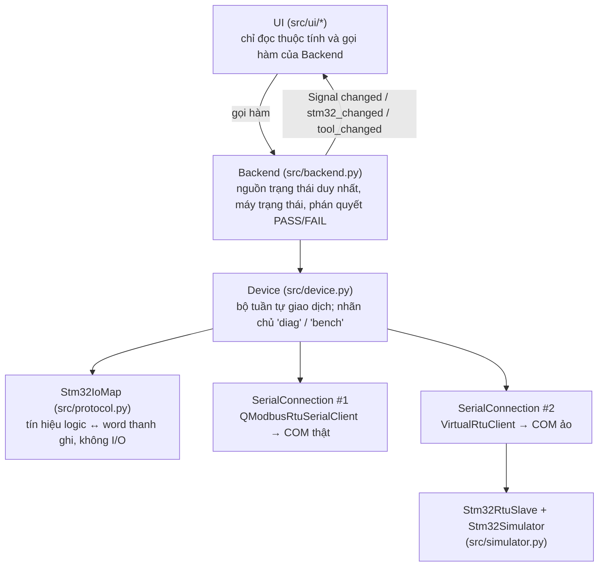
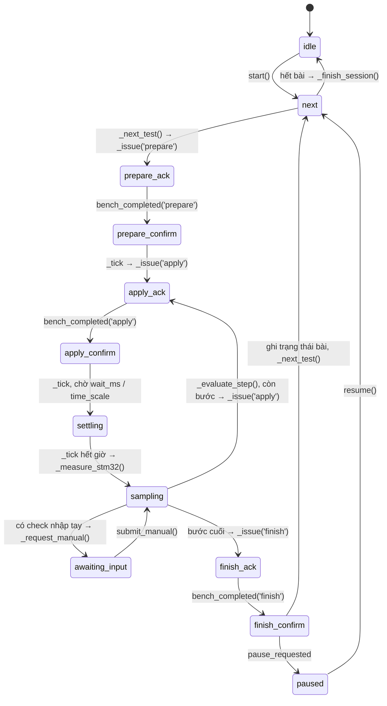

# Kiến trúc phần mềm và luồng code tổng

Tài liệu cho người muốn đọc, sửa và tùy biến phần mềm: thư mục, các tầng, đối tượng nào được tạo khi khởi động, máy trạng thái chạy bài, giao diện cập nhật thế nào và muốn sửa gì thì vào file nào. Chuỗi hàm truyền/nhận Modbus chi tiết ở [03 Luồng Modbus](03_LUONG_MODBUS_TRONG_CODE.md).

Số dòng trong tài liệu (ví dụ `backend.py:1156`) đúng tại ngày viết (2026-11-19); khi mã thay đổi, hãy tìm theo tên hàm.

## Mục lục

- [1. Bản đồ thư mục](#1-bản-đồ-thư-mục)
- [2. Nguyên tắc phân tầng](#2-nguyên-tắc-phân-tầng)
- [3. Khởi động: từ `main.py` tới khi màn hình hiện ra](#3-khởi-động-từ-mainpy-tới-khi-màn-hình-hiện-ra)
  - [Ai sở hữu ai](#ai-sở-hữu-ai)
- [4. Profile JSON quyết định hành vi](#4-profile-json-quyết-định-hành-vi)
- [5. Kết nối: hai đường](#5-kết-nối-hai-đường)
- [6. Máy trạng thái chạy bài (`Backend._tick`)](#6-máy-trạng-thái-chạy-bài-backend_tick)
- [7. Giao diện cập nhật thế nào](#7-giao-diện-cập-nhật-thế-nào)
- [8. Nơi lưu dữ liệu truyền/nhận trong code](#8-nơi-lưu-dữ-liệu-truyềnnhận-trong-code)
- [9. Muốn sửa X thì vào đâu](#9-muốn-sửa-x-thì-vào-đâu)

## 1. Bản đồ thư mục

```
main.py                     Điểm vào: nạp profile → Login → MainWindow
configs/a45/                Profile giá thử A45 (4 file JSON)
src/
  backend.py                Backend: trạng thái trung tâm + máy trạng thái chạy bài
  device.py                 Device: thao tác nghiệp vụ, bộ tuần tự giao dịch STM32
  communication.py          SerialConnection: sở hữu cổng COM, gửi/nhận Modbus RTU
                            Communication: hàng đợi của đường A45 v1 cũ (adapter mock)
  protocol.py               Codec thuần (không I/O): Stm32IoMap, CRC, PDU, giải mã
  virtual_port.py           COM ảo: VirtualRtuClient thay QModbusRtuSerialClient
  simulator.py              STM32 giả lập: Stm32Simulator, Stm32RtuSlave
  storage.py                Lưu phiên JSON (checkpoint) trong luồng phụ
  common/
    profiles.py             Nạp + kiểm tra profile
    stm32.py                Bản đồ thanh ghi CPUv1.0 / CPUv1.1 (CpuMap), Stm32RegisterBanks
    testing.py              Hằng số chung: timeout, Result, Sample, Profile, kịch bản
    serial.py               SerialSettings (cổng, baud, parity, timeout)
    models.py               SignalModel cho QML
    styles.py, config.py, monitor.py, wire.py
  ui/
    main_window.py          Cửa sổ chính, trang "Kiểm tra", điều hướng
    qml/SignalDashboard.qml Bảng tín hiệu
    widgets/
      connection_bar.py     Thanh kết nối (chọn mô phỏng / COM, mở / ngắt)
      modbus_test.py        Trang "Test Modbus" (điều khiển qua CPU, nhật ký khung)
      stm32_registers.py    Bảng hai mảng thanh ghi CPU
      manual_input.py       Hộp thoại nhập tay (ví dụ tần số đo bằng oxilo)
      login_page.py, navigation_stack.py, signal_monitor.py
tests/                      unittest + preview_*.py (xem giao diện không cần phần cứng)
```

## 2. Nguyên tắc phân tầng



Ba quy tắc cần giữ khi sửa:

- **UI không bao giờ chạm I/O.** Widget chỉ gọi `Backend.*` và vẽ lại khi nhận signal `changed`. Muốn thêm nút mới: thêm hàm vào `Backend`, widget gọi hàm đó.
- **Mô phỏng và COM thật đi chung một đường code.** Khác nhau duy nhất ở đối tượng client bên trong `SerialConnection` (Qt thật hoặc `VirtualRtuClient`). Đừng thêm nhánh `if simulation:` đi tắt trong `Device`.
- **Không rẽ nhánh theo tên giá thử / mã bài.** Mọi khác biệt giữa giá thử nằm trong `configs/<giá_thử>/*.json`.

## 3. Khởi động: từ `main.py` tới khi màn hình hiện ra

```mermaid
sequenceDiagram
    participant M as main.py
    participant P as profiles.load_profile
    participant L as LoginPage
    participant W as MainWindow
    participant B as Backend
    participant D as Device
    M->>P: load_profile(--profile, mặc định configs/a45/system.json)
    P-->>M: Profile(system, target, hardware, fixtures)  (đã validate)
    M->>L: LoginPage(authenticate=demo_authenticate).show()
    L-->>M: login_success(username)
    M->>W: ApplicationFlow.open_workspace → MainWindow(username, profile)
    W->>B: Backend(profile, username)
    B->>D: Device(profile)
    D->>D: tạo SerialConnection (COM thật), VirtualLine + SerialConnection (COM ảo),<br/>Stm32IoMap từ hardware.json → stm32_io, Stm32Simulator
    B->>B: nối signal của Device/SerialConnection; khởi động timer _tick 50 ms
    W->>W: _build_ui: ConnectionBar, trang Kiểm tra, ModbusTestPage…
```

Các mốc cần biết:

| Bước | Hàm | Ghi chú |
|---|---|---|
| Nạp profile | `load_profile()` `src/common/profiles.py:33` | Đọc `system.json`, rồi 3 file nó tham chiếu (`target_file`, `hardware_file`, `fixtures_file`). |
| Kiểm tra profile | `_validate_profile()` `profiles.py:54`, `_validate_stm32_io()` `profiles.py:194` | Lỗi → hộp thoại "Cấu hình không hợp lệ", chương trình thoát mã 2. Validator chạy thử mọi chuỗi thao tác của mọi bài. |
| Chọn bản đồ firmware | `cpu_map_for()` `src/common/stm32.py:189` | Theo `hardware.json → cpu_map` (A45 = `CPUv1.1`). |
| Tạo `Device` | `Device.__init__` `src/device.py:25` | Sở hữu hai `SerialConnection`, bộ giả lập và `io_map`. |
| Tạo `Backend` | `Backend.__init__` `src/backend.py:59` | Nối mọi signal; ba timer: `_tick` 50 ms (máy trạng thái), `_poll` 200 ms (chỉ đường A45 v1 cũ), `_monitor_timer` 100 ms (đồ thị demo). |

### Ai sở hữu ai

```
MainWindow
 └─ backend: Backend
     ├─ device: Device
     │   ├─ serial_connection: SerialConnection   (COM thật, QModbusRtuSerialClient)
     │   ├─ virtual_connection: SerialConnection  (COM ảo, VirtualRtuClient)
     │   ├─ virtual_line: VirtualLine → Stm32RtuSlave → stm32_simulator: Stm32Simulator
     │   ├─ io_map: Stm32IoMap            (từ hardware.json → stm32_io)
     │   ├─ cpu_map: CpuMap               (CPUv1.1 với A45)
     │   ├─ bench_image: {địa chỉ DO: word}  ảnh DO mà CPU đã ACK cho bộ chạy bài
     │   └─ communication: Communication  (chỉ đường A45 v1 cũ / adapter mock)
     ├─ stm32: Stm32RegisterBanks  (hai mảng hiển thị trên bảng thanh ghi)
     ├─ tool: dict                 (trạng thái trang Test Modbus: image, queue, log…)
     ├─ frame_log: deque(500)      (nhật ký khung TX/RX của cả hai cổng)
     ├─ samples: {tín hiệu: Sample} (số đo mới nhất, dùng để đánh giá)
     ├─ session: dict              (phiên đang chạy, được lưu bởi store)
     └─ store: SessionStore        (ghi JSON trong luồng phụ)
```

## 4. Profile JSON quyết định hành vi

| File | Đọc ở đâu trong code | Điều khiển |
|---|---|---|
| `system.json` | `Profile.system`, `Profile.signals`, `Profile.diagnostics` | Danh sách tín hiệu (id, nhãn, đơn vị, `stale_ms`), bài tự kiểm tra D01/D02, tín hiệu trạng thái. |
| `1101k.json` | `Profile.target`, `Profile.tests` | 24 bài: các bước (`actions`, `wait_ms`, `checks` với nominal/tolerance), `sequences` chuẩn bị/kết thúc, `dependencies`, `stop_on_fail`. |
| `hardware.json` | `Profile.hardware` → `Stm32IoMap` | `adapter`, `cpu_map`, `stm32_io`: slave, ánh xạ output (bit/pin), input (ADC/MUX/hệ số), `safe_state`, `break_ms`, `di_update_ms`, liên động. |
| `mock.json` | `Profile.fixtures` → `Stm32Simulator` | Số đo giả lập theo kích thích (`stm32_cases`), chu kỳ vòng lặp CPU giả lập (`stm32_timing.loop_ms`). |

Đổi giá trị trong JSON, chạy lại chương trình là có hiệu lực, không cần sửa Python. Chi tiết từng trường: [06 Cấu hình](06_CAU_HINH_PROFILE.md).

## 5. Kết nối: hai đường

**Mô phỏng** (thanh kết nối chọn "Mô phỏng", bấm Kết nối):

```
ConnectionBar._toggle → Backend.connect_device()            backend.py:306
  → Device.bench_connect(token, simulation=True)             device.py:182
      → chuỗi 1 thao tác [('read', [])] → FC03 qua COM ảo
  ← Device.bench_completed('connect', token, result, '')
  → Backend._bench_completed → connection = "Sẵn sàng · MÔ PHỎNG"   backend.py:1065
```

**COM thật** (chọn cổng, Modbus RTU, bấm Kết nối):

```
ConnectionBar._toggle → Backend.connect_serial(SerialSettings)     backend.py:326
  → Device.open_serial → SerialConnection.open(settings)            communication.py:57
      tạo QModbusRtuSerialClient, đặt tham số, setNumberOfRetries(0), connectDevice()
  ← SerialConnection.status_changed('open')
  → Backend._serial_status('open')                                  backend.py:339
      → Device.bench_connect(token, simulation=False)   (chỉ FC03, không ghi gì)
  ← Backend._bench_completed('connect') → connection = "Sẵn sàng · COM THẬT"
```

Ngắt: `Backend.disconnect_device()` `backend.py:785`. Hàm này hủy chuỗi đang chạy, đóng cả hai cổng và xóa dữ liệu đọc. Nó không ghi trạng thái an toàn xuống CPU.

## 6. Máy trạng thái chạy bài (`Backend._tick`)

Bộ chạy bài **không dùng vòng lặp chặn**. `_tick()` (`backend.py:1156`) được gọi 50 ms một lần. Hàm xem `self.phase` hiện tại và quyết định bước tiếp theo. Mọi giao dịch Modbus đều bất đồng bộ: hàm gửi trả về ngay, kết quả về sau qua signal.



| Phase | Ai đặt | Ai chuyển tiếp |
|---|---|---|
| `next` | `start()`, `_skip()`, `resume()` | `_tick`: hết `wait_until` → `_next_test()` `backend.py:899` (kiểm phụ thuộc, BLOCKED, rồi `_issue('prepare')`) |
| `prepare_ack` / `apply_ack` / `finish_ack` | `_issue()` `backend.py:999` → `_issue_stm32()` `backend.py:1024` | `_bench_completed()` đặt `phase = op + '_confirm'` khi Device báo xong |
| `*_confirm` | `_bench_completed()` | `_tick` (xem bảng dưới) |
| `settling` | `_tick` sau `apply_confirm` | `_tick` hết `wait_ms` → `sampling` + `_measure_stm32()` `backend.py:1050` |
| `sampling` | `_tick` | Mọi `samples[...]` có timestamp ≥ `capture_after` → `_evaluate_step()` `backend.py:1258` |
| `awaiting_input` | `_request_manual()` | `submit_manual()` từ hộp thoại |
| `paused` | `_enter_pause()` | `resume()` |
| `idle` | `_finish_session()`, `_fatal()` | `start()` |

Cơ chế an toàn trong máy trạng thái:

- **Token:** mỗi lần `_issue()` tạo `self.token` mới, `self.bench_token` mới. Kết quả về mang token cũ thì bị bỏ (`_bench_completed`: `token != self.bench_token → return`).
- **Hạn chót:** `self.deadline` = 2,5 s + 0,5 s × số giao dịch. Ở phase `*_ack`/`*_confirm` quá hạn thì `_fatal()`.
- **`_fatal()`** `backend.py:1353`: hủy chuỗi, ghi ERROR, phiên chuyển `interrupted`. Hàm **không tự ghi an toàn** (vì không biết đường truyền còn tốt không).

Đánh giá: `evaluate(check, sample, now, stale_ms)` `backend.py:26` là hàm thuần. Nó nhận một check và một mẫu đo, trả `(status, reason)`. Muốn đổi cách tính PASS/FAIL thì sửa ở đây (có unit test bao quanh).

Lưu phiên: mỗi mốc gọi `_checkpoint()` → `SessionStore.save()` ghi JSON nguyên tử trong luồng phụ, vào thư mục `AppLocalDataLocation/sessions/simulation`. Trong mỗi attempt, `transactions` ghi lại các word đã ghi xuống CPU.

## 7. Giao diện cập nhật thế nào

- `Backend.changed` phát khi có bất cứ thay đổi gì. `MainWindow.refresh()` `main_window.py:517` đọc lại thuộc tính của backend và vẽ lại.
- `Backend.stm32_changed` → bảng thanh ghi. `Backend.tool_changed` → trang Test Modbus. `Backend.manual_input_changed` → mở/đóng hộp thoại nhập tay.
- Widget chỉ gọi `setText`/`setEnabled` khi giá trị thực sự đổi. Làm vậy để giao diện không nháy khi tự đọc 500 ms.

Muốn thêm một ô hiển thị: đọc thuộc tính backend trong `refresh()` của widget. Đừng tự giữ bản sao trạng thái trong widget.

## 8. Nơi lưu dữ liệu truyền/nhận trong code

Sơ đồ tầng ở mục 2. Bảng dưới cho biết mỗi loại dữ liệu Modbus nằm ở đâu:

| Thành phần trong code | Vị trí lưu trữ / Lớp phụ trách | Vai trò cụ thể |
|---|---|---|
| **Trạng thái 2 mảng trên UI** | `backend.stm32` (`Stm32RegisterBanks` tại `src/common/stm32.py`, khởi tạo ở `src/backend.py`) | - `mod_buf_to_write` (list `write_count` `uint16`; A45: 31): lưu **bản nháp** các ô chuẩn bị ghi.<br>- `staged` (`set`): ghi nhận những địa chỉ người dùng đã sửa trên bản nháp.<br>- `mod_buf_to_read` (list `read_count` `uint16`; A45: 43): lưu kết quả lần đọc `FC03` hợp lệ gần nhất.<br>- `read_valid`, `received_at`, `last_ack`: quản lý tính hợp lệ, thời điểm nhận và biên nhận ACK. |
| **Ảnh thanh ghi DO của bộ chạy bài** | `device.bench_image` (`dict {address: uint16}` tại `src/device.py`) | Lưu các thanh ghi DO mà MCU đã ACK trong bài đo đang chạy. Bước kế tiếp chỉ gửi những thanh ghi có giá trị thay đổi so với `bench_image` (`Stm32IoMap.writes()`). Nếu ghi lỗi/hủy, địa chỉ đó bị xóa khỏi `bench_image` (`_forget_write()`). |
| **Ánh xạ Tín hiệu ↔ Thanh ghi** | `device.io_map` (`Stm32IoMap` tại `src/protocol.py`, nạp từ `stm32_io` trong `configs/a45/hardware.json`) | Dịch các lệnh nghiệp vụ (`dc_27v`, `set_40`...) thành bật/tắt bit (output `bit`), chọn một đầu vào bo matrix cho mỗi chân (output `pin`) hoặc tính mã `DAC_val`; dịch số đo từ thanh ghi `ADC` + kênh `MUX` sang đơn vị vật lý (`V`, `A`...). |
| **Cổng Serial & Khung RTU** | `device.serial_connection` (COM thật) và `device.virtual_connection` (COM ảo), cùng lớp `SerialConnection` tại `src/communication.py` | Thực thi `read_registers()` (`FC03`) và `write_registers()` (`FC06`/`FC16`), quản lý timer `deadline`, đóng cổng khi lỗi/timeout, phát `frame_logged` (khung TX/RX dựng lại từ PDU). |

## 9. Muốn sửa X thì vào đâu

| Muốn | Sửa ở |
|---|---|
| Thêm / đổi bài kiểm tra, dung sai, thời gian chờ | `configs/a45/1101k.json` |
| Đổi bit rơ-le, kênh MUX, hệ số ADC, slave ID | `configs/a45/hardware.json → stm32_io` |
| Đổi số đo giả lập | `configs/a45/mock.json` |
| Thêm thanh ghi firmware mới | `CpuMap` trong `src/common/stm32.py` (hoặc `extra_write_registers` trong profile) |
| Đổi cách tính PASS/FAIL | `evaluate()` trong `src/backend.py` |
| Đổi thứ tự các pha của một bài | `Backend._tick()`, `_issue_stm32()` |
| Đổi cách một bước được ghi xuống (ngắt trước đóng sau, thứ tự) | `Device.bench_*`, `Device._bench_step()`, `Stm32IoMap.phases/writes` |
| Đổi cách giải mã số đo | `Stm32IoMap.decode()` |
| Đổi timeout, baud mặc định | `src/common/testing.py`, `hardware.json → serial`, hộp Chi tiết kết nối |
| Thêm nút / ô trên trang Test Modbus | `src/ui/widgets/modbus_test.py` (gọi hàm `Backend.tool_*`) |
| Thêm hàm điều khiển cho nút đó | `Backend.tool_*` trong `src/backend.py` |
| Giao diện, màu, font | `assets/styles/*.qss` |
