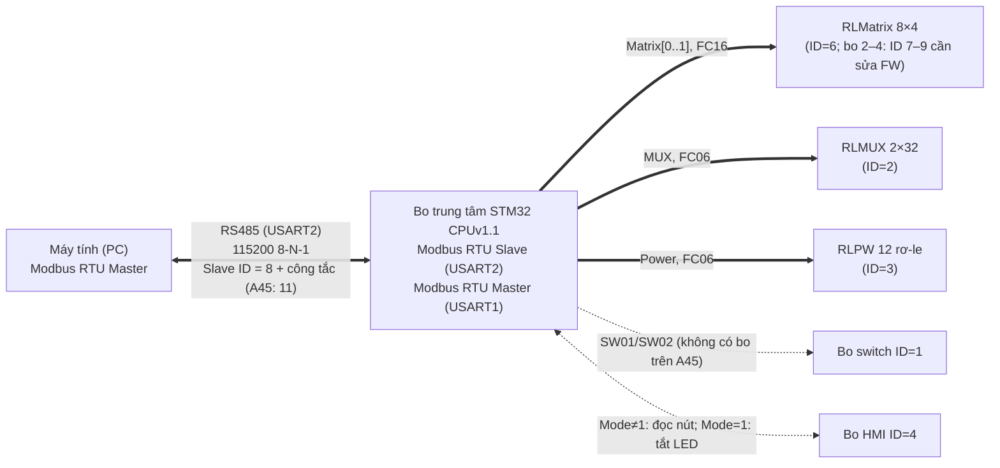

# Giao thức Modbus RTU giữa PC và STM32

Hợp đồng truyền thông giữa phần mềm PC và bo CPU **STM32F407VETx**: đường truyền, mã hàm, cấu trúc khung, bản đồ hai mảng thanh ghi, cách mã hóa dữ liệu và quy tắc giao dịch. Giá thử A45 dùng firmware **`CPUv1.1 For DK_QDT`** (slave 11, đọc 42 word); `CPUv1.0` của giá thử cũ (slave 9, đọc 29 word) giữ để so sánh.

- Code thực hiện giao thức (hàm gửi/nhận, bộ chạy bài, COM ảo, log, debug): [03 Luồng Modbus](03_LUONG_MODBUS_TRONG_CODE.md).
- Firmware CPU và bo con, chu kỳ vòng lặp, bảng đi dây A45, đề xuất sửa firmware: [04 Firmware](04_FIRMWARE_VA_PHAN_CUNG.md).
- Bản đồ thanh ghi trong code: `src/common/stm32.py` (`CPU_MAPS`), profile chọn bằng `hardware.cpu_map`. Ánh xạ tín hiệu ↔ thanh ghi: `configs/a45/hardware.json` → `stm32_io` ([06 Cấu hình](06_CAU_HINH_PROFILE.md#stm32_io)).
- Nguồn: bản phân tích gốc CPUv1.0 [nguon/PHAN_TICH_GIAO_THUC_VA_LUONG_CODE.md](nguon/PHAN_TICH_GIAO_THUC_VA_LUONG_CODE.md) (giữ nguyên); mã nguồn firmware (chỉ đọc, ngoài repo) `D:\project\2026_DT_Chinh\ref\ref_AHung\A34_Phao37\Program\`.
- Hiện trạng và điểm phải kiểm khi lên mạch: `PROGRESS.md`.

## Mục lục

- [1. Đường truyền và cấu hình serial](#1-đường-truyền-và-cấu-hình-serial)
  - [1.1. Mô hình kết nối vật lý và vai trò Master – Slave](#11-mô-hình-kết-nối-vật-lý-và-vai-trò-master--slave)
- [2. Mã hàm và địa chỉ](#2-mã-hàm-và-địa-chỉ)
  - [2.1. Bảng mã hàm (Function Codes) và quy tắc địa chỉ](#21-bảng-mã-hàm-function-codes-và-quy-tắc-địa-chỉ)
  - [2.2. Cấu trúc chi tiết từng khung truyền (Frame Format)](#22-cấu-trúc-chi-tiết-từng-khung-truyền-frame-format)
- [3. Hai mảng độc lập](#3-hai-mảng-độc-lập)
  - [3.1. Khác biệt của CPUv1.1 For DK_QDT (giá thử A45)](#31-khác-biệt-của-cpuv11-for-dk_qdt-giá-thử-a45)
- [4. Biểu diễn và giải mã (`src/protocol.py`)](#4-biểu-diễn-và-giải-mã-srcprotocolpy)
- [5. Quy tắc an toàn giao dịch](#5-quy-tắc-an-toàn-giao-dịch)
- [6. Ví dụ khung và hiệu chỉnh CRC](#6-ví-dụ-khung-và-hiệu-chỉnh-crc)
- [Phụ lục A. Giao thức A45 v1 cũ (không dùng cho MCU)](#phụ-lục-a-giao-thức-a45-v1-cũ-không-dùng-cho-mcu)

## 1. Đường truyền và cấu hình serial

### 1.1. Mô hình kết nối vật lý và vai trò Master – Slave

Hệ thống giao tiếp theo chuẩn **Modbus RTU** trên đường truyền vật lý **RS485 hai dây (A/B)**:



| Mục | Giá trị |
|---|---|
| Vai trò | PC = Modbus RTU **Master**; **một** bo CPU STM32 = Slave (`USART2`). CPU tự điều phối các bo con (A45: RLMatrix, RLMUX, RLPW) qua bus riêng `USART1`; PC không giao tiếp trực tiếp với bo con (phần mềm chặn bằng `Backend.check_cpu_slave()`) |
| Vật lý | RS485 hai dây (`PD5` TX, `PD6` RX, `PD7` điều khiển hướng thu/phát tự động). Cần bộ chuyển USB–RS485; không nối USB–UART TTL trực tiếp vào A/B |
| Mặc định | Slave ID theo profile (`hardware.json` → `stm32_io.slave`; A45 = **11** vì CPUv1.1 dùng `8 + Read_board_ID()`; CPUv1.0 cố định 9), **115200** baud, **8N1**, không flow control |
| Timeout | 1000 ms mặc định (chỉnh 100–10000 ms trong Chi tiết); `setNumberOfRetries(0)` (không tự gửi lại) |
| Khung/CRC | Qt `QModbusRtuSerialClient` đóng khung RTU, tính CRC16 Modbus và canh khoảng lặng frame (`T3.5`) |

Một đối tượng `SerialConnection` (`src/communication.py`) duy nhất sở hữu cổng COM; vòng đời trạng thái:
`disconnected → connecting → open`, lỗi mở cổng hoặc rút cáp USB → `error`.
**Mở COM thành công chỉ xác nhận cổng serial trên PC đã mở**; chỉ khi nhận phản hồi `FC03` hợp lệ mới xác nhận Slave STM32 đang trả lời.

## 2. Mã hàm và địa chỉ

### 2.1. Bảng mã hàm (Function Codes) và quy tắc địa chỉ

| Thao tác | FC | Địa chỉ | Số word | Vùng MCU |
|---|---|---|---|---|
| Đọc toàn bộ dữ liệu | `03` (`0x03`) | `1` | `29` (CPUv1.0) / `42` (CPUv1.1) | `mod_buf_to_read[1..N]` |
| Ghi một ô | `06` (`0x06`) | `1…28` (v1.0) / `1…30` (v1.1) | `1` | `mod_buf_to_write[addr]` |
| Ghi một vùng liên tục | `16` (`0x10`) | như trên | không vượt cuối bản đồ | `mod_buf_to_write[addr..addr+N-1]` |

Bộ chạy bài và công cụ Test Modbus còn được ghi index 31–36 (`Matrix2_0…Matrix4_1`) vì profile A45 khai báo chúng là
**đề xuất sửa firmware** ([04 Firmware](04_FIRMWARE_VA_PHAN_CUNG.md) mục 9); mảng của CPUv1.1 có 50 word nên ghi vào đó không đè RAM, nhưng chưa có tác dụng.

- **Địa chỉ zero-based = chỉ số mảng trực tiếp**: Khi nhận khung Modbus, hàm `mbfuncholding.c` trong firmware cộng `+1` vào địa chỉ bắt đầu, sau đó hàm callback `eMBRegHoldingCB` (`port.c`) lại trừ đi `usRegHoldingStart` (`= 1`). Hai phép tính `+1` và `-1` triệt tiêu nhau, nên **địa chỉ gửi trên khung truyền chính là chỉ số phần tử mảng `0, 1, 2...`** (không cộng 1, không dùng kiểu `40001`).
- **Index `0` là `Null`**: thanh ghi đệm không sử dụng. Firmware vẫn cho ghi, nhưng PC không bao giờ ghi vào địa chỉ `0`.
- **Firmware không chặn địa chỉ ngoài mảng** (chấp nhận tới 128 thanh ghi trong khi mảng chỉ có 32 word ở CPUv1.0, 50 word ở CPUv1.1): ghi ngoài mảng sẽ đè RAM của MCU. PC tự giới hạn theo bản đồ (CPUv1.0: ghi 1–28, đọc 1–29; CPUv1.1: ghi 1–30, đọc 1–42) ([04 Firmware](04_FIRMWARE_VA_PHAN_CUNG.md) mục 6).
- **Thứ tự byte (Endianness)**:
  - Mọi trường 16-bit (Địa chỉ, Số lượng word, Giá trị thanh ghi) truyền theo chuẩn **Big-Endian** (Byte cao `Hi` trước, Byte thấp `Lo` sau).
  - Riêng 2 byte **CRC16-Modbus** ở cuối khung truyền theo chuẩn **Little-Endian** (Byte thấp `CRC_Lo` trước, Byte cao `CRC_Hi` sau; đa thức `0xA001`, khởi tạo `0xFFFF`).
- Firmware có `FC17` nhưng PC chưa dùng. `FC04` của firmware chỉ trả hằng `0x0304`, không có dữ liệu. Ô "Đọc một lần" (`FC03`/`FC04`, địa chỉ tùy ý) trên UI chỉ phục vụ chẩn đoán thô.

### 2.2. Cấu trúc chi tiết từng khung truyền (Frame Format)

Các bảng dưới lấy ví dụ CPUv1.0 (slave `0x09`, đọc 29 word). Với **A45 (CPUv1.1, slave `0x0B` = 11, đọc 42 word)** cấu
trúc giống hệt, chỉ khác slave, số lượng và CRC (khung đúng ở mục 6):
`0B 03 00 01 00 2A 95 7F` (FC03), phản hồi `5 + 2×42 = 89` byte; `0B 06 00 01 00 01 19 60` (FC06 `Mode = 1`).

#### A. Đọc toàn bộ trạng thái từ STM32 — `FC03` (Read Holding Registers)
PC luôn đọc một lượt cả mảng DI từ địa chỉ `1` (CPUv1.0: **29 thanh ghi** `mod_buf_to_read[1..29]`; CPUv1.1: 42):

- **Khung PC gửi đi (Request — 8 bytes):**
  | Byte 0 | Byte 1 | Byte 2 | Byte 3 | Byte 4 | Byte 5 | Byte 6 | Byte 7 |
  | :---: | :---: | :---: | :---: | :---: | :---: | :---: | :---: |
  | **Slave ID** | **FC** | **Start Addr Hi** | **Start Addr Lo** | **Quantity Hi** | **Quantity Lo** | **CRC16 Lo** | **CRC16 Hi** |
  | `0x09` | `0x03` | `0x00` | `0x01` | `0x00` | `0x1D` (29) | `0xD5` | `0x4B` |

- **Khung STM32 phản hồi (Response — `5 + 2×29 = 63` bytes):**
  | Byte 0 | Byte 1 | Byte 2 | Byte 3..4 | ... | Byte 59..60 | Byte 61 | Byte 62 |
  | :---: | :---: | :---: | :---: | :---: | :---: | :---: | :---: |
  | **Slave ID** | **FC** | **Byte Count** | **Reg[1] Hi, Lo** | ... | **Reg[29] Hi, Lo** | **CRC16 Lo** | **CRC16 Hi** |
  | `0x09` | `0x03` | `0x3A` (58 bytes) | `mod_buf_to_read[1]` | ... | `mod_buf_to_read[29]` | `CRC_L` | `CRC_H` |

#### B. Ghi 1 thanh ghi đơn lẻ — `FC06` (Write Single Register)
Dùng khi PC chỉ thay đổi 1 thanh ghi trong vùng `1…28` (ví dụ ghi `Mode = 1` vào địa chỉ `1`):

- **Khung PC gửi đi (Request — 8 bytes):**
  | Byte 0 | Byte 1 | Byte 2 | Byte 3 | Byte 4 | Byte 5 | Byte 6 | Byte 7 |
  | :---: | :---: | :---: | :---: | :---: | :---: | :---: | :---: |
  | **Slave ID** | **FC** | **Reg Addr Hi** | **Reg Addr Lo** | **Value Hi** | **Value Lo** | **CRC16 Lo** | **CRC16 Hi** |
  | `0x09` | `0x06` | `0x00` | `0x01` | `0x00` | `0x01` | `0x18` | `0x82` |

- **Khung STM32 phản hồi (Response ACK — 8 bytes):**
  STM32 echo lại đúng 8 byte vừa nhận (`09 06 00 01 00 01 18 82`) làm biên nhận ACK.

#### C. Ghi nhiều thanh ghi liên tiếp — `FC16` / `0x10` (Write Multiple Registers)
Dùng khi PC ghi một dải `N` thanh ghi liên tiếp bắt đầu từ `Start Addr`:

- **Khung PC gửi đi (Request — `9 + 2×N` bytes):**
  | Byte 0 | Byte 1 | Byte 2..3 | Byte 4..5 | Byte 6 | Byte 7..8 | ... | Byte `7+2N..8+2N` |
  | :---: | :---: | :---: | :---: | :---: | :---: | :---: | :---: |
  | **Slave ID** | **FC** | **Start Addr Hi, Lo** | **Quantity (`N`) Hi, Lo** | **Byte Count (`2N`)** | **Val[1] Hi, Lo** | ... | **CRC16 Lo, Hi** |
  | `0x09` | `0x10` | `Addr Hi, Lo` | `N Hi, Lo` | `2 * N` | `Word 1` | ... | `CRC_L, CRC_H` |

- **Khung STM32 phản hồi (Response ACK — 8 bytes):**
  | Byte 0 | Byte 1 | Byte 2 | Byte 3 | Byte 4 | Byte 5 | Byte 6 | Byte 7 |
  | :---: | :---: | :---: | :---: | :---: | :---: | :---: | :---: |
  | **Slave ID** | **FC** | **Start Addr Hi** | **Start Addr Lo** | **Quantity Hi** | **Quantity Lo** | **CRC16 Lo** | **CRC16 Hi** |
  | `0x09` | `0x10` | `Addr Hi` | `Addr Lo` | `N Hi` | `N Lo` | `CRC_L` | `CRC_H` |

## 3. Hai mảng độc lập

Khi PC **ghi**, dữ liệu vào mảng `mod_buf_to_write` (`Modbus_DO`); khi PC **đọc**, dữ liệu lấy từ mảng `mod_buf_to_read` (`Modbus_DI`). **Cùng địa chỉ không phải cùng dữ liệu**: ghi địa chỉ `7` là đặt giá trị đầu ra `DAC_val`, đọc địa chỉ `7` lại nhận về điện áp đo `ADC0_val`.

Bảng dưới là **CPUv1.0** (DO 29 word, DI 30 word); index 0–17 của DO và 0–19 của DI giống hệt ở CPUv1.1, phần khác ở mục 3.1. Trong code, bản đồ theo firmware nằm ở `CPU_MAPS` (`src/common/stm32.py`); code theo profile dùng `cpu_map.write_index()`/`read_index()`, không dùng enum `WriteRegister`/`ReadRegister` (chỉ là CPUv1.0).

| Index (Dec / Hex) | Ghi (`mod_buf_to_write` / DO) | Đọc (`mod_buf_to_read` / DI) | Ý nghĩa chi tiết |
| :---: | :--- | :--- | :--- |
| **`0` (`0x00`)** | `Null` | `Null` | Thanh ghi đệm, không sử dụng |
| **`1` (`0x01`)** | **`Mode`** | `Mode` (firmware luôn trả `0`) | Ghi `1` (`AutoComputer`): MCU chạy theo lệnh PC; `≠ 1`: chạy theo mặt máy HMI |
| **`2` (`0x02`)** | **`Plan`** | `Plan` | Chế độ: `0` = SelfTest, `1` = Test_EncoderPulse, `2` = Test |
| **`3–5` (`0x03–0x05`)** | `Block`, `Cabinet`, `Status` | `Block`, `Cabinet`, `Status` | Định danh khối, tủ và trạng thái hiển thị |
| **`6` (`0x06`)** | `DisplayOut` | `DisplayIN` | Dữ liệu hiển thị LED mặt máy |
| **`7` (`0x07`)** | **`DAC_val`** (`int16`) | **`ADC0_val`** (`int16`) | **Ghi**: Mã xuất DAC1 (`PA4`). **Đọc**: Điện áp kênh ADC0 (`int16/100` V, thang ±100 V) |
| **`8` (`0x08`)** | **`DOUT`** (`bit0–9`) | **`ADC1_val`** (`int16`) | **Ghi**: Xuất 10 kênh Digital Output. **Đọc**: Điện áp ADC1 (`int16/100` V, thang ±50 V) |
| **`9` (`0x09`)** | **`SW01`** → bo Switch reg 0 | **`ADC2_val`** (`int16`) | **Ghi**: 16 bit rơ-le chuyển mạch reg 0. **Đọc**: Điện áp ADC2 (`int16/100` V, thang ±24 V) |
| **`10` (`0x0A`)** | **`SW02`** → bo Switch reg 1 | **`ADC3_val`** (`int16`) | **Ghi**: 16 bit rơ-le chuyển mạch reg 1. **Đọc**: Điện áp ADC3 (`int16/100` V, thang ±12 V) |
| **`11` (`0x0B`)** | **`MUX`** → bo MUX | **`ADC4_val`** (`int16`) | **Ghi**: Chọn kênh đo trên bo đa hợp. **Đọc**: Điện áp ADC4 (`int16/100` V, thang ±7,5 V) |
| **`12` (`0x0C`)** | **`Power`** → bo RelayPower | **`Ohm_val`** | **Ghi**: 16 bit chuyển **nguyên vẹn** tới bo RelayPower (ID 3, reg 0) ở mỗi vòng lặp; bit nào là rơ-le nào do bo RelayPower quyết định. Mã HMI của CPU dùng `bit1` 24 V, `bit2` 12 V, `bit4` 5 V, `bit6` 3,3 V, `bit7–9` VDD1–3 ([04 Firmware](04_FIRMWARE_VA_PHAN_CUNG.md) mục 5). **Đọc**: Giá trị đo điện trở |
| **`13` (`0x0D`)** | `DataO1`: encoder En/Dir/Period (tự xóa) | **`DIN`** (mức raw `bit0–9`) | **Ghi**: Lệnh phát xung Encoder (Bit 15 En, Bit 14 Dir, Bit 0–13 Period ms). **Đọc**: 10 kênh Digital Input |
| **`14` (`0x0E`)** | `DataO2`: số xung encoder (tự xóa) | `DataI1`: `encoder_count` (`int16`) | **Ghi**: Số xung Encoder cần phát. **Đọc**: Bộ đếm xung có xét chiều quay |
| **`15` (`0x0F`)** | `DataO3`: SSI En + byte | `DataI2`: `ENCA_cnt` (`uint16`) | **Ghi**: Bit 15 = SSI Enable, Bit 0–7 = Data byte (`main.c:297–298`). **Đọc**: Bộ đếm xung pha A |
| **`16–17` (`0x10–0x11`)** | `DataO4`, `DataO5` (dự phòng) | `DataI3`: `ENCB_cnt`, `DataI4`: `encoder_num_pulse` (`int16`) | **Ghi**: Dự phòng. **Đọc**: Bộ đếm xung pha B (`16`) và số xung mỗi vòng chốt theo xung Z (`17`) |
| **`18` (`0x12`)** | `CDT` (cổng RS232/422, enable `bit8`, độ dài) | `DataI5`: `SSI Ident` (`uint16`) | **Ghi**: Cấu hình phát UART ngoại vi. **Đọc**: Mã định danh 16-bit đọc về từ SSI |
| **`19` (`0x13`)** | `DataT0` | `CDN` (dự phòng) | **Ghi**: Byte 0–1 chuỗi phát UART. **Đọc**: Dự phòng (chưa mang độ dài RX) |
| **`20–28` (`0x14–0x1C`)** | `DataT1…DataT9` | `DataR0…DataR8` | **Ghi**: Byte 2–19 chuỗi phát UART. **Đọc**: Byte 0–17 chuỗi nhận UART |
| **`29` (`0x1D`)** | — *(không tồn tại)* | `DataR9` | **Đọc**: Byte 18–19 chuỗi nhận UART (tổng `DataR0…DataR9` = 20 byte) |

**Điều kiện bắt buộc (`Mode = 1`)**: Trong vòng lặp `while(1)` của STM32, phải **ghi `Mode = 1`** vào địa chỉ `1` thì MCU mới chép mảng `mod_buf_to_write` vào cấu trúc `Modbus_DO` để thực thi xuống phần cứng.
- Nếu `Mode ≠ 1`, MCU chạy theo nút bấm mặt máy (HMI) và tự bật một số nguồn/tiếp điểm.
- Sau khi MCU khởi động lại, `Mode` trở về 0.

Xem [04 Firmware](04_FIRMWARE_VA_PHAN_CUNG.md) mục 5.

### 3.1. Khác biệt của CPUv1.1 For DK_QDT (giá thử A45)

Đối chiếu `Inc/System_Register.h`, `Inc/main.h`, `Src/main.c` của `CPUv1.1 For DK_QDT` với CPUv1.0:

| Index | CPUv1.0 | **CPUv1.1** | Ghi chú |
|---|---|---|---|
| DO 0–17 | như bảng trên | **giống hệt** | `Mode`…`DataO5` |
| DO 18 | `CDT` | **`Matrix[0]`** | CPU gửi `Matrix[0..1]` bằng FC16 tới bo RLMatrix **ID 6**, reg 0–1, mỗi vòng |
| DO 19 | `DataT0` | **`Matrix[1]`** | |
| DO 20 | `DataT1` | **`CDT`** | thêm `bit9` = đổi baud 4 cổng UART ngoài (`bit3–7` chọn 9600…115200) |
| DO 21–30 | `DataT2…` | `DataT[0..9]` | |
| DI 0–19 | | **giống hệt** | `ADC0_val`…`CDN` |
| DI 20–42 | `DataR0…DataR9` (20–29) | `DataR1[5]` 20–24, `DataR2[5]` 25–29, `DataR3[8]` 30–37, `DataR4[5]` 38–42 | 4 cổng RS422 riêng (UART4/5/6, USART3), tự xóa sau 3 s không nhận |
| Mảng | 32 word | **50 word** | `REG_HOLDING_NREGS` vẫn 128 → địa chỉ 50–127 vẫn đè RAM |
| Slave | 9 | **8 + công tắc ID** | mạch A45 trả lời ở **11** |

**Nguy hiểm khi dùng sai bản đồ:** công cụ cũ hiểu index 18 là `CDT`; trên CPUv1.1 ghi vào đó là **đóng rơ-le
bo matrix**. Phần mềm dùng bản đồ theo `hardware.cpu_map`; màn hình thanh ghi hiển thị đúng tên theo bản đồ.

## 4. Biểu diễn và giải mã (`src/protocol.py`)

- **Raw word `0…65535` (`uint16`)**: `encode_int16(value)` / `decode_int16(word)` đổi số nguyên có dấu bù hai (`-32768…32767`). Ví dụ: đọc `ADC` raw `64969` (`0xFDD7`) → `decode_int16` ra `-567` → chia `100` được **`−5,67 V`**.
- **`DAC_val` (địa chỉ ghi `7`)**: `V_DAC(PA4) = 1,62 − DAC_val/1000 × 1,55` (đã xác nhận trong `main.c:310`).
  - Firmware kẹp im lặng trong `0–3,3 V`, tương đương mã `−1083…+1045`.
  - `DAC_val = 0` cho **1,62 V tại PA4**.
  - Hệ số tầng khuếch đại ra tới chân `XP1` (ví dụ `-5 mV/mã`) vẫn đang là giả định trong `stm32_io`.
- **`Ohm_val` (địa chỉ đọc `12`)**:
  - 2 bit cao (`metric = word >> 14`) chọn đơn vị: `0` = $\Omega$ ($\times 1$), `1` = $\text{k}\Omega$ ($\times 1\,000$), `2` = $\text{M}\Omega$ ($\times 1\,000\,000$), `3` = quá thang đo (`overrange`).
  - 14 bit thấp (`amount = (word & 0x3FFF) / 100.0`) là giá trị số.
  - Hàm `decode_stm32()` trả về giá trị quy đổi ra $\Omega$; nếu `metric == 3` (quá thang) thì trả về `None` kèm `resistance_quality = 'overrange'` (tuyệt đối không trả `0` để tránh nhầm với ngắn mạch $0\,\Omega$).
- **`DIN` (địa chỉ đọc `13`)**: giữ nguyên mức logic raw từng bit (`(word >> bit) & 1` cho `bit 0..9`, mạch đầu vào pull-up, kích mức thấp), không tự đảo trong tầng giao thức.
- **`DataT0..9` / `DataR0..9` (chuỗi 20 byte UART)**: **byte thấp đứng trước bên trong mỗi word 16-bit** (khác với thứ tự Big-Endian của khung Modbus trên dây). Ví dụ chuỗi 4 byte `11 22 00 44` được đóng gói thành 2 word `[0x2211, 0x4400]`. Dùng `pack_data_t()` / `unpack_data_r()` (`struct.unpack('<10H', ...)`). Vì `CDN` chưa báo độ dài nhận thực tế, `unpack_data_r()` luôn trả đủ 20 byte và `received_length = None`.
- **Encoder (`DataO1`, `DataO2`)**: hàm `encode_encoder(period_ms, pulses, forward=True)` kiểm tra chu kỳ phải là bội số của `4 ms` trong dải `4…16380 ms` ($\le 250\text{ Hz}$) và trả về 2 word `[0x8000 | (0x4000 nếu forward) | period_ms, pulses]`.

## 5. Quy tắc an toàn giao dịch

- **Một giao dịch tại một thời điểm**, I/O hoàn toàn bất đồng bộ theo event loop Qt (`QModbusRtuSerialClient` / `QTimer`), không chặn luồng giao diện (GUI thread).
- **Không retry** đối với cả lệnh ghi lẫn lệnh đọc (`setNumberOfRetries(0)`). Khi xảy ra Timeout hoặc phản hồi sai định dạng (`InvalidResponseError`) → **đóng cổng COM ngay lập tức**, người dùng phải kết nối lại (vì Modbus RTU không có Transaction ID; nếu giữ cổng mở và gửi tiếp, phản hồi trễ của giao dịch cũ có thể bị nhận nhầm cho giao dịch mới). Mã lỗi Modbus exception (`ProtocolError`) được báo riêng.
- **Xác minh lệnh Ghi**: `FC06` kiểm tra echo đúng địa chỉ + giá trị, `FC16` kiểm tra đúng địa chỉ + số lượng thanh ghi thông qua `reply.rawResult()` (với hàm `validate_write_ack()` trong `src/protocol.py`, vì [Qt `result()` không hợp lệ đối với request ghi](https://doc.qt.io/qt-6/qmodbusreply.html#result)). **ACK chỉ là biên nhận MCU đã nhận khung**, không xác nhận đầu ra vật lý đã đóng/cắt; nếu mất ACK thì trạng thái được coi là **chưa biết**, không tự gửi lại.
- **Xác minh lệnh Đọc**: chỉ cập nhật mảng đọc sau khi nhận phản hồi `FC03` hợp lệ (khớp Slave ID, địa chỉ bắt đầu `1`, đủ số word của bản đồ: 29 ở CPUv1.0, 42 ở CPUv1.1). Dữ liệu đọc mất hiệu lực khi gặp lỗi, ngắt kết nối, đổi nguồn/Slave ID hoặc quá hạn `READ_STALE_MS = 2000 ms` (chính sách hạn hiển thị phía PC; MCU không có timestamp hay bộ đếm mẫu nên không chứng minh được tuổi mẫu ADC hay tính nguyên tử giữa các kênh).
- **Không tự phát lệnh**: không tự động ghi khi mở COM, đổi nguồn giả lập/thật, kết nối lại hay khởi động lại ứng dụng; không tự ghi cả mảng zero; không gửi lại lệnh phát xung encoder.
- **Tự đọc định kỳ** (ô "Tự đọc mỗi" trên trang Test Modbus, bảng thanh ghi) chỉ dùng `FC03` dạng đọc nền (`request_stm32(background=True)`, [05 Vận hành](05_VAN_HANH_GIAO_DIEN.md) mục 2), bỏ lượt khi đang có giao dịch khác, dừng khi ẩn trang/ngắt; tuyệt đối không poll bằng cách ghi mảng DO. Chuỗi hàm truyền/nhận trong code: [03 Luồng Modbus](03_LUONG_MODBUS_TRONG_CODE.md).
- Chẩn đoán và bộ chạy bài dùng chung một kênh trong `Device`: mỗi request mang nhãn sở hữu `owner = 'diag'` hoặc `'bench'`; khi bộ chạy bài đang hoạt động, mọi thao tác đọc/ghi từ màn hình chẩn đoán bị từ chối.
- Nút **Dừng** qua phần mềm/Modbus **không thay thế** nút dừng khẩn cấp và mạch bảo vệ phần cứng.

## 6. Ví dụ khung và hiệu chỉnh CRC

Tính lại theo chuẩn CRC16/Modbus (`init = 0xFFFF`, `poly = 0xA001`, byte thấp truyền trước) cho thấy ba ví dụ khung trong tài liệu phân tích gốc có byte CRC bị sai. Các khung đúng trên đường dây:

```text
CPUv1.0 (slave 9)
FC03 đọc DI 1–29        : 09 03 00 01 00 1D D5 4B
FC06 ghi Mode=1         : 09 06 00 01 00 01 18 82
FC16 ACK start 1, n=28  : 09 10 00 01 00 1C 91 48
FC03 bo HMI (USART1)    : 04 03 00 00 00 05 85 9C   (tài liệu gốc ghi sai 84 5C)

A45 · CPUv1.1 (slave 11; hai khung đầu đã chạy thử trên COM ảo)
FC03 đọc DI 1–42        : 0B 03 00 01 00 2A 95 7F
FC06 ghi Mode=1         : 0B 06 00 01 00 01 19 60
FC16 ghi Mode=1, Plan=2 : 0B 10 00 01 00 02 04 00 01 00 02 C3 BA   → ACK 0B 10 00 01 00 02 10 A2
FC06 ghi Power=0x0004   : 0B 06 00 0C 00 04 48 A0   (bật RLPW bit 2 = +27 V theo bảng đi dây)
```

Khung trên bus nội bộ USART1 tới bo con: [04 Firmware](04_FIRMWARE_VA_PHAN_CUNG.md) mục 3.

Phần mềm PC luôn để thư viện Qt tự tính và kiểm tra CRC; không dùng các chuỗi byte hard-code để giao tiếp. COM ảo tính CRC bằng `protocol.crc16_modbus`, đã kiểm với vector chuẩn `01 03 00 00 00 01 84 0A` (`tests/test_virtual_port.py`).

## Phụ lục A. Giao thức A45 v1 cũ (không dùng cho MCU)

Đề xuất của dự án trước khi có tài liệu firmware `CPUv1.0`. **Không yêu cầu firmware hiện tại thực hiện**, không bọc vào giao dịch STM32. Hiện còn tồn tại trong mã nguồn vì:
- phục vụ adapter `mock` của bộ chạy bài (cấu hình thứ hai `alternative_profile` trong `tests/test_bench.py`);
- validator vẫn bắt buộc `hardware.wire_signals` liệt kê mọi tín hiệu (1–80 kênh, ID duy nhất);
- hàm `SerialConnection.exchange_frame()` và công cụ `tests.preview_protocol`.

Tóm tắt (chi tiết nằm trong mã: `src/common/wire.py`, `WireCodec` trong `src/protocol.py`, `SimulatedController` trong `src/simulator.py`, test `tests/test_wire_protocol.py`):
- Khung truyền: `A5 5A | version 01 | node | opcode | flags | session u32 | sequence u32 | length u16 | payload | CRC-16/CCITT-FALSE`, big-endian, tối đa 1042 byte.
- Lệnh: `HELLO 0x01`, `SNAPSHOT 0x02`, `PREPARE 0x10`, `APPLY 0x11`, `FINISH 0x12`; báo lỗi bằng `flags = 03` + mã lỗi `u16`.
- Khi bọc qua Modbus: thanh ghi `COMMIT 0x0FFF`, `request mailbox 0x1000`, `response mailbox 0x2000` (522 thanh ghi mỗi vùng).

Bản đầy đủ cũ (`COMMUNICATION_PROTOCOL.md`, `MODBUS_CONTRACT.md`) đã gộp vào tài liệu này ngày 2026-11-18; bản gốc còn lưu trong `.backup/GUI_2026-11-18_00-15-14_UTC+07_before-docs-consolidation.zip`. Chỉ loại bỏ hẳn phần A45 v1 khi đã thay thế adapter `mock` và các bài test liên quan.
