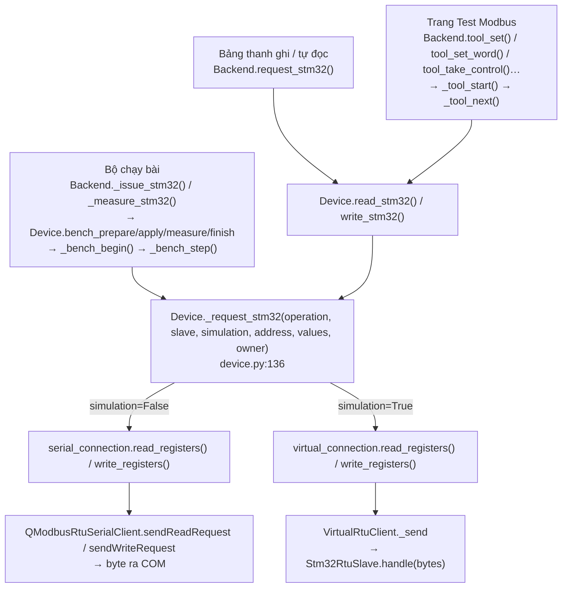
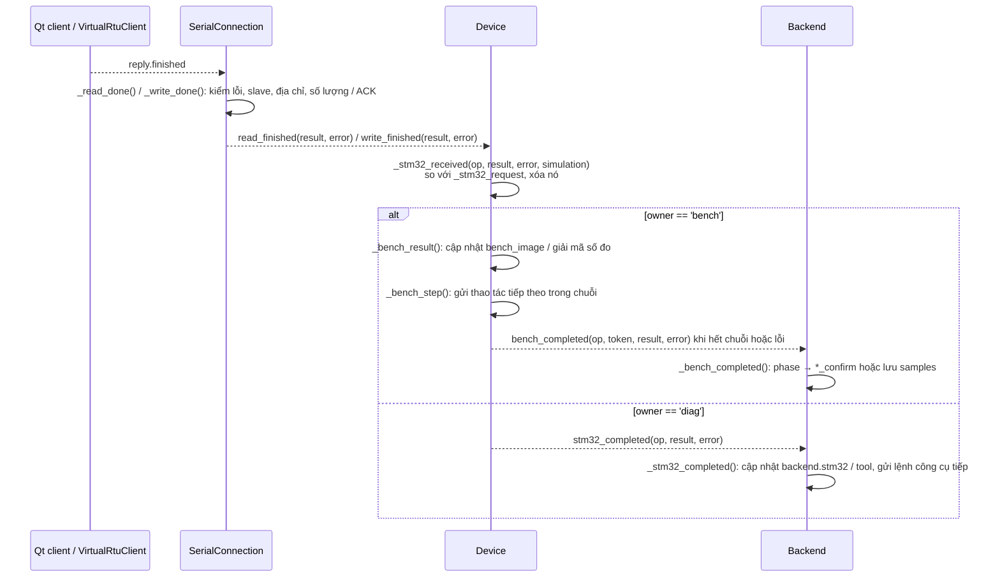

# Luồng truyền nhận Modbus trong code

Một lệnh Modbus tới STM32 được gửi bởi hàm nào, phản hồi được nhận và xử lý ở đâu; bộ chạy bài ghép các giao dịch thành một bài đo thế nào; COM ảo hoạt động ra sao; cách đặt log, debug và tự thêm khung truyền nhận.

- Cấu trúc byte của khung, bản đồ thanh ghi, quy tắc giao dịch: [02 Giao thức](02_GIAO_THUC_MODBUS.md).
- Tổng quan các tầng, máy trạng thái chạy bài: [01 Kiến trúc](01_KIEN_TRUC_PHAN_MEM.md).

Số dòng (ví dụ `device.py:136`) đúng tại 2026-11-19; khi mã thay đổi, tìm theo tên hàm.

## Mục lục

- [1. Các lớp tham gia và vai trò](#1-các-lớp-tham-gia-và-vai-trò)
- [2. Đường truyền (TX): từ nút bấm tới dây RS485](#2-đường-truyền-tx-từ-nút-bấm-tới-dây-rs485)
  - [`Device._request_stm32()` (`device.py:136`): điểm hội tụ](#device_request_stm32-devicepy136-điểm-hội-tụ)
  - [`SerialConnection.read_registers()` (`communication.py:258`)](#serialconnectionread_registers-communicationpy258)
  - [`SerialConnection.write_registers()` (`communication.py:321`)](#serialconnectionwrite_registers-communicationpy321)
- [3. Đường nhận (RX): từ byte về tới kết quả hiển thị](#3-đường-nhận-rx-từ-byte-về-tới-kết-quả-hiển-thị)
  - [`SerialConnection._read_done()` (`communication.py:283`)](#serialconnection_read_done-communicationpy283)
  - [`SerialConnection._write_done()` (`communication.py:350`)](#serialconnection_write_done-communicationpy350)
  - [`Device._stm32_received()` (`device.py:159`)](#device_stm32_received-devicepy159)
  - [`Device._bench_result()` (`device.py:336`): nhận trong bộ chạy bài](#device_bench_result-devicepy336-nhận-trong-bộ-chạy-bài)
  - [`Backend._stm32_completed()` (`backend.py:667`): nhận ở đường chẩn đoán / công cụ](#backend_stm32_completed-backendpy667-nhận-ở-đường-chẩn-đoán--công-cụ)
- [4. Bộ chạy bài: trình tự giao dịch và quy tắc](#4-bộ-chạy-bài-trình-tự-giao-dịch-và-quy-tắc)
- [5. Bộ tuần tự của bộ chạy bài: các loại thao tác](#5-bộ-tuần-tự-của-bộ-chạy-bài-các-loại-thao-tác)
- [6. Ví dụ trọn vẹn: một bước đo](#6-ví-dụ-trọn-vẹn-một-bước-đo)
- [7. COM ảo: phía "bên kia dây"](#7-com-ảo-phía-bên-kia-dây)
  - [Hành vi của CPU giả lập](#hành-vi-của-cpu-giả-lập)
- [8. Mã hóa / giải mã: các hàm thuần trong `protocol.py`](#8-mã-hóa--giải-mã-các-hàm-thuần-trong-protocolpy)
- [9. Hằng số thời gian liên quan](#9-hằng-số-thời-gian-liên-quan)
- [10. Log có sẵn](#10-log-có-sẵn)
- [11. Xem byte thô thật trên COM (Qt logging)](#11-xem-byte-thô-thật-trên-com-qt-logging)
- [12. Thêm log bằng Python `logging` (đề xuất, chưa có trong mã)](#12-thêm-log-bằng-python-logging-đề-xuất-chưa-có-trong-mã)
- [13. Debug không cần giao diện: script nhỏ](#13-debug-không-cần-giao-diện-script-nhỏ)
- [14. Tùy biến khung truyền nhận](#14-tùy-biến-khung-truyền-nhận)
  - [14.1. Đổi vùng đọc (địa chỉ / số lượng / FC04)](#141-đổi-vùng-đọc-địa-chỉ--số-lượng--fc04)
  - [14.2. Đổi cách ghi (luôn FC16, gom nhiều thanh ghi…)](#142-đổi-cách-ghi-luôn-fc16-gom-nhiều-thanh-ghi)
  - [14.3. Thêm mã hàm mới (FC17, FC23, khung tự định nghĩa)](#143-thêm-mã-hàm-mới-fc17-fc23-khung-tự-định-nghĩa)
  - [14.4. Tự kiểm soát từng byte (bỏ Qt Modbus)](#144-tự-kiểm-soát-từng-byte-bỏ-qt-modbus)
- [15. Checklist khi sửa phần truyền nhận](#15-checklist-khi-sửa-phần-truyền-nhận)
- [16. Kiểm thử](#16-kiểm-thử)

## 1. Các lớp tham gia và vai trò

| Lớp (file) | Vai trò trong một giao dịch |
|---|---|
| `Backend` (`backend.py`) | Người khởi tạo yêu cầu: đọc chẩn đoán, công cụ Test Modbus, bộ chạy bài. Kiểm quyền (`check_cpu_slave`, bận/rảnh). Nhận kết quả cuối, cập nhật trạng thái hiển thị. |
| `Device` (`device.py`) | Bộ tuần tự: **một giao dịch tại một thời điểm**. Gắn nhãn chủ `owner='diag'` hoặc `'bench'` cho mỗi giao dịch. Chạy chuỗi thao tác của bộ chạy bài (`_bench_step`). |
| `Stm32IoMap` (`protocol.py`) | Dịch "đặt tín hiệu X = giá trị" thành word thanh ghi, tách thành các lệnh ghi liên tiếp, giải mã word đọc được thành giá trị vật lý. Không I/O. |
| `SerialConnection` (`communication.py`) | Sở hữu cổng: gửi FC03/06/16 qua client Qt, kiểm tra phản hồi, timeout, đóng cổng khi lỗi mơ hồ. Phát `frame_logged`. |
| `QModbusRtuSerialClient` (Qt) | Đóng khung RTU (slave + PDU + CRC), ghi byte ra `QSerialPort`, ghép byte nhận, kiểm CRC, báo `reply.finished`. |
| `VirtualRtuClient` (`virtual_port.py`) | Thay Qt client khi mô phỏng: tự tạo byte RTU, giả thời gian truyền 115200 baud, đưa cho `Stm32RtuSlave`. |

## 2. Đường truyền (TX): từ nút bấm tới dây RS485

Có ba nơi khởi tạo giao dịch. Cả ba đều hội tụ ở **`Device._request_stm32()`**:



### `Device._request_stm32()` (`device.py:136`): điểm hội tụ

```python
def _request_stm32(self, operation, slave, simulation, address=1, values=None, owner='diag'):
    count = self.cpu_map.read_count - 1          # A45 / CPUv1.1: 42 word (DI 1–42)
    if self._stm32_request is not None:
        raise ValueError('Đang chờ giao dịch STM32.')   # chỉ 1 giao dịch đang bay
    link = self.virtual_connection if simulation else self.serial_connection
    ...
    self._stm32_request = dict(operation=..., slave=..., simulation=..., address=..., values=..., owner=owner)
    if operation == 'read':
        link.read_registers(slave, 3, 1, count)  # luôn đọc cả mảng DI từ địa chỉ 1
    else:
        link.write_registers(slave, address, values)
```

- `self._stm32_request` là "giao dịch đang bay". Nó dùng để biết phản hồi về thuộc ai (`owner`).
- **Đọc luôn là FC03, địa chỉ 1, số lượng = `read_count - 1`.** Muốn đọc vùng khác thì sửa ở đây (xem mục 14.1).

### `SerialConnection.read_registers()` (`communication.py:258`)

1. `make_read_unit()` kiểm slave 1–247, địa chỉ, số lượng 1–125, FC 3/4. Kết quả là `QModbusDataUnit`.
2. Từ chối nếu cổng chưa mở hoặc còn giao dịch (`self.reply is not None`).
3. Lưu `self._request = {slave, function, address, count}` để đối chiếu khi phản hồi về.
4. `reply = client.sendReadRequest(unit, slave)`. Qt tự đóng khung và CRC, rồi ghi ra cổng.
5. Phát `frame_logged('TX', rtu_adu(...))`. Khung này **được dựng lại** từ PDU + CRC tính lại; Qt không cho lấy byte thô.
6. `reply.finished.connect(lambda: self._read_done(client, reply))`.
7. Bật `self.deadline` = `timeout_ms + 1000`. Đây là chốt chặn phòng khi Qt không bao giờ báo xong.

### `SerialConnection.write_registers()` (`communication.py:321`)

Giống đọc, khác ở chỗ:

- 1 word → **FC06**; nhiều word → **FC16**. Qt tự chọn; code ghi lại `function` để kiểm ACK.
- Tối đa 123 thanh ghi mỗi khung.
- Gọi `client.sendWriteRequest(QModbusDataUnit(HoldingRegisters, address, values), slave)`.

## 3. Đường nhận (RX): từ byte về tới kết quả hiển thị



### `SerialConnection._read_done()` (`communication.py:283`)

Mỗi nhánh dẫn tới một kết quả:

| Trường hợp | Kết quả |
|---|---|
| `reply.error() == NoError`, slave/loại/địa chỉ/số lượng khớp `self._request` | `result = {slave, function, address, count, values: [uint16…], timestamp}`; phát `frame_logged('RX', …)`; `read_finished(result, '')` |
| Khớp sai (Qt trả về vùng khác) | `read_finished(None, 'Phản hồi không khớp…')` |
| `ProtocolError` (CPU trả exception, ví dụ 02 = địa chỉ ngoài mảng) | Log khung exception `slave, FC|0x80, code`; `read_finished(None, 'Lỗi Modbus exception N…')`, cổng **vẫn mở** |
| `TimeoutError` hoặc `InvalidResponseError` | `_fail()`: **đóng COM**, `status_changed('error')`, `read_finished(None, …)`. Lý do: RTU không có mã giao dịch, phản hồi trễ có thể bị nhận nhầm cho lệnh sau. |

### `SerialConnection._write_done()` (`communication.py:350`)

- ACK hợp lệ phải qua `validate_write_ack(reply.rawResult(), address, values)` `protocol.py:393`. FC06 so echo địa chỉ + giá trị; FC16 so địa chỉ + số lượng. Phải dùng `rawResult()` vì `reply.result()` của Qt không hợp lệ với lệnh ghi.
- Exception Modbus → `write_finished(None, 'Modbus exception N…')`, cổng vẫn mở.
- Lỗi khác (timeout, ACK sai) → `_fail()` đóng cổng: "chưa biết lệnh đã thực thi hay chưa; không tự gửi lại".
- Thành công → `write_finished({slave, function, address, values, timestamp}, '')`.

### `Device._stm32_received()` (`device.py:159`)

```python
pending = self._stm32_request
if pending is None or pending['operation'] != operation or pending['simulation'] != simulation:
    return                      # phản hồi không thuộc giao dịch đang chờ: bỏ
self._stm32_request = None
if pending['owner'] == 'bench':
    self._bench_result(pending, result, error)
else:
    self.stm32_completed.emit(operation, result, error)
```

Hàm được nối vào **cả hai cổng** trong `Device.__init__`, với tham số `sim` cố định cho từng cổng. Nhờ vậy phản hồi từ COM ảo không bị nhầm với COM thật.

### `Device._bench_result()` (`device.py:336`): nhận trong bộ chạy bài

- **Lỗi** → `_forget_write()` xóa các địa chỉ vừa ghi khỏi `bench_image` (không biết CPU đã nhận chưa), rồi `_bench_fail()` → `bench_completed(op, token, None, error)`.
- **Ghi OK** → `_last_write_ack = time.monotonic()` (mốc cho thời gian chờ `after_ack`), cập nhật `bench_image`, lưu vào `seq['writes']`.
- **Đọc OK** → `words = [0] + values` (chèn index 0 cho khớp chỉ số mảng firmware), rồi:
  - Đang đo chu kỳ (D02, `pending_probe`): so ADC0–4 với lần trước, ghi thời điểm đổi.
  - Đọc đo thường: `seq['values'][sid] = io_map.decode(words, sid)` cho từng tín hiệu trong nhóm MUX.
  - Phát `stm32_snapshot` để bảng thanh ghi hiển thị mảng DI vừa đọc.
- Cuối cùng gọi `_bench_step()` để chạy thao tác tiếp theo.

### `Backend._stm32_completed()` (`backend.py:667`): nhận ở đường chẩn đoán / công cụ

- Đọc OK → kiểm đủ `read_count - 1` word, `decode_stm32()`, ghi vào `backend.stm32.mod_buf_to_read`, `read_valid = True`.
- Ghi OK → `backend.stm32.last_ack = result`.
- Lỗi → `backend.stm32.invalidate()`.
- Lệnh này thuộc công cụ Test Modbus → `_tool_completed()`: cập nhật `tool['image']`, rồi `_tool_next()` gửi lệnh kế. Gặp lỗi thì xóa hàng đợi, `tool['image'] = None` (trạng thái chưa biết).
- Có lệnh công cụ đang xếp sau một lần tự đọc nền → `_tool_next()`.

## 4. Bộ chạy bài: trình tự giao dịch và quy tắc

Bộ tuần tự `Device.bench_*` (`src/device.py`) thực thi từng giao dịch một, không bao giờ retry:

```mermaid
sequenceDiagram
    participant Runner as Backend / Device (PC)
    participant STM32 as STM32 (hoặc Stm32Simulator)

    Note over Runner,STM32: 1. Kết nối mô phỏng: mở COM ảo (bench_connect)
    Runner->>STM32: FC03 (đọc DI 1..N, A45: 42 word; không ghi gì)
    STM32-->>Runner: N word hợp lệ -> Xác nhận "Sẵn sàng"

    Note over Runner,STM32: 2. Chuẩn bị bài đo (bench_prepare)
    Runner->>STM32: FC03 (Kiểm tra liên lạc đầu bài)
    STM32-->>Runner: N word
    Runner->>STM32: FC06/FC16: Ghi safe_state đầy đủ (Mode=1, Plan=2 trước; mọi nguồn/SW/MUX/DAC tắt)
    STM32-->>Runner: ACK
    Runner->>STM32: FC06/FC16: Ghi trình tự chuẩn bị (prepare actions)
    STM32-->>Runner: ACK

    Note over Runner,STM32: 3. Từng bước kích thích & đo (apply -> wait -> measure)
    Runner->>STM32: FC06/FC16: Mở các rơ-le phải nhả (nếu bước vừa nhả vừa đóng)
    STM32-->>Runner: ACK
    Note right of Runner: Chờ break_ms kể từ ACK (ngắt trước đóng sau)
    Runner->>STM32: FC06/FC16: Ghi phần còn lại khác ảnh DO đã ACK (bench_apply)
    STM32-->>Runner: ACK
    Note right of Runner: Chờ ổn định tín hiệu (wait_ms; ×N chỉ trong mô phỏng)
    loop Cho mỗi nhóm kênh MUX cần đo (bench_measure)
        Runner->>STM32: FC06: Ghi MUX (địa chỉ 11) = số kênh (byte thấp MUX1, byte cao MUX2)
        STM32-->>Runner: ACK
        Note right of Runner: Chờ đủ di_update_ms + mux_settle_ms kể từ ACK ghi cuối
        Runner->>STM32: FC03: Đọc DI 1..N
        STM32-->>Runner: N word -> word × scale + offset -> so nominal ± tolerance
    end

    Note over Runner,STM32: 4. Kết thúc / Dừng bài (bench_finish)
    Runner->>STM32: FC06/FC16: Ghi cleanup -> safe_state (ngắt nguồn/rơ-le an toàn)
    STM32-->>Runner: ACK
```

Tóm tắt trình tự:
```text
Kết nối mô phỏng → mở COM ảo → FC03 (không ghi gì)
prepare          → FC03 → ghi safe_state đầy đủ (Mode=1, Plan=2 trước; mọi
                   nguồn/định tuyến/MUX/DAC tắt) → ghi trình tự chuẩn bị
apply (mỗi bước) → chỉ ghi các word khác ảnh DO đã ACK (cộng dồn trong bài);
                   nếu vừa nhả vừa đóng rơ-le: ghi nhả → chờ break_ms → ghi đóng
chờ ổn định      → wait_ms (×N chỉ trong mô phỏng)
measure          → mỗi nhóm tín hiệu đo: ghi MUX = số kênh → chờ tới khi đủ
                   di_update_ms + mux_settle_ms kể từ ACK ghi cuối
                   → FC03 → word × scale → so nominal ± tolerance
                   tín hiệu "manual": hỏi người vận hành (đầu ra vẫn giữ nguyên)
finish           → cleanup → safe_state (dừng tay cũng đi qua bước này)
```

- **Ánh xạ `Stm32IoMap`** đọc từ `hardware.json` → `stm32_io`. Ý nghĩa các kiểu output (`bit`, `pin`) và input (`adc`, `link`, `manual`, `loop_probe`): [06 Cấu hình](06_CAU_HINH_PROFILE.md#stm32_io); bảng bit A45: [04 Firmware](04_FIRMWARE_VA_PHAN_CUNG.md) mục 10; thao tác trong code: mục 5.
- **Ngắt trước đóng sau** (`break_ms`): khi một bước vừa nhả vừa đóng rơ-le (đổi +3 V → −3 V trên một chân, AC 36 V → 22 V), bộ chạy bài ghi phần nhả trước, chờ `break_ms` kể từ ACK để vòng lặp CPU đã thực thi, rồi mới ghi phần đóng. **Liên động** `interlocks` (ví dụ `ac_36v` / `ac_22v`) bị từ chối ngay khi tính ảnh DO.
- **Giới hạn vùng ghi**: Bộ chạy bài chỉ được phép ghi các thanh ghi `bench_writable` của bản đồ CPU (`Mode`, `Plan`, `Block`, `Cabinet`, `Status`, `DisplayOut`, `DAC_val`, `DOUT`, `SW01`, `SW02`, `MUX`, `Power`, `DataO4`, `DataO5`; CPUv1.1 thêm `Matrix0`/`Matrix1`) cộng các thanh ghi **đề xuất sửa firmware** mà profile khai báo trong `extra_write_registers` (A45: `Matrix2_0…Matrix4_1`, index 31–36). **Không bao giờ** tự ghi `DataO1`/`DataO2` (encoder tự xóa), `DataO3` (SSI), `CDT`, `DataT…` hoặc index `0`. Bit mà firmware tự bật ở chế độ HMI (`hmi_forced_bits`) không được gán cho output nào.
- **Lưu vết và đánh giá**: Biên nhận ACK được lưu vào `attempt.transactions` với ghi chú *"chưa xác nhận đầu ra vật lý"*. Kết luận `PASS`/`FAIL` chỉ đến từ số đo `FC03` hợp lệ sau thời gian chờ ổn định, hoặc số người vận hành nhập. Check có `absolute: true` so `|giá trị|` với `nominal ± tolerance`.
- **Xử lý lỗi giữa chừng**: Lỗi hoặc timeout ở bất kỳ bước nào → bài đo nhận trạng thái `ERROR`; các thanh ghi đang ghi trong `bench_image` coi là **chưa biết**; không tự gửi lại, không tự ghi `safe_state` đè lên sau khi kênh truyền đã lỗi.
- **Bài nguồn hỏng thì dừng lượt** (`stop_on_fail` ở P01/P02): bài FAIL → cleanup về `safe_state` như thường, rồi bỏ các bài còn lại (dòng sai thường là chập/hỏng).
- **Ràng buộc 1 kênh DAC**: hai chân cần hai mức khác nhau trên cùng `DAC_val` bị từ chối ngay.
- **Mục `unsupported`** (một bo matrix, một input…) → bài kiểm tra chuyển sang `BLOCKED` trước khi gửi bất kỳ lệnh nào xuống STM32.
- **Tạm dừng (`Pause`)**: Chuỗi giao dịch đang chạy được thay bằng `finish` (giao dịch đang ở trên đường dây vẫn hoàn tất trước) → đưa đầu ra về `safe_state`; lần thử hiện tại ghi nhận `PAUSED`; khi bấm **Tiếp tục**, bài đó chạy lại từ bước `prepare`. Trong lúc đang tạm dừng không gửi gì xuống MCU. Tạm dừng/dừng khi đang chờ nhập tay thì hộp thoại đóng, câu trả lời muộn bị bỏ qua.
- `CPUv1.0` không có cờ sẵn sàng/bảo vệ riêng: trên giao diện, `"Sẵn sàng"` = phản hồi `FC03` hợp lệ; `"Bảo vệ"` hiển thị `"Chưa biết"`.
- **Thời gian chờ DI** (`stm32_io.di_update_ms`, giả định 150 ms): ACK chỉ cho biết MCU đã chép lệnh vào mảng. Số đo chỉ phản ánh lệnh mới sau tối đa ~2 vòng lặp CPU ([04 Firmware](04_FIRMWARE_VA_PHAN_CUNG.md) mục 2). Đo chu kỳ vòng lặp trên mạch thật bằng bài tự kiểm tra **D02** rồi chỉnh.
- **Chạy trên mạch thật**: cùng đường code (`Device` → `SerialConnection`), chỉ khác client Modbus. Điều kiện mở (tự kiểm tra ngay; bài đo cần `verified` + D02 + xác nhận): [05 Vận hành](05_VAN_HANH_GIAO_DIEN.md) mục 3.

## 5. Bộ tuần tự của bộ chạy bài: các loại thao tác

`Device.bench_*` không gửi ngay. Chúng dựng một **danh sách thao tác** (`deque`), rồi `_bench_step()` `device.py:247` lấy từng thao tác ra chạy:

| Thao tác | Ý nghĩa | Ai tạo |
|---|---|---|
| `('read', [sid…])` | FC03 cả mảng DI, rồi giải mã các tín hiệu trong danh sách | `bench_connect`, `bench_prepare`, `bench_measure` |
| `('image', ảnh_đích, full)` | Đưa DO tới `ảnh_đích`. Khi chạy, nó **nở ra** thành các `write` (và `after_ack` nếu phải ngắt trước rồi mới đóng). `full=True`: không biết trạng thái cũ, ghi lại mọi thanh ghi. | `bench_prepare`, `bench_apply`, `bench_finish` |
| `('mux', word)` | Đổi riêng thanh ghi MUX (nở thành `image`) | `bench_measure` |
| `('write', address, words)` | Một giao dịch FC06/FC16 | sinh ra từ `image` |
| `('after_ack', ms)` | Chờ tới khi đã qua `ms` kể từ ACK ghi cuối | `image` (giữa hai pha), `bench_measure` (`di_update_ms + mux_settle_ms`) |
| `('wait', ms)` | Chờ cố định | dự phòng |
| `('probe', sid)` | D02: đọc FC03 liên tục trong `duration_ms` để ước lượng chu kỳ CPU | `bench_measure` |

Cách một `image` nở ra (trong `_bench_step`):

```python
previous = None if full else self.bench_image
for index, image in enumerate(io.phases(previous, target)):   # [ảnh_nhả, ảnh_đích] hoặc [ảnh_đích]
    if index:
        expanded.append(('after_ack', io.break_ms))           # ngắt trước, chờ CPU chạy xong, rồi đóng
    expanded += [('write', addr, words) for addr, words in io.writes(previous, image)]
    previous = image
```

- `Stm32IoMap.writes(old, new)` `protocol.py:261`: chỉ lấy các word **khác** `old` và gộp các địa chỉ liền nhau thành một khung FC16.
- `Stm32IoMap.phases(old, new)` `protocol.py:276`: nếu bước này vừa nhả vừa đóng rơ-le thì tách thành hai pha.

## 6. Ví dụ trọn vẹn: một bước đo

Ví dụ dùng đúng profile A45 hiện tại: một bước có action `{"signal": "dc_27v", "value": 1}` (rơ-le +27 V = `Power` bit 2, DO index 12), rồi đo `xp1_50` (MUX1 kênh 8 → `ADC3_val`, hệ số 0,01).

```
Backend._issue('apply') → _issue_stm32('apply'):
  Device.bench_apply(token, actions)                         device.py:195
    io.apply(bench_image, actions)  → ảnh đích: {…, 12: 0x0004, …}
    deque = [('image', đích, False)]
  _bench_step → nở: [('write', 12, [4])]   (io.writes chỉ lấy word đổi; 1 word → FC06; 1 pha vì chỉ đóng)
    _request_stm32('write', 11, sim, 12, [4], owner='bench')
      SerialConnection.write_registers → TX 0B 06 00 0C 00 04 CRC
      … RX 0B 06 00 0C 00 04 CRC (echo) → _write_done → write_finished
    _stm32_received → _bench_result: bench_image[12] = 4, _last_write_ack = now → _bench_step
  hết thao tác → bench_completed('apply', token, {...}, '')
Backend._bench_completed → phase 'apply_confirm', confirmed = token
_tick → settling (chờ wait_ms của bước) → sampling → _measure_stm32()
  Device.bench_measure(token2, ['xp1_50'])                   device.py:202
    io.groups → [(0x1F08, ['xp1_50'])]   (byte thấp = kênh 8 của MUX1, byte cao = 31 = MUX2 nghỉ)
    deque = [('mux', 0x1F08), ('after_ack', di_update_ms + mux_settle_ms), ('read', ['xp1_50'])]
  _bench_step: mux → image → write DO 11 = 0x1F08 (FC06) → ACK
               after_ack → QTimer chờ → read → FC03 42 word
  _bench_result: words = [0] + values
                 values['xp1_50'] = io.decode(words, 'xp1_50') = int16(words[ADC3_val]) × 0.01
  bench_completed('measure') → Backend._store_bench_samples → samples['xp1_50'] = Sample(…)
_tick (sampling): mọi mẫu đã mới → _evaluate_step → evaluate() → PASS/FAIL
```

## 7. COM ảo: phía "bên kia dây"

```
SerialConnection.read_registers/write_registers
  → VirtualRtuClient.sendReadRequest / sendWriteRequest      virtual_port.py:144
      → _send(): request = rtu_adu(slave, pdu)  (byte RTU thật, có CRC)
         QTimer: thời gian truyền = số byte × 10/115200 s + 1,75 ms
  → _arrive(): VirtualLine.fault() (timeout / rút cáp theo kịch bản)
      → Stm32RtuSlave.handle(request_bytes)                 simulator.py:186
          split_rtu_adu (kiểm CRC) → FC03: Stm32Simulator.read_holding
                                   → FC06/16: Stm32Simulator.write (vào mod_buf_to_write)
          → byte phản hồi (hoặc None = im lặng)
  → _deliver(): parse byte như Qt (CRC, slave, FC, exception) → reply._finish → reply.finished
```

`Stm32Simulator` mô phỏng vòng lặp CPU (`loop_ms`): lệnh ghi chỉ có hiệu lực ở đầu vòng sau, DI phản ánh vòng đã chạy xong. Số đo lấy theo kích thích đọc ngược từ DO (`io_map.inverse`) và bảng `mock.json → stm32_cases`.

### Hành vi của CPU giả lập

- **Cùng một đường code**: chế độ mô phỏng dùng một `SerialConnection` thứ hai, giống hệt của COM thật, chỉ thay client Qt bằng `VirtualRtuClient`. Mọi kiểm tra phía PC (slave/địa chỉ/số lượng, ACK FC06/FC16 qua `rawResult()`, exception, timeout → đóng COM) đều chạy như khi nối mạch.
- **Khung byte thật**: ADU `slave + PDU + CRC16`, tính theo thời gian truyền 115200 baud (10 bit/ký tự, T3.5, 1 ms `eMBPoll`). Phản hồi được tách lại như client Qt: sai CRC/slave/FC thì bỏ, chờ timeout.
- **`Stm32RtuSlave`** xử lý khung như FreeModbus của CPUv1.0:
  - sai CRC, khác slave ID hoặc broadcast: im lặng;
  - FC03 đọc `mod_buf_to_read`; FC06/FC16 ghi `mod_buf_to_write` (ghi được cả index 0);
  - exception 03 khi sai số lượng/độ dài; 01 với FC khác.
  - **Khác firmware có chủ đích**: COM ảo trả exception 02 khi vượt mảng của bản đồ (CPUv1.0: 30 DI / 29 DO; CPUv1.1: 43 DI / 31 DO; cộng các thanh ghi `extra_write_registers` profile đề xuất), còn firmware thật chấp nhận tới 128 thanh ghi và đọc/ghi tràn RAM ([04 Firmware](04_FIRMWARE_VA_PHAN_CUNG.md) mục 6). Mục đích là bắt lỗi phía PC.
  - FC17 không mô phỏng vì PC không dùng.
- **Vòng lặp chính CPU** (`mock.json` → `stm32_timing.loop_ms`, đang giả định 50 ms; CPUv1.1 trên A45 ước tính ≈ 360–380 ms, [04 Firmware](04_FIRMWARE_VA_PHAN_CUNG.md) mục 2):
  - lệnh ghi được ACK ngay, nhưng chỉ có hiệu lực ở đầu vòng lặp kế tiếp;
  - FC03 trả bản DI chép ở vòng lặp đã chạy xong gần nhất;
  - đọc quá sớm sau khi đổi MUX hoặc kích thích sẽ nhận kênh cũ và bài FAIL, giống mạch thật.
- Hai vùng nhớ độc lập; `Mode` ở DI luôn 0; `DataO1`/`DataO2` tự xóa khi `Mode = 1` (như firmware).
- `MUX` không chọn kênh đo nào (ví dụ kênh an toàn 31): các thanh ghi đo trả giá trị cố định (phục vụ màn hình chẩn đoán). `ADC2` có nhiễu 1 LSB đổi theo từng vòng lặp để bài D02 đo được chu kỳ.
- Khi bộ chạy bài chọn kênh `MUX`:
  - ADC trả phản hồi demo từ `mock.json` → `stm32_cases`, dựa trên **kích thích đọc ngược từ ảnh DO đang thực thi** (`Stm32IoMap.inverse()`);
  - `Mode ≠ 1` thì coi như không có kích thích;
  - sai bit hoặc sai đầu vào matrix → ADC trả 0 → FAIL; một chân bị đóng hai nguồn cùng lúc (chập) cũng không khớp case nào;
  - mức DAC khớp case trong phạm vi nửa bước DAC (lượng tử);
  - `after_ms` mô phỏng đáp ứng theo thời gian.
- **Kịch bản lỗi** được tạo **trên đường truyền** (`VirtualLine`), nên ứng dụng thấy chúng như với COM thật:
  - `slow`: trả lời trễ thêm 320 ms;
  - `timeout` (khi apply) và `stop_timeout` (khi finish): slave im lặng → timeout → đóng COM ảo, phải kết nối lại;
  - `disconnect` (khi đo): mất cổng, như rút cáp;
  - `fail`: lệch một số đo.

  `stale`/`protection` không áp dụng.
- **Không mô phỏng**: tín hiệu điện, các khung trên USART1 tới bo con và lỗi bo con, HMI mode, jitter vòng lặp, dạng sóng encoder, race xóa `RevData`.

## 8. Mã hóa / giải mã: các hàm thuần trong `protocol.py`

| Hàm | Làm gì |
|---|---|
| `register_words(values)` | Kiểm mỗi giá trị là int 0–65535 |
| `encode_int16` / `decode_int16` | Số có dấu ↔ word (ADC, DAC_val) |
| `stm32_write_words(address, values, limit)` | Kiểm vùng ghi 1…limit−1 (index 0 dành riêng) |
| `make_read_unit(slave, fc, address, count)` | Tạo `QModbusDataUnit` có kiểm giới hạn |
| `rtu_request_pdu(fc, address, values, count)` | Dựng PDU FC03/04/06/16 |
| `rtu_adu(slave, pdu)` / `split_rtu_adu(raw)` | Thêm / tách slave + CRC16 |
| `crc16_modbus(data)` | CRC Modbus (đa thức 0xA001, khởi tạo 0xFFFF) |
| `validate_write_ack(response, address, values)` | Kiểm echo của FC06/FC16 |
| `decode_stm32(words, cpu_map)` | Giải mã cả mảng DI để hiển thị |
| `Stm32IoMap.apply / writes / phases` | Tín hiệu → ảnh DO → danh sách lệnh ghi |
| `Stm32IoMap.groups / mux_word / decode` | Tín hiệu đo → nhóm theo kênh MUX → giá trị vật lý |

Các hàm này không có I/O nên test được độc lập. Muốn hiểu một ánh xạ, gọi thử chúng trong Python với profile thật (xem mục 13).

## 9. Hằng số thời gian liên quan

| Hằng số | Ở đâu | Ý nghĩa |
|---|---|---|
| `TRANSACTION_TIMEOUT_MS = 1000` | `common/testing.py` | Timeout Qt cho COM ảo; COM thật lấy `timeout_ms` trong Chi tiết kết nối |
| `timeout_ms + 1000` | `SerialConnection.deadline` | Chốt chặn nếu Qt không báo xong |
| `OPERATION_TIMEOUT_MS = 2500` (+0,5 s/giao dịch) | `Backend.deadline` | Hạn của mỗi chuỗi trong máy trạng thái |
| `break_ms` | `hardware.json → stm32_io` | Chờ giữa pha nhả và pha đóng rơ-le |
| `di_update_ms + mux_settle_ms` | `hardware.json → stm32_io` | Chờ từ ACK ghi cuối tới khi đọc DI |
| `READ_STALE_MS` | `common/stm32.py` | Hạn hiển thị của mảng DI trên bảng |

## 10. Log có sẵn

1. **Nhật ký khung trên giao diện:** trang Test Modbus → tab "Nhật ký".
   - Hiển thị mọi khung TX/RX của cả COM thật và COM ảo, gồm cả khung của bộ chạy bài.
   - Có nút "Xuất nhật ký…" ra file `.txt`.
   - Nguồn dữ liệu: `SerialConnection.frame_logged` → `Backend._frame_logged()` `backend.py:402` → `backend.frame_log` (giữ 500 dòng).
   - **Lưu ý:** khung được **dựng lại** từ PDU và CRC tính lại, không phải byte thô trên dây. Timeout không có dòng RX. Khung có CRC sai bị Qt bỏ nên không hiện.
2. **Nhật ký thao tác của công cụ:** `backend.tool['log']` hiện trong cùng tab, ở đầu.
3. **Phiên JSON:** mỗi attempt có `transactions` (word đã ghi, thời điểm) và `measurements` (giá trị, chất lượng, lý do).

## 11. Xem byte thô thật trên COM (Qt logging)

`QModbusRtuSerialClient` có log nội bộ theo category `qt.modbus` và `qt.modbus.lowlevel`. Bật trước khi chạy:

```powershell
$env:QT_LOGGING_RULES = "qt.modbus*=true"
conda run -n qt_env python main.py
```

Log Qt in ra stderr của console. Nó chỉ có với **COM thật**, vì COM ảo không dùng client của Qt. Tên và định dạng dòng log tùy bản Qt; mục này chưa được kiểm trên mạch thật. Muốn gom log Qt vào cùng file với log Python, dùng `qInstallMessageHandler` (xem mục 12).

Với nhiễu, sai baud hay sai dây, cách chắc chắn nhất vẫn là một bộ chuyển USB-RS485 thứ hai cắm song song, chỉ nghe, mở bằng phần mềm terminal.

## 12. Thêm log bằng Python `logging` (đề xuất, chưa có trong mã)

Project hiện chưa dùng `logging`. Cách thêm ít xâm lấn nhất:

**Bước 1: cấu hình một lần trong `main.py`**, trước `QApplication`:

```python
import logging
from pathlib import Path
from PySide6.QtCore import qInstallMessageHandler

Path('logs').mkdir(exist_ok=True)
logging.basicConfig(
    filename='logs/modbus.log', level=logging.DEBUG, encoding='utf-8',
    format='%(asctime)s.%(msecs)03d %(name)-12s %(message)s', datefmt='%H:%M:%S')

def _qt_to_logging(mode, context, message):          # gom log Qt (mục 11) vào cùng file
    logging.getLogger(f'qt.{context.category}').debug(message)
qInstallMessageHandler(_qt_to_logging)
```

Thêm `logs/` vào `.gitignore` và dọn file log theo quy tắc trong AGENTS.md.

**Bước 2: đặt log ở các điểm then chốt.** Mỗi điểm một dòng `log.debug(...)`, với `log = logging.getLogger('modbus.xxx')` ở đầu file:

| Muốn thấy | Đặt log ở | Nội dung nên ghi |
|---|---|---|
| Mọi khung TX/RX (một chỗ cho cả hai cổng) | `Backend._frame_logged()` `backend.py:402` | `'SIM' if simulation else 'REAL'`, `direction`, `raw.hex(' ')` |
| Ai gửi, vì sao | `Device._request_stm32()` `device.py:136` | `owner`, `operation`, `slave`, `address`, `values`, `self._bench['operation']` nếu có |
| Kết quả từng giao dịch, kể cả lỗi | `Device._stm32_received()` `device.py:159` | `operation`, `error`, độ dài `result['values']` |
| Chuỗi thao tác bộ chạy bài | `Device._bench_step()` `device.py:247`, ngay sau `op = seq['ops'].popleft()` | `seq['operation']`, `op`. Thấy rõ `after_ack`, `image` nở ra thế nào |
| Ảnh DO sau mỗi ACK | `Device._bench_result()` nhánh ghi | `{hex(k): hex(v) for k, v in self.bench_image.items()}` |
| Giá trị giải mã | `Device._bench_result()` nhánh đọc, sau `io_map.decode` | `sid`, word thô, giá trị vật lý |
| Lỗi đóng cổng | `SerialConnection._fail()` `communication.py:385` | `detail`, `self._request` |
| Chuyển phase | `Backend._tick()` hoặc mỗi chỗ gán `self.phase` | phase cũ → mới, `test['id']`, `step_index` |
| Phía CPU giả lập nhận gì | `Stm32RtuSlave.handle()` `simulator.py:186` | `raw.hex(' ')` vào, byte trả ra |

Ví dụ một điểm log:

```python
# src/device.py
import logging
log = logging.getLogger('modbus.device')
...
def _request_stm32(self, operation, slave, simulation, address=1, values=None, owner='diag'):
    ...
    log.debug('%s %s %s slave=%d addr=%s values=%s stage=%s', 'SIM' if simulation else 'REAL',
              owner, operation, slave, address, values, self._bench and self._bench['operation'])
```

Ghi log dùng `%s` lazy như trên để không tốn chi phí khi tắt mức DEBUG. Không log trong vòng lặp `_tick` 50 ms trừ khi phase đổi, nếu không file log sẽ phình rất nhanh.

## 13. Debug không cần giao diện: script nhỏ

Script dưới đây đã được chạy thử trên COM ảo (2026-11-19). Nó ghi Mode=1 rồi đọc mảng DI và in khung TX/RX:

```python
"""Ghi Mode=1 rồi đọc DI của CPU giả lập qua COM ảo, in khung TX/RX."""
import sys
from PySide6.QtCore import QCoreApplication
from src.common.profiles import load_profile
from src.device import Device

app = QCoreApplication(sys.argv)
dev = Device(load_profile())
cpu = dev.io_map.slave                       # 11 với profile A45
link = dev.virtual_connection                # đổi thành dev.serial_connection cho COM thật
link.frame_logged.connect(lambda d, raw: print(d, bytes(raw).hex(' ').upper()))

def completed(operation, result, error):
    if error:
        print(operation, 'LỖI:', error)
        app.quit()
    elif operation == 'write':
        print('ACK ghi', result['address'], result['values'])
        dev.read_stm32(cpu, simulation=True)        # bước 2: FC03
    else:
        print('DI[1..12] =', result['values'][:12])
        app.quit()

dev.stm32_completed.connect(completed)
dev.write_stm32(dev.cpu_map.write_index('Mode'), [1], cpu, simulation=True)   # bước 1: FC06
app.exec()
```

Chạy (lưu script ngoài project, ví dụ `D:\tmp\probe.py`):

```powershell
$env:PYTHONPATH = "."; $env:PYTHONIOENCODING = "utf-8"
conda run -n qt_env python -B D:\tmp\probe.py
```

Kết quả thực tế:

```
TX 0B 06 00 01 00 01 19 60          ← slave 11, FC06, địa chỉ 1 (Mode), giá trị 1, CRC
RX 0B 06 00 01 00 01 19 60          ← ACK = echo
ACK ghi 1 [1]
TX 0B 03 00 01 00 2A 95 7F          ← FC03, từ địa chỉ 1, 0x2A = 42 word
RX 0B 03 54 00 00 … 88 34           ← 0x54 = 84 byte dữ liệu
DI[1..12] = [0, 0, 0, 0, 0, 0, 1234, 64969, 2401, 1200, 330, 16854]
```

Để dùng script với COM thật:

1. Gọi `dev.open_serial(SerialSettings('rtu', 'COM5', 115200))`.
2. Chờ `dev.serial_connection.status_changed` báo `'open'`, rồi mới gửi.
3. Đổi `simulation=False`.

Hỏi trước khi chạy với mạch thật: lệnh ghi sẽ thực sự đóng/ngắt rơ-le.

Thử nhanh ánh xạ, không I/O:

```python
from src.common.profiles import load_profile
from src.device import Device          # hoặc dựng Stm32IoMap trực tiếp
io = Device(load_profile()).io_map
img = io.apply(io.safe_image(), [{'signal': 'dc_27v', 'value': 1}])
print(io.writes(io.safe_image(), img))       # [(12, [4])]: ghi Power (DO 12) = bit 2
print(len(io.phases(io.safe_image(), img)))  # 1 pha (chỉ đóng, không cần ngắt trước)
print(io.groups(['xp1_50']))                 # [(7944, ['xp1_50'])]: MUX = 0x1F08
```

Kết quả trên là output thật với profile A45. Tên tín hiệu lấy từ `system.json → signals`. Giá trị action phải khớp `on_value` / `levels` trong `hardware.json`; giá trị khác bị `apply()` từ chối.

Ngoài ra, chọn kịch bản lỗi (timeout, disconnect, slow…) ở trang Kiểm tra để xem phần mềm phản ứng với lỗi đường truyền trên COM ảo. Mỗi file trong `tests/` cũng là ví dụ gọi trực tiếp các hàm trên.

## 14. Tùy biến khung truyền nhận

### 14.1. Đổi vùng đọc (địa chỉ / số lượng / FC04)

Hiện mọi lần đọc là FC03, từ địa chỉ 1, số lượng `read_count - 1`. Giá trị này cố định trong `Device._request_stm32()` (`link.read_registers(slave, 3, 1, count)`). Muốn đọc vùng khác:

1. Thêm tham số `function`, `address`, `count` vào `_request_stm32`, `read_stm32`, và lưu chúng trong `self._stm32_request`.
2. Sửa các nơi kiểm "đủ mảng DI", vì chúng đang ép `address == 1` và đủ độ dài:
   - `Device._bench_result()`;
   - `Backend._stm32_completed()`.
3. `SerialConnection.read_registers()` đã hỗ trợ sẵn FC03/FC04, địa chỉ và số lượng tùy ý.
4. Phía giả lập: `Stm32RtuSlave.handle()` chỉ trả FC03 (các FC khác trả exception 01). Thêm nhánh `function == 4` nếu dùng FC04.

### 14.2. Đổi cách ghi (luôn FC16, gom nhiều thanh ghi…)

- Qt tự chọn FC06 cho 1 word, FC16 cho nhiều word. Muốn **luôn FC16** cho cả 1 word thì dùng request thô (mục 14.3) với FC 0x10.
- Muốn gom hay tách khung: sửa `Stm32IoMap.writes()`. Hàm này quyết định các địa chỉ liền nhau được gộp thành một khung. Nhớ giữ giới hạn 123 word mỗi khung của chuẩn Modbus, đồng thời không vượt kích thước mảng DO của firmware (xem [02 Giao thức](02_GIAO_THUC_MODBUS.md) mục 3.1, [04 Firmware](04_FIRMWARE_VA_PHAN_CUNG.md) mục 6).

### 14.3. Thêm mã hàm mới (FC17, FC23, khung tự định nghĩa)

`QModbusClient` có `sendRawRequest(QModbusRequest, server)` để gửi PDU tùy ý. Khung sườn gợi ý:

```python
# src/communication.py — trong SerialConnection
from PySide6.QtSerialBus import QModbusRequest, QModbusPdu
from PySide6.QtCore import QByteArray

raw_finished = Signal(object, str)        # (dict | None, lỗi)

def raw_request(self, slave, function, data: bytes):
    if self.state != 'open' or not self.client or self.settings.adapter != 'rtu':
        raise ValueError('Hãy mở kết nối Modbus RTU trước.')
    if self.reply is not None or self._wire is not None:
        raise ValueError('Đang chờ phản hồi giao dịch trước.')
    client = self.client
    self._request = dict(slave=slave, function=function, data=data)
    request = QModbusRequest(QModbusPdu.FunctionCode(function), QByteArray(data))
    reply = client.sendRawRequest(request, slave)
    if reply is None:
        self._request = None
        self.raw_finished.emit(None, client.errorString())
        return
    self.reply = reply
    self.frame_logged.emit('TX', rtu_adu(slave, bytes([function]) + data))
    reply.finished.connect(lambda: self._raw_done(client, reply))
    self.deadline.start(self.settings.timeout_ms + 1000)

def _raw_done(self, client, reply):
    if self.client is not client or self.reply is not reply:
        return
    self.deadline.stop()
    request, self._request, self.reply = self._request, None, None
    error = reply.error()
    raw = reply.rawResult()
    if error == QModbusDevice.NoError:
        pdu = bytes([raw.functionCode().value]) + bytes(raw.data())
        self.frame_logged.emit('RX', rtu_adu(request['slave'], pdu))
        result, message = dict(request, response=pdu, timestamp=time.monotonic()), ''
    else:
        result, message = None, reply.errorString()
    reply.deleteLater()
    if error in (QModbusDevice.TimeoutError, QModbusDevice.InvalidResponseError):
        self._fail(message + ' Đã đóng COM.')     # giữ quy tắc: phản hồi mơ hồ → đóng cổng
    self.raw_finished.emit(result, message)
```

Đây là khung sườn chưa chạy thử. Khi dùng phải làm thêm bốn việc:

1. **Qt phải biết độ dài phản hồi** của mã hàm lạ, nếu không nó sẽ không biết khi nào khung kết thúc. Với FC chuẩn (17, 23…) Qt đã biết. Với FC tự định nghĩa, xem `QModbusResponse.registerDataSizeCalculator` trong tài liệu Qt.
2. **COM ảo:** thêm `sendRawRequest` vào `VirtualRtuClient` (dựng `rtu_adu(server, bytes([fc]) + data)` rồi đi qua `_send`). Thêm nhánh mã hàm đó vào `Stm32RtuSlave.handle()`. Nếu không, mô phỏng và COM thật sẽ khác đường code.
3. **Device:** thêm `operation='raw'` trong `_request_stm32`, nối `raw_finished` của cả hai cổng vào `_stm32_received` như `read_finished`/`write_finished`.
4. **Firmware CPU** phải hỗ trợ mã hàm đó. Các mã CPU đang nhận được phân tích ở [04 Firmware](04_FIRMWARE_VA_PHAN_CUNG.md) mục 6; mã không hỗ trợ sẽ nhận exception 01.

### 14.4. Tự kiểm soát từng byte (bỏ Qt Modbus)

Trong `SerialConnection.open()`, `adapter='uart'` dùng `QSerialPort` thô. Đường A45 v1 cũ dùng adapter này qua `exchange_frame()` / `_receive_uart()` / `FrameStream`. Có thể dựng một client RTU riêng trên đó:

- gửi `rtu_adu(slave, pdu)`;
- gom byte nhận, nhận diện hết khung bằng khoảng lặng T3.5 (khoảng 1,75 ms ở 115200 baud) hoặc bằng độ dài dự kiến theo mã hàm;
- kiểm bằng `split_rtu_adu()`.

Cách này cho log byte thô thật, kể cả khung CRC sai, nhưng phải tự xử lý timeout và khoảng lặng. Chỉ nên làm khi thực sự cần, vì client Qt đã được kiểm chứng.

## 15. Checklist khi sửa phần truyền nhận

- [ ] Vẫn **một giao dịch tại một thời điểm** (`Device._stm32_request`, `SerialConnection.reply`).
- [ ] Không retry; timeout hoặc phản hồi sai thì đóng COM; lệnh ghi lỗi → trạng thái DO "chưa biết", không tự gửi lại.
- [ ] Mọi yêu cầu stm32 đi qua `Backend.check_cpu_slave()`: PC chỉ nói chuyện với CPU slave.
- [ ] ACK chỉ là biên nhận, không phải xác nhận đầu ra.
- [ ] COM ảo và COM thật vẫn đi chung `SerialConnection` / `Device`; nếu thêm tính năng client thì thêm cả vào `VirtualRtuClient` và `Stm32RtuSlave`.
- [ ] Chạy test: `conda run -n qt_env python -B -m unittest discover -s tests`. Các file liên quan nhất:
  - `test_serial_connection.py`
  - `test_virtual_port.py`
  - `test_stm32_modbus.py`
  - `test_stm32_bench.py`
  - `test_real_bench.py`
- [ ] Cập nhật `PROGRESS.md`. Nếu đổi giao thức, cập nhật [02 Giao thức](02_GIAO_THUC_MODBUS.md).

## 16. Kiểm thử

Chạy trong môi trường Conda `qt_env`:

```powershell
conda run -n qt_env python -m tests.preview_stm32                    # giao diện hai mảng, giả lập
conda run -n qt_env python -B -m unittest tests.test_stm32_modbus -v  # chẩn đoán, ACK, timeout
conda run -n qt_env python -B -m unittest tests.test_stm32_bench -v   # ánh xạ, simulator, bộ chạy bài
conda run -n qt_env python -B -m unittest tests.test_virtual_port -v   # COM ảo: CRC, slave FreeModbus, vòng lặp CPU
conda run -n qt_env python -B -m unittest tests.test_real_bench -v    # đường COM thật (giả lập CPUv1.1), công cụ Test Modbus
conda run -n qt_env python -m tests.preview_main --state modbus       # xem trang Test Modbus trên COM ảo
conda run -n qt_env python -B -m unittest tests.test_serial_connection -v
```

Bộ test tự động mặc định không mở cổng COM thật.
