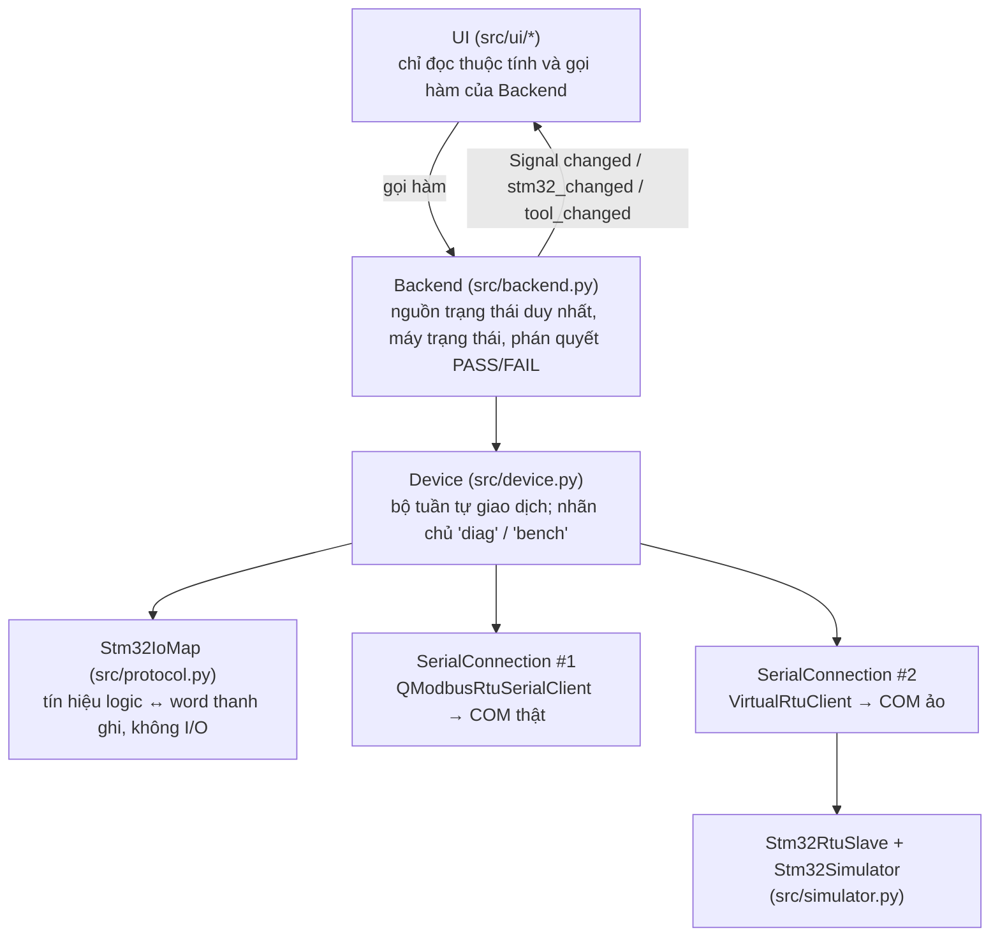
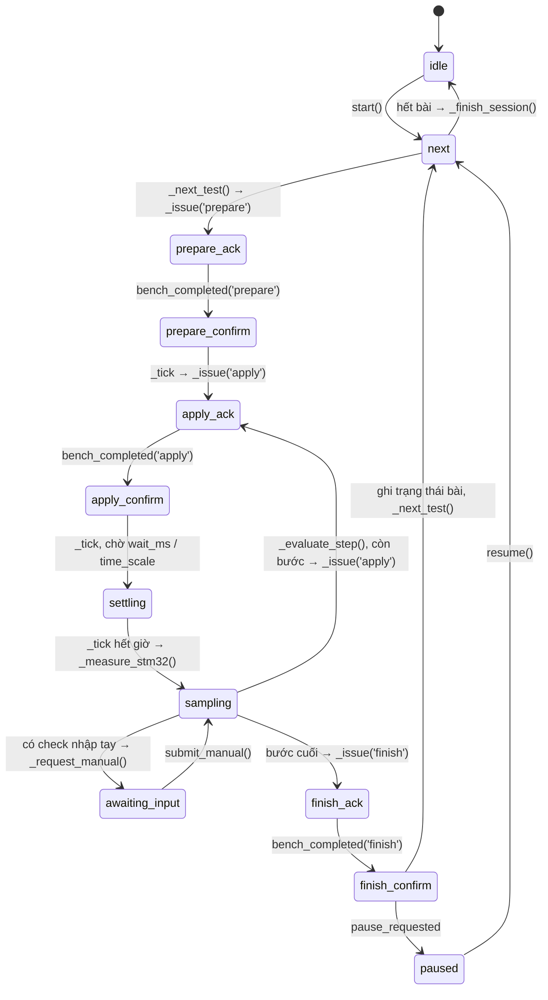
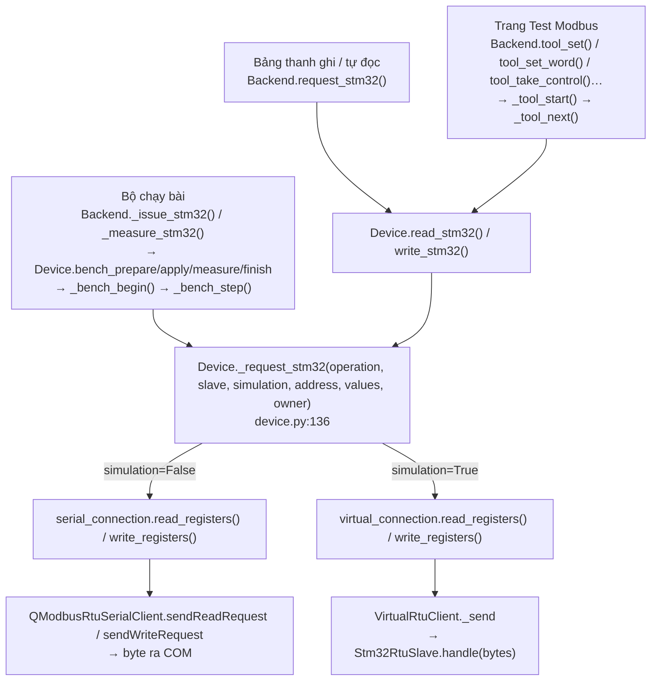
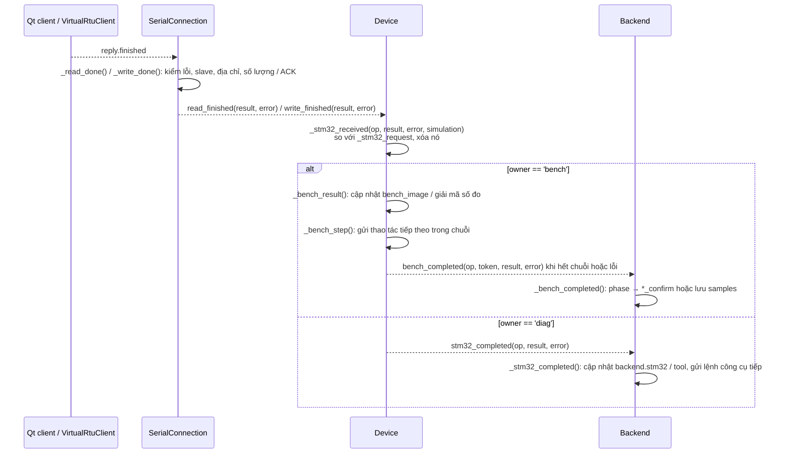

# Luồng code của project và luồng truyền nhận Modbus

Tài liệu này dành cho người muốn tự đọc, sửa và tùy biến phần mềm. Nó trả lời ba câu hỏi:

1. Khi chạy chương trình, đối tượng nào được tạo, ai gọi ai, dữ liệu đi qua đâu (phần A).
2. Một lệnh Modbus tới STM32 được gửi bởi hàm nào, phản hồi được nhận và xử lý bởi hàm nào (phần B).
3. Muốn đặt log, debug hoặc tự thêm khung truyền nhận thì sửa ở đâu (phần C).

Tài liệu không lặp lại các nội dung đã có ở nơi khác:

| Muốn biết | Đọc |
|---|---|
| Cấu trúc byte của khung FC03/06/16, bảng thanh ghi DO/DI, firmware CPU/bo con | [STM32_MODBUS_PC.md](STM32_MODBUS_PC.md) mục 2, 3, 9 |
| Quy tắc an toàn giao dịch (không retry, đóng COM khi timeout…) | [STM32_MODBUS_PC.md](STM32_MODBUS_PC.md) mục 5.1 |
| Schema các file JSON trong `configs/` | [CONFIGURATION.md](CONFIGURATION.md) |
| Quy tắc phát triển bắt buộc | [../AGENTS.md](../AGENTS.md) |

Số dòng trong tài liệu (ví dụ `backend.py:1156`) đúng tại ngày viết (2026-11-19); khi mã thay đổi, hãy tìm theo tên hàm.

---

# Phần A. Luồng code tổng của project

## A1. Bản đồ thư mục

```
main.py                     Điểm vào: nạp profile → Login → MainWindow
configs/a45/                Profile giá thử A45 (4 file JSON)
src/
  backend.py                Backend: trạng thái trung tâm + máy trạng thái chạy bài
  device.py                 Device: thao tác nghiệp vụ, bộ tuần tự giao dịch STM32
  communication.py          SerialConnection: sở hữu cổng COM, gửi/nhận Modbus RTU
                            Communication: hàng đợi của đường A45 v1 cũ (adapter mock)
  protocol.py               Codec thuần (không I/O): Stm32IoMap, CRC, PDU, giải mã
  virtual_port.py           COM ảo: VirtualRtuClient thay QModbusRtuSerialClient
  simulator.py              STM32 giả lập: Stm32Simulator, Stm32RtuSlave
  storage.py                Lưu phiên JSON (checkpoint) trong luồng phụ
  common/
    profiles.py             Nạp + kiểm tra profile
    stm32.py                Bản đồ thanh ghi CPUv1.0 / CPUv1.1 (CpuMap), Stm32RegisterBanks
    testing.py              Hằng số chung: timeout, Result, Sample, Profile, kịch bản
    serial.py               SerialSettings (cổng, baud, parity, timeout)
    models.py               SignalModel cho QML
    styles.py, config.py, monitor.py, wire.py
  ui/
    main_window.py          Cửa sổ chính, trang "Kiểm tra", điều hướng
    qml/SignalDashboard.qml Bảng tín hiệu
    widgets/
      connection_bar.py     Thanh kết nối (chọn mô phỏng / COM, mở / ngắt)
      modbus_test.py        Trang "Test Modbus" (điều khiển qua CPU, nhật ký khung)
      stm32_registers.py    Bảng hai mảng thanh ghi CPU
      manual_input.py       Hộp thoại nhập tay (ví dụ tần số đo bằng oxilo)
      login_page.py, navigation_stack.py, signal_monitor.py
tests/                      unittest + preview_*.py (xem giao diện không cần phần cứng)
```

## A2. Nguyên tắc phân tầng



Ba quy tắc cần giữ khi sửa:

- **UI không bao giờ chạm I/O.** Widget chỉ gọi `Backend.*` và vẽ lại khi nhận signal `changed`. Muốn thêm nút mới: thêm hàm vào `Backend`, widget gọi hàm đó.
- **Mô phỏng và COM thật đi chung một đường code.** Khác nhau duy nhất ở đối tượng client bên trong `SerialConnection` (Qt thật hoặc `VirtualRtuClient`). Đừng thêm nhánh `if simulation:` đi tắt trong `Device`.
- **Không rẽ nhánh theo tên giá thử / mã bài.** Mọi khác biệt giữa giá thử nằm trong `configs/<giá_thử>/*.json`.

## A3. Khởi động: từ `main.py` tới khi màn hình hiện ra

```mermaid
sequenceDiagram
    participant M as main.py
    participant P as profiles.load_profile
    participant L as LoginPage
    participant W as MainWindow
    participant B as Backend
    participant D as Device
    M->>P: load_profile(--profile, mặc định configs/a45/system.json)
    P-->>M: Profile(system, target, hardware, fixtures)  (đã validate)
    M->>L: LoginPage(authenticate=demo_authenticate).show()
    L-->>M: login_success(username)
    M->>W: ApplicationFlow.open_workspace → MainWindow(username, profile)
    W->>B: Backend(profile, username)
    B->>D: Device(profile)
    D->>D: tạo SerialConnection (COM thật), VirtualLine + SerialConnection (COM ảo),<br/>Stm32IoMap từ hardware.json → stm32_io, Stm32Simulator
    B->>B: nối signal của Device/SerialConnection; khởi động timer _tick 50 ms
    W->>W: _build_ui: ConnectionBar, trang Kiểm tra, ModbusTestPage…
```

Các mốc cần biết:

| Bước | Hàm | Ghi chú |
|---|---|---|
| Nạp profile | `load_profile()` `src/common/profiles.py:33` | Đọc `system.json`, rồi 3 file nó tham chiếu (`target_file`, `hardware_file`, `fixtures_file`). |
| Kiểm tra profile | `_validate_profile()` `profiles.py:54`, `_validate_stm32_io()` `profiles.py:194` | Lỗi → hộp thoại "Cấu hình không hợp lệ", chương trình thoát mã 2. Validator chạy thử mọi chuỗi thao tác của mọi bài. |
| Chọn bản đồ firmware | `cpu_map_for()` `src/common/stm32.py:189` | Theo `hardware.json → cpu_map` (A45 = `CPUv1.1`). |
| Tạo `Device` | `Device.__init__` `src/device.py:25` | Sở hữu hai `SerialConnection`, bộ giả lập và `io_map`. |
| Tạo `Backend` | `Backend.__init__` `src/backend.py:59` | Nối mọi signal; ba timer: `_tick` 50 ms (máy trạng thái), `_poll` 200 ms (chỉ đường A45 v1 cũ), `_monitor_timer` 100 ms (đồ thị demo). |

### Ai sở hữu ai

```
MainWindow
 └─ backend: Backend
     ├─ device: Device
     │   ├─ serial_connection: SerialConnection   (COM thật, QModbusRtuSerialClient)
     │   ├─ virtual_connection: SerialConnection  (COM ảo, VirtualRtuClient)
     │   ├─ virtual_line: VirtualLine → Stm32RtuSlave → stm32_simulator: Stm32Simulator
     │   ├─ io_map: Stm32IoMap            (từ hardware.json → stm32_io)
     │   ├─ cpu_map: CpuMap               (CPUv1.1 với A45)
     │   ├─ bench_image: {địa chỉ DO: word}  ảnh DO mà CPU đã ACK cho bộ chạy bài
     │   └─ communication: Communication  (chỉ đường A45 v1 cũ / adapter mock)
     ├─ stm32: Stm32RegisterBanks  (hai mảng hiển thị trên bảng thanh ghi)
     ├─ tool: dict                 (trạng thái trang Test Modbus: image, queue, log…)
     ├─ frame_log: deque(500)      (nhật ký khung TX/RX của cả hai cổng)
     ├─ samples: {tín hiệu: Sample} (số đo mới nhất, dùng để đánh giá)
     ├─ session: dict              (phiên đang chạy, được lưu bởi store)
     └─ store: SessionStore        (ghi JSON trong luồng phụ)
```

## A4. Profile JSON quyết định hành vi

| File | Đọc ở đâu trong code | Điều khiển |
|---|---|---|
| `system.json` | `Profile.system`, `Profile.signals`, `Profile.diagnostics` | Danh sách tín hiệu (id, nhãn, đơn vị, `stale_ms`), bài tự kiểm tra D01/D02, tín hiệu trạng thái. |
| `1101k.json` | `Profile.target`, `Profile.tests` | 24 bài: các bước (`actions`, `wait_ms`, `checks` với nominal/tolerance), `sequences` chuẩn bị/kết thúc, `dependencies`, `stop_on_fail`. |
| `hardware.json` | `Profile.hardware` → `Stm32IoMap` | `adapter`, `cpu_map`, `stm32_io`: slave, ánh xạ output (bit/pin), input (ADC/MUX/hệ số), `safe_state`, `break_ms`, `di_update_ms`, liên động. |
| `mock.json` | `Profile.fixtures` → `Stm32Simulator` | Số đo giả lập theo kích thích (`stm32_cases`), chu kỳ vòng lặp CPU giả lập (`stm32_timing.loop_ms`). |

Đổi giá trị trong JSON, chạy lại chương trình là có hiệu lực, không cần sửa Python. Chi tiết từng trường: [CONFIGURATION.md](CONFIGURATION.md).

## A5. Kết nối: hai đường

**Mô phỏng** (thanh kết nối chọn "Mô phỏng", bấm Kết nối):

```
ConnectionBar._toggle → Backend.connect_device()            backend.py:306
  → Device.bench_connect(token, simulation=True)             device.py:182
      → chuỗi 1 thao tác [('read', [])] → FC03 qua COM ảo
  ← Device.bench_completed('connect', token, result, '')
  → Backend._bench_completed → connection = "Sẵn sàng · MÔ PHỎNG"   backend.py:1065
```

**COM thật** (chọn cổng, Modbus RTU, bấm Kết nối):

```
ConnectionBar._toggle → Backend.connect_serial(SerialSettings)     backend.py:326
  → Device.open_serial → SerialConnection.open(settings)            communication.py:57
      tạo QModbusRtuSerialClient, đặt tham số, setNumberOfRetries(0), connectDevice()
  ← SerialConnection.status_changed('open')
  → Backend._serial_status('open')                                  backend.py:339
      → Device.bench_connect(token, simulation=False)   (chỉ FC03, không ghi gì)
  ← Backend._bench_completed('connect') → connection = "Sẵn sàng · COM THẬT"
```

Ngắt: `Backend.disconnect_device()` `backend.py:785`. Hàm này hủy chuỗi đang chạy, đóng cả hai cổng và xóa dữ liệu đọc. Nó không ghi trạng thái an toàn xuống CPU.

## A6. Máy trạng thái chạy bài (`Backend._tick`)

Bộ chạy bài **không dùng vòng lặp chặn**. `_tick()` (`backend.py:1156`) được gọi 50 ms một lần. Hàm xem `self.phase` hiện tại và quyết định bước tiếp theo. Mọi giao dịch Modbus đều bất đồng bộ: hàm gửi trả về ngay, kết quả về sau qua signal.



| Phase | Ai đặt | Ai chuyển tiếp |
|---|---|---|
| `next` | `start()`, `_skip()`, `resume()` | `_tick`: hết `wait_until` → `_next_test()` `backend.py:899` (kiểm phụ thuộc, BLOCKED, rồi `_issue('prepare')`) |
| `prepare_ack` / `apply_ack` / `finish_ack` | `_issue()` `backend.py:999` → `_issue_stm32()` `backend.py:1024` | `_bench_completed()` đặt `phase = op + '_confirm'` khi Device báo xong |
| `*_confirm` | `_bench_completed()` | `_tick` (xem bảng dưới) |
| `settling` | `_tick` sau `apply_confirm` | `_tick` hết `wait_ms` → `sampling` + `_measure_stm32()` `backend.py:1050` |
| `sampling` | `_tick` | Mọi `samples[...]` có timestamp ≥ `capture_after` → `_evaluate_step()` `backend.py:1258` |
| `awaiting_input` | `_request_manual()` | `submit_manual()` từ hộp thoại |
| `paused` | `_enter_pause()` | `resume()` |
| `idle` | `_finish_session()`, `_fatal()` | `start()` |

Cơ chế an toàn trong máy trạng thái:

- **Token:** mỗi lần `_issue()` tạo `self.token` mới, `self.bench_token` mới. Kết quả về mang token cũ thì bị bỏ (`_bench_completed`: `token != self.bench_token → return`).
- **Hạn chót:** `self.deadline` = 2,5 s + 0,5 s × số giao dịch. Ở phase `*_ack`/`*_confirm` quá hạn thì `_fatal()`.
- **`_fatal()`** `backend.py:1353`: hủy chuỗi, ghi ERROR, phiên chuyển `interrupted`. Hàm **không tự ghi an toàn** (vì không biết đường truyền còn tốt không).

Đánh giá: `evaluate(check, sample, now, stale_ms)` `backend.py:26` là hàm thuần. Nó nhận một check và một mẫu đo, trả `(status, reason)`. Muốn đổi cách tính PASS/FAIL thì sửa ở đây (có unit test bao quanh).

Lưu phiên: mỗi mốc gọi `_checkpoint()` → `SessionStore.save()` ghi JSON nguyên tử trong luồng phụ, vào thư mục `AppLocalDataLocation/sessions/simulation`. Trong mỗi attempt, `transactions` ghi lại các word đã ghi xuống CPU.

## A7. Giao diện cập nhật thế nào

- `Backend.changed` phát khi có bất cứ thay đổi gì. `MainWindow.refresh()` `main_window.py:517` đọc lại thuộc tính của backend và vẽ lại.
- `Backend.stm32_changed` → bảng thanh ghi. `Backend.tool_changed` → trang Test Modbus. `Backend.manual_input_changed` → mở/đóng hộp thoại nhập tay.
- Widget chỉ gọi `setText`/`setEnabled` khi giá trị thực sự đổi. Làm vậy để giao diện không nháy khi tự đọc 500 ms.

Muốn thêm một ô hiển thị: đọc thuộc tính backend trong `refresh()` của widget. Đừng tự giữ bản sao trạng thái trong widget.

---

# Phần B. Luồng dữ liệu Modbus với STM32 (hàm truyền, hàm nhận)

## B1. Các lớp tham gia và vai trò

| Lớp (file) | Vai trò trong một giao dịch |
|---|---|
| `Backend` (`backend.py`) | Người khởi tạo yêu cầu: đọc chẩn đoán, công cụ Test Modbus, bộ chạy bài. Kiểm quyền (`check_cpu_slave`, bận/rảnh). Nhận kết quả cuối, cập nhật trạng thái hiển thị. |
| `Device` (`device.py`) | Bộ tuần tự: **một giao dịch tại một thời điểm**. Gắn nhãn chủ `owner='diag'` hoặc `'bench'` cho mỗi giao dịch. Chạy chuỗi thao tác của bộ chạy bài (`_bench_step`). |
| `Stm32IoMap` (`protocol.py`) | Dịch "đặt tín hiệu X = giá trị" thành word thanh ghi, tách thành các lệnh ghi liên tiếp, giải mã word đọc được thành giá trị vật lý. Không I/O. |
| `SerialConnection` (`communication.py`) | Sở hữu cổng: gửi FC03/06/16 qua client Qt, kiểm tra phản hồi, timeout, đóng cổng khi lỗi mơ hồ. Phát `frame_logged`. |
| `QModbusRtuSerialClient` (Qt) | Đóng khung RTU (slave + PDU + CRC), ghi byte ra `QSerialPort`, ghép byte nhận, kiểm CRC, báo `reply.finished`. |
| `VirtualRtuClient` (`virtual_port.py`) | Thay Qt client khi mô phỏng: tự tạo byte RTU, giả thời gian truyền 115200 baud, đưa cho `Stm32RtuSlave`. |

## B2. Đường truyền (TX): từ nút bấm tới dây RS485

Có ba nơi khởi tạo giao dịch. Cả ba đều hội tụ ở **`Device._request_stm32()`**:



### `Device._request_stm32()` (`device.py:136`): điểm hội tụ

```python
def _request_stm32(self, operation, slave, simulation, address=1, values=None, owner='diag'):
    count = self.cpu_map.read_count - 1          # A45 / CPUv1.1: 42 word (DI 1–42)
    if self._stm32_request is not None:
        raise ValueError('Đang chờ giao dịch STM32.')   # chỉ 1 giao dịch đang bay
    link = self.virtual_connection if simulation else self.serial_connection
    ...
    self._stm32_request = dict(operation=..., slave=..., simulation=..., address=..., values=..., owner=owner)
    if operation == 'read':
        link.read_registers(slave, 3, 1, count)  # luôn đọc cả mảng DI từ địa chỉ 1
    else:
        link.write_registers(slave, address, values)
```

- `self._stm32_request` là "giao dịch đang bay". Nó dùng để biết phản hồi về thuộc ai (`owner`).
- **Đọc luôn là FC03, địa chỉ 1, số lượng = `read_count - 1`.** Muốn đọc vùng khác thì sửa ở đây (xem C4).

### `SerialConnection.read_registers()` (`communication.py:258`)

1. `make_read_unit()` kiểm slave 1–247, địa chỉ, số lượng 1–125, FC 3/4. Kết quả là `QModbusDataUnit`.
2. Từ chối nếu cổng chưa mở hoặc còn giao dịch (`self.reply is not None`).
3. Lưu `self._request = {slave, function, address, count}` để đối chiếu khi phản hồi về.
4. `reply = client.sendReadRequest(unit, slave)`. Qt tự đóng khung và CRC, rồi ghi ra cổng.
5. Phát `frame_logged('TX', rtu_adu(...))`. Khung này **được dựng lại** từ PDU + CRC tính lại; Qt không cho lấy byte thô.
6. `reply.finished.connect(lambda: self._read_done(client, reply))`.
7. Bật `self.deadline` = `timeout_ms + 1000`. Đây là chốt chặn phòng khi Qt không bao giờ báo xong.

### `SerialConnection.write_registers()` (`communication.py:321`)

Giống đọc, khác ở chỗ:

- 1 word → **FC06**; nhiều word → **FC16**. Qt tự chọn; code ghi lại `function` để kiểm ACK.
- Tối đa 123 thanh ghi mỗi khung.
- Gọi `client.sendWriteRequest(QModbusDataUnit(HoldingRegisters, address, values), slave)`.

## B3. Đường nhận (RX): từ byte về tới kết quả hiển thị



### `SerialConnection._read_done()` (`communication.py:283`)

Mỗi nhánh dẫn tới một kết quả:

| Trường hợp | Kết quả |
|---|---|
| `reply.error() == NoError`, slave/loại/địa chỉ/số lượng khớp `self._request` | `result = {slave, function, address, count, values: [uint16…], timestamp}`; phát `frame_logged('RX', …)`; `read_finished(result, '')` |
| Khớp sai (Qt trả về vùng khác) | `read_finished(None, 'Phản hồi không khớp…')` |
| `ProtocolError` (CPU trả exception, ví dụ 02 = địa chỉ ngoài mảng) | Log khung exception `slave, FC|0x80, code`; `read_finished(None, 'Lỗi Modbus exception N…')`, cổng **vẫn mở** |
| `TimeoutError` hoặc `InvalidResponseError` | `_fail()`: **đóng COM**, `status_changed('error')`, `read_finished(None, …)`. Lý do: RTU không có mã giao dịch, phản hồi trễ có thể bị nhận nhầm cho lệnh sau. |

### `SerialConnection._write_done()` (`communication.py:350`)

- ACK hợp lệ phải qua `validate_write_ack(reply.rawResult(), address, values)` `protocol.py:393`. FC06 so echo địa chỉ + giá trị; FC16 so địa chỉ + số lượng. Phải dùng `rawResult()` vì `reply.result()` của Qt không hợp lệ với lệnh ghi.
- Exception Modbus → `write_finished(None, 'Modbus exception N…')`, cổng vẫn mở.
- Lỗi khác (timeout, ACK sai) → `_fail()` đóng cổng: "chưa biết lệnh đã thực thi hay chưa; không tự gửi lại".
- Thành công → `write_finished({slave, function, address, values, timestamp}, '')`.

### `Device._stm32_received()` (`device.py:159`)

```python
pending = self._stm32_request
if pending is None or pending['operation'] != operation or pending['simulation'] != simulation:
    return                      # phản hồi không thuộc giao dịch đang chờ: bỏ
self._stm32_request = None
if pending['owner'] == 'bench':
    self._bench_result(pending, result, error)
else:
    self.stm32_completed.emit(operation, result, error)
```

Hàm được nối vào **cả hai cổng** trong `Device.__init__`, với tham số `sim` cố định cho từng cổng. Nhờ vậy phản hồi từ COM ảo không bị nhầm với COM thật.

### `Device._bench_result()` (`device.py:336`): nhận trong bộ chạy bài

- **Lỗi** → `_forget_write()` xóa các địa chỉ vừa ghi khỏi `bench_image` (không biết CPU đã nhận chưa), rồi `_bench_fail()` → `bench_completed(op, token, None, error)`.
- **Ghi OK** → `_last_write_ack = time.monotonic()` (mốc cho thời gian chờ `after_ack`), cập nhật `bench_image`, lưu vào `seq['writes']`.
- **Đọc OK** → `words = [0] + values` (chèn index 0 cho khớp chỉ số mảng firmware), rồi:
  - Đang đo chu kỳ (D02, `pending_probe`): so ADC0–4 với lần trước, ghi thời điểm đổi.
  - Đọc đo thường: `seq['values'][sid] = io_map.decode(words, sid)` cho từng tín hiệu trong nhóm MUX.
  - Phát `stm32_snapshot` để bảng thanh ghi hiển thị mảng DI vừa đọc.
- Cuối cùng gọi `_bench_step()` để chạy thao tác tiếp theo.

### `Backend._stm32_completed()` (`backend.py:667`): nhận ở đường chẩn đoán / công cụ

- Đọc OK → kiểm đủ `read_count - 1` word, `decode_stm32()`, ghi vào `backend.stm32.mod_buf_to_read`, `read_valid = True`.
- Ghi OK → `backend.stm32.last_ack = result`.
- Lỗi → `backend.stm32.invalidate()`.
- Lệnh này thuộc công cụ Test Modbus → `_tool_completed()`: cập nhật `tool['image']`, rồi `_tool_next()` gửi lệnh kế. Gặp lỗi thì xóa hàng đợi, `tool['image'] = None` (trạng thái chưa biết).
- Có lệnh công cụ đang xếp sau một lần tự đọc nền → `_tool_next()`.

## B4. Bộ tuần tự của bộ chạy bài: các loại thao tác

`Device.bench_*` không gửi ngay. Chúng dựng một **danh sách thao tác** (`deque`), rồi `_bench_step()` `device.py:247` lấy từng thao tác ra chạy:

| Thao tác | Ý nghĩa | Ai tạo |
|---|---|---|
| `('read', [sid…])` | FC03 cả mảng DI, rồi giải mã các tín hiệu trong danh sách | `bench_connect`, `bench_prepare`, `bench_measure` |
| `('image', ảnh_đích, full)` | Đưa DO tới `ảnh_đích`. Khi chạy, nó **nở ra** thành các `write` (và `after_ack` nếu phải ngắt trước rồi mới đóng). `full=True`: không biết trạng thái cũ, ghi lại mọi thanh ghi. | `bench_prepare`, `bench_apply`, `bench_finish` |
| `('mux', word)` | Đổi riêng thanh ghi MUX (nở thành `image`) | `bench_measure` |
| `('write', address, words)` | Một giao dịch FC06/FC16 | sinh ra từ `image` |
| `('after_ack', ms)` | Chờ tới khi đã qua `ms` kể từ ACK ghi cuối | `image` (giữa hai pha), `bench_measure` (`di_update_ms + mux_settle_ms`) |
| `('wait', ms)` | Chờ cố định | dự phòng |
| `('probe', sid)` | D02: đọc FC03 liên tục trong `duration_ms` để ước lượng chu kỳ CPU | `bench_measure` |

Cách một `image` nở ra (trong `_bench_step`):

```python
previous = None if full else self.bench_image
for index, image in enumerate(io.phases(previous, target)):   # [ảnh_nhả, ảnh_đích] hoặc [ảnh_đích]
    if index:
        expanded.append(('after_ack', io.break_ms))           # ngắt trước, chờ CPU chạy xong, rồi đóng
    expanded += [('write', addr, words) for addr, words in io.writes(previous, image)]
    previous = image
```

- `Stm32IoMap.writes(old, new)` `protocol.py:261`: chỉ lấy các word **khác** `old` và gộp các địa chỉ liền nhau thành một khung FC16.
- `Stm32IoMap.phases(old, new)` `protocol.py:276`: nếu bước này vừa nhả vừa đóng rơ-le thì tách thành hai pha.

## B5. Ví dụ trọn vẹn: một bước đo

Ví dụ dùng đúng profile A45 hiện tại: một bước có action `{"signal": "dc_27v", "value": 1}` (rơ-le +27 V = `Power` bit 2, DO index 12), rồi đo `xp1_50` (MUX1 kênh 8 → `ADC3_val`, hệ số 0,01).

```
Backend._issue('apply') → _issue_stm32('apply'):
  Device.bench_apply(token, actions)                         device.py:195
    io.apply(bench_image, actions)  → ảnh đích: {…, 12: 0x0004, …}
    deque = [('image', đích, False)]
  _bench_step → nở: [('write', 12, [4])]   (io.writes chỉ lấy word đổi; 1 word → FC06; 1 pha vì chỉ đóng)
    _request_stm32('write', 11, sim, 12, [4], owner='bench')
      SerialConnection.write_registers → TX 0B 06 00 0C 00 04 CRC
      … RX 0B 06 00 0C 00 04 CRC (echo) → _write_done → write_finished
    _stm32_received → _bench_result: bench_image[12] = 4, _last_write_ack = now → _bench_step
  hết thao tác → bench_completed('apply', token, {...}, '')
Backend._bench_completed → phase 'apply_confirm', confirmed = token
_tick → settling (chờ wait_ms của bước) → sampling → _measure_stm32()
  Device.bench_measure(token2, ['xp1_50'])                   device.py:202
    io.groups → [(0x1F08, ['xp1_50'])]   (byte thấp = kênh 8 của MUX1, byte cao = 31 = MUX2 nghỉ)
    deque = [('mux', 0x1F08), ('after_ack', di_update_ms + mux_settle_ms), ('read', ['xp1_50'])]
  _bench_step: mux → image → write DO 11 = 0x1F08 (FC06) → ACK
               after_ack → QTimer chờ → read → FC03 42 word
  _bench_result: words = [0] + values
                 values['xp1_50'] = io.decode(words, 'xp1_50') = int16(words[ADC3_val]) × 0.01
  bench_completed('measure') → Backend._store_bench_samples → samples['xp1_50'] = Sample(…)
_tick (sampling): mọi mẫu đã mới → _evaluate_step → evaluate() → PASS/FAIL
```

## B6. COM ảo: phía "bên kia dây"

```
SerialConnection.read_registers/write_registers
  → VirtualRtuClient.sendReadRequest / sendWriteRequest      virtual_port.py:144
      → _send(): request = rtu_adu(slave, pdu)  (byte RTU thật, có CRC)
         QTimer: thời gian truyền = số byte × 10/115200 s + 1,75 ms
  → _arrive(): VirtualLine.fault() (timeout / rút cáp theo kịch bản)
      → Stm32RtuSlave.handle(request_bytes)                 simulator.py:186
          split_rtu_adu (kiểm CRC) → FC03: Stm32Simulator.read_holding
                                   → FC06/16: Stm32Simulator.write (vào mod_buf_to_write)
          → byte phản hồi (hoặc None = im lặng)
  → _deliver(): parse byte như Qt (CRC, slave, FC, exception) → reply._finish → reply.finished
```

`Stm32Simulator` mô phỏng vòng lặp CPU (`loop_ms`): lệnh ghi chỉ có hiệu lực ở đầu vòng sau, DI phản ánh vòng đã chạy xong. Số đo lấy theo kích thích đọc ngược từ DO (`io_map.inverse`) và bảng `mock.json → stm32_cases`.

## B7. Mã hóa / giải mã: các hàm thuần trong `protocol.py`

| Hàm | Làm gì |
|---|---|
| `register_words(values)` | Kiểm mỗi giá trị là int 0–65535 |
| `encode_int16` / `decode_int16` | Số có dấu ↔ word (ADC, DAC_val) |
| `stm32_write_words(address, values, limit)` | Kiểm vùng ghi 1…limit−1 (index 0 dành riêng) |
| `make_read_unit(slave, fc, address, count)` | Tạo `QModbusDataUnit` có kiểm giới hạn |
| `rtu_request_pdu(fc, address, values, count)` | Dựng PDU FC03/04/06/16 |
| `rtu_adu(slave, pdu)` / `split_rtu_adu(raw)` | Thêm / tách slave + CRC16 |
| `crc16_modbus(data)` | CRC Modbus (đa thức 0xA001, khởi tạo 0xFFFF) |
| `validate_write_ack(response, address, values)` | Kiểm echo của FC06/FC16 |
| `decode_stm32(words, cpu_map)` | Giải mã cả mảng DI để hiển thị |
| `Stm32IoMap.apply / writes / phases` | Tín hiệu → ảnh DO → danh sách lệnh ghi |
| `Stm32IoMap.groups / mux_word / decode` | Tín hiệu đo → nhóm theo kênh MUX → giá trị vật lý |

Các hàm này không có I/O nên test được độc lập. Muốn hiểu một ánh xạ, gọi thử chúng trong Python với profile thật (xem C3).

## B8. Hằng số thời gian liên quan

| Hằng số | Ở đâu | Ý nghĩa |
|---|---|---|
| `TRANSACTION_TIMEOUT_MS = 1000` | `common/testing.py` | Timeout Qt cho COM ảo; COM thật lấy `timeout_ms` trong Chi tiết kết nối |
| `timeout_ms + 1000` | `SerialConnection.deadline` | Chốt chặn nếu Qt không báo xong |
| `OPERATION_TIMEOUT_MS = 2500` (+0,5 s/giao dịch) | `Backend.deadline` | Hạn của mỗi chuỗi trong máy trạng thái |
| `break_ms` | `hardware.json → stm32_io` | Chờ giữa pha nhả và pha đóng rơ-le |
| `di_update_ms + mux_settle_ms` | `hardware.json → stm32_io` | Chờ từ ACK ghi cuối tới khi đọc DI |
| `READ_STALE_MS` | `common/stm32.py` | Hạn hiển thị của mảng DI trên bảng |

---

# Phần C. Đặt log, debug và tùy biến khung truyền nhận

## C1. Những gì đã có sẵn

1. **Nhật ký khung trên giao diện:** trang Test Modbus → tab "Nhật ký".
   - Hiển thị mọi khung TX/RX của cả COM thật và COM ảo, gồm cả khung của bộ chạy bài.
   - Có nút "Xuất nhật ký…" ra file `.txt`.
   - Nguồn dữ liệu: `SerialConnection.frame_logged` → `Backend._frame_logged()` `backend.py:402` → `backend.frame_log` (giữ 500 dòng).
   - **Lưu ý:** khung được **dựng lại** từ PDU và CRC tính lại, không phải byte thô trên dây. Timeout không có dòng RX. Khung có CRC sai bị Qt bỏ nên không hiện.
2. **Nhật ký thao tác của công cụ:** `backend.tool['log']` hiện trong cùng tab, ở đầu.
3. **Phiên JSON:** mỗi attempt có `transactions` (word đã ghi, thời điểm) và `measurements` (giá trị, chất lượng, lý do).

## C2. Xem byte thô thật trên COM (Qt logging)

`QModbusRtuSerialClient` có log nội bộ theo category `qt.modbus` và `qt.modbus.lowlevel`. Bật trước khi chạy:

```powershell
$env:QT_LOGGING_RULES = "qt.modbus*=true"
conda run -n qt_env python main.py
```

Log Qt in ra stderr của console. Nó chỉ có với **COM thật**, vì COM ảo không dùng client của Qt. Tên và định dạng dòng log tùy bản Qt; mục này chưa được kiểm trên mạch thật. Muốn gom log Qt vào cùng file với log Python, dùng `qInstallMessageHandler` (xem C3).

Với nhiễu, sai baud hay sai dây, cách chắc chắn nhất vẫn là một bộ chuyển USB-RS485 thứ hai cắm song song, chỉ nghe, mở bằng phần mềm terminal.

## C3. Thêm log bằng Python `logging` (đề xuất, chưa có trong mã)

Project hiện chưa dùng `logging`. Cách thêm ít xâm lấn nhất:

**Bước 1: cấu hình một lần trong `main.py`**, trước `QApplication`:

```python
import logging
from pathlib import Path
from PySide6.QtCore import qInstallMessageHandler

Path('logs').mkdir(exist_ok=True)
logging.basicConfig(
    filename='logs/modbus.log', level=logging.DEBUG, encoding='utf-8',
    format='%(asctime)s.%(msecs)03d %(name)-12s %(message)s', datefmt='%H:%M:%S')

def _qt_to_logging(mode, context, message):          # gom log Qt (C2) vào cùng file
    logging.getLogger(f'qt.{context.category}').debug(message)
qInstallMessageHandler(_qt_to_logging)
```

Thêm `logs/` vào `.gitignore` và dọn file log theo quy tắc trong AGENTS.md.

**Bước 2: đặt log ở các điểm then chốt.** Mỗi điểm một dòng `log.debug(...)`, với `log = logging.getLogger('modbus.xxx')` ở đầu file:

| Muốn thấy | Đặt log ở | Nội dung nên ghi |
|---|---|---|
| Mọi khung TX/RX (một chỗ cho cả hai cổng) | `Backend._frame_logged()` `backend.py:402` | `'SIM' if simulation else 'REAL'`, `direction`, `raw.hex(' ')` |
| Ai gửi, vì sao | `Device._request_stm32()` `device.py:136` | `owner`, `operation`, `slave`, `address`, `values`, `self._bench['operation']` nếu có |
| Kết quả từng giao dịch, kể cả lỗi | `Device._stm32_received()` `device.py:159` | `operation`, `error`, độ dài `result['values']` |
| Chuỗi thao tác bộ chạy bài | `Device._bench_step()` `device.py:247`, ngay sau `op = seq['ops'].popleft()` | `seq['operation']`, `op`. Thấy rõ `after_ack`, `image` nở ra thế nào |
| Ảnh DO sau mỗi ACK | `Device._bench_result()` nhánh ghi | `{hex(k): hex(v) for k, v in self.bench_image.items()}` |
| Giá trị giải mã | `Device._bench_result()` nhánh đọc, sau `io_map.decode` | `sid`, word thô, giá trị vật lý |
| Lỗi đóng cổng | `SerialConnection._fail()` `communication.py:385` | `detail`, `self._request` |
| Chuyển phase | `Backend._tick()` hoặc mỗi chỗ gán `self.phase` | phase cũ → mới, `test['id']`, `step_index` |
| Phía CPU giả lập nhận gì | `Stm32RtuSlave.handle()` `simulator.py:186` | `raw.hex(' ')` vào, byte trả ra |

Ví dụ một điểm log:

```python
# src/device.py
import logging
log = logging.getLogger('modbus.device')
...
def _request_stm32(self, operation, slave, simulation, address=1, values=None, owner='diag'):
    ...
    log.debug('%s %s %s slave=%d addr=%s values=%s stage=%s', 'SIM' if simulation else 'REAL',
              owner, operation, slave, address, values, self._bench and self._bench['operation'])
```

Ghi log dùng `%s` lazy như trên để không tốn chi phí khi tắt mức DEBUG. Không log trong vòng lặp `_tick` 50 ms trừ khi phase đổi, nếu không file log sẽ phình rất nhanh.

## C4. Debug không cần giao diện: script nhỏ

Script dưới đây đã được chạy thử trên COM ảo (2026-11-19). Nó ghi Mode=1 rồi đọc mảng DI và in khung TX/RX:

```python
"""Ghi Mode=1 rồi đọc DI của CPU giả lập qua COM ảo, in khung TX/RX."""
import sys
from PySide6.QtCore import QCoreApplication
from src.common.profiles import load_profile
from src.device import Device

app = QCoreApplication(sys.argv)
dev = Device(load_profile())
cpu = dev.io_map.slave                       # 11 với profile A45
link = dev.virtual_connection                # đổi thành dev.serial_connection cho COM thật
link.frame_logged.connect(lambda d, raw: print(d, bytes(raw).hex(' ').upper()))


def completed(operation, result, error):
    if error:
        print(operation, 'LỖI:', error)
        app.quit()
    elif operation == 'write':
        print('ACK ghi', result['address'], result['values'])
        dev.read_stm32(cpu, simulation=True)        # bước 2: FC03
    else:
        print('DI[1..12] =', result['values'][:12])
        app.quit()


dev.stm32_completed.connect(completed)
dev.write_stm32(dev.cpu_map.write_index('Mode'), [1], cpu, simulation=True)   # bước 1: FC06
app.exec()
```

Chạy (lưu script ngoài project, ví dụ `D:\tmp\probe.py`):

```powershell
$env:PYTHONPATH = "."; $env:PYTHONIOENCODING = "utf-8"
conda run -n qt_env python -B D:\tmp\probe.py
```

Kết quả thực tế:

```
TX 0B 06 00 01 00 01 19 60          ← slave 11, FC06, địa chỉ 1 (Mode), giá trị 1, CRC
RX 0B 06 00 01 00 01 19 60          ← ACK = echo
ACK ghi 1 [1]
TX 0B 03 00 01 00 2A 95 7F          ← FC03, từ địa chỉ 1, 0x2A = 42 word
RX 0B 03 54 00 00 … 88 34           ← 0x54 = 84 byte dữ liệu
DI[1..12] = [0, 0, 0, 0, 0, 0, 1234, 64969, 2401, 1200, 330, 16854]
```

Để dùng script với COM thật:

1. Gọi `dev.open_serial(SerialSettings('rtu', 'COM5', 115200))`.
2. Chờ `dev.serial_connection.status_changed` báo `'open'`, rồi mới gửi.
3. Đổi `simulation=False`.

Hỏi trước khi chạy với mạch thật: lệnh ghi sẽ thực sự đóng/ngắt rơ-le.

Thử nhanh ánh xạ, không I/O:

```python
from src.common.profiles import load_profile
from src.device import Device          # hoặc dựng Stm32IoMap trực tiếp
io = Device(load_profile()).io_map
img = io.apply(io.safe_image(), [{'signal': 'dc_27v', 'value': 1}])
print(io.writes(io.safe_image(), img))       # [(12, [4])]: ghi Power (DO 12) = bit 2
print(len(io.phases(io.safe_image(), img)))  # 1 pha (chỉ đóng, không cần ngắt trước)
print(io.groups(['xp1_50']))                 # [(7944, ['xp1_50'])]: MUX = 0x1F08
```

Kết quả trên là output thật với profile A45. Tên tín hiệu lấy từ `system.json → signals`. Giá trị action phải khớp `on_value` / `levels` trong `hardware.json`; giá trị khác bị `apply()` từ chối.

Ngoài ra, chọn kịch bản lỗi (timeout, disconnect, slow…) ở trang Kiểm tra để xem phần mềm phản ứng với lỗi đường truyền trên COM ảo. Mỗi file trong `tests/` cũng là ví dụ gọi trực tiếp các hàm trên.

## C5. Tùy biến khung truyền nhận

### C5.1. Đổi vùng đọc (địa chỉ / số lượng / FC04)

Hiện mọi lần đọc là FC03, từ địa chỉ 1, số lượng `read_count - 1`. Giá trị này cố định trong `Device._request_stm32()` (`link.read_registers(slave, 3, 1, count)`). Muốn đọc vùng khác:

1. Thêm tham số `function`, `address`, `count` vào `_request_stm32`, `read_stm32`, và lưu chúng trong `self._stm32_request`.
2. Sửa các nơi kiểm "đủ mảng DI", vì chúng đang ép `address == 1` và đủ độ dài:
   - `Device._bench_result()`;
   - `Backend._stm32_completed()`.
3. `SerialConnection.read_registers()` đã hỗ trợ sẵn FC03/FC04, địa chỉ và số lượng tùy ý.
4. Phía giả lập: `Stm32RtuSlave.handle()` chỉ trả FC03 (các FC khác trả exception 01). Thêm nhánh `function == 4` nếu dùng FC04.

### C5.2. Đổi cách ghi (luôn FC16, gom nhiều thanh ghi…)

- Qt tự chọn FC06 cho 1 word, FC16 cho nhiều word. Muốn **luôn FC16** cho cả 1 word thì dùng request thô (C5.3) với FC 0x10.
- Muốn gom hay tách khung: sửa `Stm32IoMap.writes()`. Hàm này quyết định các địa chỉ liền nhau được gộp thành một khung. Nhớ giữ giới hạn 123 word mỗi khung của chuẩn Modbus, đồng thời không vượt kích thước mảng DO của firmware (xem [STM32_MODBUS_PC.md](STM32_MODBUS_PC.md) mục 3.1 và 9.6).

### C5.3. Thêm mã hàm mới (FC17, FC23, khung tự định nghĩa)

`QModbusClient` có `sendRawRequest(QModbusRequest, server)` để gửi PDU tùy ý. Khung sườn gợi ý:

```python
# src/communication.py — trong SerialConnection
from PySide6.QtSerialBus import QModbusRequest, QModbusPdu
from PySide6.QtCore import QByteArray

raw_finished = Signal(object, str)        # (dict | None, lỗi)

def raw_request(self, slave, function, data: bytes):
    if self.state != 'open' or not self.client or self.settings.adapter != 'rtu':
        raise ValueError('Hãy mở kết nối Modbus RTU trước.')
    if self.reply is not None or self._wire is not None:
        raise ValueError('Đang chờ phản hồi giao dịch trước.')
    client = self.client
    self._request = dict(slave=slave, function=function, data=data)
    request = QModbusRequest(QModbusPdu.FunctionCode(function), QByteArray(data))
    reply = client.sendRawRequest(request, slave)
    if reply is None:
        self._request = None
        self.raw_finished.emit(None, client.errorString())
        return
    self.reply = reply
    self.frame_logged.emit('TX', rtu_adu(slave, bytes([function]) + data))
    reply.finished.connect(lambda: self._raw_done(client, reply))
    self.deadline.start(self.settings.timeout_ms + 1000)

def _raw_done(self, client, reply):
    if self.client is not client or self.reply is not reply:
        return
    self.deadline.stop()
    request, self._request, self.reply = self._request, None, None
    error = reply.error()
    raw = reply.rawResult()
    if error == QModbusDevice.NoError:
        pdu = bytes([raw.functionCode().value]) + bytes(raw.data())
        self.frame_logged.emit('RX', rtu_adu(request['slave'], pdu))
        result, message = dict(request, response=pdu, timestamp=time.monotonic()), ''
    else:
        result, message = None, reply.errorString()
    reply.deleteLater()
    if error in (QModbusDevice.TimeoutError, QModbusDevice.InvalidResponseError):
        self._fail(message + ' Đã đóng COM.')     # giữ quy tắc: phản hồi mơ hồ → đóng cổng
    self.raw_finished.emit(result, message)
```

Đây là khung sườn chưa chạy thử. Khi dùng phải làm thêm bốn việc:

1. **Qt phải biết độ dài phản hồi** của mã hàm lạ, nếu không nó sẽ không biết khi nào khung kết thúc. Với FC chuẩn (17, 23…) Qt đã biết. Với FC tự định nghĩa, xem `QModbusResponse.registerDataSizeCalculator` trong tài liệu Qt.
2. **COM ảo:** thêm `sendRawRequest` vào `VirtualRtuClient` (dựng `rtu_adu(server, bytes([fc]) + data)` rồi đi qua `_send`). Thêm nhánh mã hàm đó vào `Stm32RtuSlave.handle()`. Nếu không, mô phỏng và COM thật sẽ khác đường code.
3. **Device:** thêm `operation='raw'` trong `_request_stm32`, nối `raw_finished` của cả hai cổng vào `_stm32_received` như `read_finished`/`write_finished`.
4. **Firmware CPU** phải hỗ trợ mã hàm đó. Các mã CPU đang nhận được phân tích ở [STM32_MODBUS_PC.md](STM32_MODBUS_PC.md) mục 9.6; mã không hỗ trợ sẽ nhận exception 01.

### C5.4. Tự kiểm soát từng byte (bỏ Qt Modbus)

Trong `SerialConnection.open()`, `adapter='uart'` dùng `QSerialPort` thô. Đường A45 v1 cũ dùng adapter này qua `exchange_frame()` / `_receive_uart()` / `FrameStream`. Có thể dựng một client RTU riêng trên đó:

- gửi `rtu_adu(slave, pdu)`;
- gom byte nhận, nhận diện hết khung bằng khoảng lặng T3.5 (khoảng 1,75 ms ở 115200 baud) hoặc bằng độ dài dự kiến theo mã hàm;
- kiểm bằng `split_rtu_adu()`.

Cách này cho log byte thô thật, kể cả khung CRC sai, nhưng phải tự xử lý timeout và khoảng lặng. Chỉ nên làm khi thực sự cần, vì client Qt đã được kiểm chứng.

## C6. Checklist khi sửa phần truyền nhận

- [ ] Vẫn **một giao dịch tại một thời điểm** (`Device._stm32_request`, `SerialConnection.reply`).
- [ ] Không retry; timeout hoặc phản hồi sai thì đóng COM; lệnh ghi lỗi → trạng thái DO "chưa biết", không tự gửi lại.
- [ ] Mọi yêu cầu stm32 đi qua `Backend.check_cpu_slave()`: PC chỉ nói chuyện với CPU slave.
- [ ] ACK chỉ là biên nhận, không phải xác nhận đầu ra.
- [ ] COM ảo và COM thật vẫn đi chung `SerialConnection` / `Device`; nếu thêm tính năng client thì thêm cả vào `VirtualRtuClient` và `Stm32RtuSlave`.
- [ ] Chạy test: `conda run -n qt_env python -B -m unittest discover -s tests`. Các file liên quan nhất:
  - `test_serial_connection.py`
  - `test_virtual_port.py`
  - `test_stm32_modbus.py`
  - `test_stm32_bench.py`
  - `test_real_bench.py`
- [ ] Cập nhật `PROGRESS.md`. Nếu đổi giao thức, cập nhật [STM32_MODBUS_PC.md](STM32_MODBUS_PC.md).

## C7. "Muốn sửa X thì vào đâu"

| Muốn | Sửa ở |
|---|---|
| Thêm / đổi bài kiểm tra, dung sai, thời gian chờ | `configs/a45/1101k.json` |
| Đổi bit rơ-le, kênh MUX, hệ số ADC, slave ID | `configs/a45/hardware.json → stm32_io` |
| Đổi số đo giả lập | `configs/a45/mock.json` |
| Thêm thanh ghi firmware mới | `CpuMap` trong `src/common/stm32.py` (hoặc `extra_write_registers` trong profile) |
| Đổi cách tính PASS/FAIL | `evaluate()` trong `src/backend.py` |
| Đổi thứ tự các pha của một bài | `Backend._tick()`, `_issue_stm32()` |
| Đổi cách một bước được ghi xuống (ngắt trước đóng sau, thứ tự) | `Device.bench_*`, `Device._bench_step()`, `Stm32IoMap.phases/writes` |
| Đổi cách giải mã số đo | `Stm32IoMap.decode()` |
| Đổi timeout, baud mặc định | `src/common/testing.py`, `hardware.json → serial`, hộp Chi tiết kết nối |
| Thêm nút / ô trên trang Test Modbus | `src/ui/widgets/modbus_test.py` (gọi hàm `Backend.tool_*`) |
| Thêm hàm điều khiển cho nút đó | `Backend.tool_*` trong `src/backend.py` |
| Giao diện, màu, font | `assets/styles/*.qss` |
