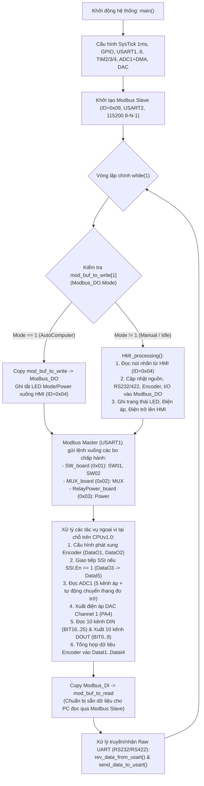

# Tài Liệu Phân Tích Luồng Code & Các Giao Thức Truyền Thông (Project CPUv1.0 - Mạch Giả Thử)

Tài liệu này phân tích chi tiết kiến trúc chương trình, luồng thực thi và toàn bộ các giao thức truyền thông của bo mạch **CPUv1.0** (`STM32F407VETx`), đặc biệt tập trung vào **khung truyền và bản đồ thanh ghi (Memory Map) của Modbus RTU Slave** để phục vụ việc viết phần mềm điều khiển trên máy tính (PC).

---

## 1. Tổng Quan Hệ Thống & Phần Cứng

* **Vi điều khiển trung tâm**: `STM32F407VETx` (sử dụng thư viện Standard Peripheral Driver `STM32F4xx_StdPeriph_Driver`).
* **Vai trò của bo mạch CPUv1.0**:
  Bo mạch đóng vai trò là bộ điều khiển trung tâm (Central Controller) của hệ thống **Mạch Giả Thử**. Mạch cho phép vận hành ở 2 chế độ:
  1. **`AutoComputer` (`Mode = 1`)**: Nhận lệnh điều khiển trực tiếp từ **Máy tính (PC)** qua giao thức **Modbus RTU Slave (`USART2`)**, thực thi việc đóng cắt nguồn/chuyển mạch/phát tín hiệu giả lập và thu thập dữ liệu đo lường gửi trả về máy tính.
  2. **Chế độ Mặt máy / Thủ công (`Mode != 1`, ví dụ `Idle = 0` hoặc `ManualHMI = 2`)**: Đọc nút nhấn và hiển thị trạng thái trực tiếp lên bảng điều khiển mặt máy (**HMI Board**) thông qua **Modbus RTU Master (`USART1`)**.

### Tổng hợp các giao thức có trên mạch

| STT | Giao thức / Chuẩn giao tiếp | Ngoại vi STM32 | Chân phần cứng (Pins) | Cấu hình | Vai trò & Đối tượng giao tiếp |
| :-- | :--- | :--- | :--- | :--- | :--- |
| **1** | **Modbus RTU Slave** | `USART2` + `TIM3` | `PD5` (Tx), `PD6` (Rx), `PD7` (RS485 DIR2) | `115200, 8-N-1`, Slave ID = **`0x09`** | Giao tiếp với **Máy tính (PC - Modbus Master)** qua chuẩn RS485 |
| **2** | **Modbus RTU Master** | `USART1` (`TIM4` không dùng thực tế) | `PA9` (Tx), `PA10` (Rx), `PA8` (RS485 DIR1) | `115200, 8-N-1`, Polling Blocking | Điều khiển 4 bo mạch phụ qua RS485: - `0x01`: Bo chuyển mạch (`SW_board`) - `0x02`: Bo đa hợp (`MUX_board`) - `0x03`: Bo rơ-le nguồn (`RelayPower_board`) - `0x04`: Bo mặt máy (`HMI_board`) |
| **3** | **Raw UART (RS232 / RS422)** | `UART5` `UART4` `USART3` `USART6` | `PC12` (Tx), `PD2` (Rx) `PC10` (Tx), `PC11` (Rx) `PD8` (Tx), `PD9` (Rx) `PC6` (Tx), `PC7` (Rx) | `115200, 8-N-1` | Truyền/nhận chuỗi byte kiểm tra các kênh: - `RS232_1` (`UART5`) - `RS232_2` (`UART4`) - `RS232_4` (`USART3`) - `RS422_3` (`USART6`) |
| **4** | **SSI (Custom Bit-banged Serial)** | GPIO (dùng chung chân UART3/4/5) | `PC12` (`CLKBit`), `PC10` (`CLKByte`), `PD8` (`Dat`), `PD2` (`IDENT`) | Xung đồng bộ tạo bằng phần mềm | Phát 1 byte lệnh (`SSI.Data`) và đọc về 16-bit định danh (`SSI.Ident`) |
| **5** | **Encoder (Pha A, B, Z)** | GPIO + `SysTick` (Phát) GPIO + `TIM2` (Đọc) | **Phát**: `PA0` (A), `PA1` (B), `PA2` (Z) **Đọc**: `PE9` (A), `PE11` (B), `PE13` (Z) | Phát: nền 1ms Đọc: lấy mẫu 40kHz (25µs) | Phát xung vuông lệch pha 90° A/B/Z giả lập Encoder và đọc/lọc số xung Encoder phản hồi |

---

## 2. Phân Tích Luồng Thực Thi Code (Execution Flow)

### 2.1. Sơ đồ khối luồng hoạt động tổng thể

### 2.2. Hoạt động của các trình phục vụ ngắt (ISR) trong [`stm32f4xx_it.c`](file:///d:/project/2026_DT_AChinh/ref/ref_aTrung/Mach%20Gia%20Thu/Program/CPUv1.0/Src/stm32f4xx_it.c)

1. **`SysTick_Handler()` (Chu kỳ 1ms)**:
   * Giảm biến trễ `TimingDelay` và tăng bộ đếm thời gian `uwTick`.
   * Gọi hàm **`eMBPoll()`** của thư viện FreeModbus Slave để giải mã khung truyền nhận được từ máy tính và kích hoạt các hàm callback (`eMBRegHoldingCB`, `eMBRegInputCB`, `eMBRegCoilsCB`).
   * Gọi hàm **`Encoder_Output()`** để tạo xung vuông pha A, B, Z trên các chân GPIO nếu chức năng phát Encoder đang bật (`Encoder_out.En == 1`).
2. **`USART2_IRQHandler()` & `TIM3_IRQHandler()` (Dành cho Modbus RTU Slave - Giao tiếp PC)**:
   * Khi nhận từng byte trên `USART2`, `prvvUARTRxISR()` lưu byte vào buffer và reset bộ đếm `TIM3`.
   * Khi hết khoảng lặng `T3.5` (timer `TIM3` tràn), `prvvTIMERExpiredISR()` phát sự kiện `EV_FRAME_RECEIVED` để `eMBPoll()` xử lý gói tin.
   * Khi trả lời PC, chân `PD7` (`RS485_DIR2`) được kéo lên mức `1` (chế độ phát), gửi hết khung dữ liệu qua ngắt `TXE`, sau đó đợi cờ `TC` (Transmission Complete) rồi kéo `PD7` về mức `0` (chế độ nhận).
3. **`TIM2_IRQHandler()` (Chu kỳ 25µs - Tần số 40kHz)**:
   * Gọi hàm **`read_encoder()`** trong [`read_encoder.c`](file:///d:/project/2026_DT_AChinh/ref/ref_aTrung/Mach%20Gia%20Thu/Program/CPUv1.0/Src/read_encoder.c): Đọc trạng thái 3 pha A, B, Z đầu vào (`PE9`, `PE11`, `PE13`), lọc nhiễu bằng bộ đếm tích lũy (`CT_Low = 2`, `CT_High = 8`, `CT_MAX = 10`), phát hiện sườn xuống để đếm xung `ENCA_cnt`, `ENCB_cnt`, `encoder_count` (có xét chiều quay) và chốt số xung mỗi vòng `encoder_num_pulse` khi có xung Z.
4. **`USART3_IRQHandler()`, `UART4_IRQHandler()`, `UART5_IRQHandler()`, `USART6_IRQHandler()`**:
   * Khi có dữ liệu phản hồi trên bất kỳ cổng RS232/RS422 nào, ngắt `RXNE` sẽ lưu byte nhận được vào mảng chung `RevData[index_rev++]` (tối đa 20 bytes, quay vòng về 0 nếu vượt quá 20 bytes).

---

## 3. Phân Tích Giao Thức 1: Modbus RTU Slave (Giao Tiếp Với Máy Tính)

Đây là giao thức chính bạn cần sử dụng để viết phần mềm điều khiển trên máy tính (PC đóng vai trò **Modbus RTU Master**, mạch `CPUv1.0` đóng vai trò **Modbus RTU Slave**).

### 3.1. Thông số kết nối Vật lý & Cổng COM
* **Chuẩn giao tiếp**: RS485 (2 dây A/B, điều khiển hướng thu/phát tự động bởi MCU qua chân `PD7`).
* **Cấu hình Serial Port trên máy tính**:
  * **Baudrate**: `115200` bps
  * **Data bits**: `8` bits
  * **Parity**: `None` (`MB_PAR_NONE`)
  * **Stop bits**: `1` bit
* **Địa chỉ Slave (`SLAVE_ADDRESS`)**: **`0x09`** (9 hệ thập phân) — định nghĩa tại [`main.h`](file:///d:/project/2026_DT_AChinh/ref/ref_aTrung/Mach%20Gia%20Thu/Program/CPUv1.0/Inc/main.h#L32).

### 3.2. Đặc điểm QUAN TRỌNG về Địa chỉ Thanh ghi & Vùng nhớ (Memory Map)

Khi viết phần mềm trên máy tính, bạn cần lưu ý **3 cơ chế đặc thù** trong code [`mbfuncholding.c`](file:///d:/project/2026_DT_AChinh/ref/ref_aTrung/Mach%20Gia%20Thu/Program/CPUv1.0/MIddleware/Modbus_slave/functions/mbfuncholding.c) và [`port.c`](file:///d:/project/2026_DT_AChinh/ref/ref_aTrung/Mach%20Gia%20Thu/Program/CPUv1.0/MIddleware/FreeModbus/port/no_os/port.c):

1. **Cách ánh xạ địa chỉ (0-based Indexing trực tiếp)**:
   * Khi PC gửi địa chỉ bắt đầu `Starting Address` trong khung truyền Modbus (ví dụ `0x0001`), hàm xử lý trong [`mbfuncholding.c`](file:///d:/project/2026_DT_AChinh/ref/ref_aTrung/Mach%20Gia%20Thu/Program/CPUv1.0/MIddleware/Modbus_slave/functions/mbfuncholding.c#L87) sẽ cộng thêm 1 (`usRegAddress++` $\rightarrow$ `2`).
   * Sau đó trong hàm `eMBRegHoldingCB` ([`port.c`](file:///d:/project/2026_DT_AChinh/ref/ref_aTrung/Mach%20Gia%20Thu/Program/CPUv1.0/MIddleware/FreeModbus/port/no_os/port.c#L102)), chỉ số mảng được tính bằng:
     `iRegIndex = usAddress - usRegHoldingStart` (với `usRegHoldingStart = 1`).
   * **Kết quả**: Hiệu ứng `+1` và `-1` triệt tiêu nhau! **Giá trị `Starting Address` trên khung truyền Modbus chính là chỉ số mảng `iRegIndex` (`0, 1, 2, ...`)** trong `mod_buf_to_write[iRegIndex]` và `mod_buf_to_read[iRegIndex]`.
   * *Lưu ý*: Phần tử thứ `0` (`Null` tại địa chỉ `0x0000`) là thanh ghi đệm không dùng; các thanh ghi dữ liệu thực sự bắt đầu từ địa chỉ **`0x0001`** (`Mode`).

2. **Tách biệt hoàn toàn giữa Vùng nhớ ĐỌC và Vùng nhớ GHI**:
   * **Khi Máy tính GHI xuống mạch** (Function `0x06` hoặc `0x10`): Dữ liệu được ghi vào mảng **`mod_buf_to_write[]`** (cấu trúc `DataOutTypeDef Modbus_DO`, gồm **29 thanh ghi** từ địa chỉ `0x0000` đến `0x001C`).
   * **Khi Máy tính ĐỌC từ mạch về** (Function `0x03`): Dữ liệu được lấy từ mảng **`mod_buf_to_read[]`** (cấu trúc `DataINTypeDef Modbus_DI`, gồm **30 thanh ghi** từ địa chỉ `0x0000` đến `0x001D`).
   * Vì vậy, nếu bạn ghi một giá trị xuống địa chỉ `0x0007` (`DAC_val`) rồi đọc lại địa chỉ `0x0007`, bạn sẽ nhận được giá trị của `ADC0_val` (thuộc `Modbus_DI`) chứ không phải `DAC_val`!

3. **Điều kiện để mạch nhận lệnh điều khiển từ Máy tính**:
   * Trong vòng lặp `main()`, mạch luôn kiểm tra thanh ghi `mod_buf_to_write[1]` (địa chỉ Modbus **`0x0001`** - trường `Mode`).
   * **Bắt buộc phải ghi `Mode = 1` (`AutoComputer`) vào địa chỉ `0x0001`** thì mạch mới copy toàn bộ mảng `mod_buf_to_write` vào cấu trúc điều khiển `Modbus_DO` để thực thi! Nếu `mod_buf_to_write[1] != 1`, mạch sẽ chạy theo chế độ đọc nút nhấn từ mặt máy HMI (`HMI_processing()`).

---

### 3.3. Cấu trúc Khung Truyền (Frame Format) giữa Máy Tính và Mạch

Thứ tự byte của mọi thanh ghi 16-bit (Address, Quantity, Register Value) trong khung truyền Modbus RTU là **Big-Endian (Byte cao `Hi` truyền trước, Byte thấp `Lo` truyền sau)**. Riêng **2 byte CRC16** ở cuối khung truyền theo chuẩn Modbus là **Little-Endian (Byte thấp `CRC_Lo` truyền trước, Byte cao `CRC_Hi` truyền sau)** (đa thức `0xA001`, khởi tạo `0xFFFF`).

#### A. Đọc dữ liệu từ mạch về Máy tính — Function Code `0x03` (Read Holding Registers)

* **Khung truyền Máy tính gửi đi (Request - 8 bytes)**:

| Byte 0 | Byte 1 | Byte 2 | Byte 3 | Byte 4 | Byte 5 | Byte 6 | Byte 7 |
| :---: | :---: | :---: | :---: | :---: | :---: | :---: | :---: |
| **Slave ID** | **Func Code** | **Start Addr Hi** | **Start Addr Lo** | **Quantity Hi** | **Quantity Lo** | **CRC16 Lo** | **CRC16 Hi** |
| `0x09` | `0x03` | `Addr >> 8` | `Addr & 0xFF` | `0x00` | `N` (`1..125`) | `CRC_L` | `CRC_H` |

* **Khung truyền Mạch phản hồi về Máy tính (Response - `5 + 2*N` bytes)**:

| Byte 0 | Byte 1 | Byte 2 | Byte 3..4 | ... | Byte `3+2N-2 .. 3+2N-1` | Byte `3+2N` | Byte `4+2N` |
| :---: | :---: | :---: | :---: | :---: | :---: | :---: | :---: |
| **Slave ID** | **Func Code** | **Byte Count** | **Reg[Addr] Hi, Lo** | ... | **Reg[Addr+N-1] Hi, Lo** | **CRC16 Lo** | **CRC16 Hi** |
| `0x09` | `0x03` | `2 * N` | `mod_buf_to_read[Addr]` | ... | `mod_buf_to_read[Addr+N-1]` | `CRC_L` | `CRC_H` |

> **Ví dụ thực tế**: Máy tính đọc toàn bộ 29 thanh ghi dữ liệu hữu ích của `Modbus_DI` (từ địa chỉ `0x0001` đến `0x001D`, tức `N = 29 = 0x1D`):
> * **PC gửi (Hex)**: `09 03 00 01 00 1D D4 9B`
> * **Mạch trả về (Hex)**: `09 03 3A <58 bytes dữ liệu ứng với mod_buf_to_read[1..29]> <CRC_Lo> <CRC_Hi>`

---

#### B. Ghi 1 thanh ghi xuống mạch — Function Code `0x06` (Write Single Register)

* **Khung truyền Máy tính gửi đi (Request - 8 bytes)**:

| Byte 0 | Byte 1 | Byte 2 | Byte 3 | Byte 4 | Byte 5 | Byte 6 | Byte 7 |
| :---: | :---: | :---: | :---: | :---: | :---: | :---: | :---: |
| **Slave ID** | **Func Code** | **Reg Addr Hi** | **Reg Addr Lo** | **Value Hi** | **Value Lo** | **CRC16 Lo** | **CRC16 Hi** |
| `0x09` | `0x06` | `Addr >> 8` | `Addr & 0xFF` | `Val >> 8` | `Val & 0xFF` | `CRC_L` | `CRC_H` |

* **Khung truyền Mạch phản hồi (Response - 8 bytes)**: Giống hệt khung Request (Echo).

> **Ví dụ thực tế**: Máy tính chuyển mạch sang chế độ điều khiển bằng máy tính (`Mode = AutoComputer = 1` tại địa chỉ `0x0001`):
> * **PC gửi (Hex)**: `09 06 00 01 00 01 19 42`
> * **Mạch trả về (Hex)**: `09 06 00 01 00 01 19 42`

---

#### C. Ghi nhiều thanh ghi cùng lúc xuống mạch — Function Code `0x10` (Write Multiple Registers)

* **Khung truyền Máy tính gửi đi (Request - `9 + 2*N` bytes)**:

| Byte 0 | Byte 1 | Byte 2..3 | Byte 4..5 | Byte 6 | Byte 7..8 | ... | Byte `7+2N-2..7+2N-1` | Byte `7+2N` | Byte `8+2N` |
| :---: | :---: | :---: | :---: | :---: | :---: | :---: | :---: | :---: | :---: |
| **Slave ID** | **Func** | **Start Addr** | **Quantity (`N`)** | **Byte Count** | **Val[0] Hi, Lo** | ... | **Val[N-1] Hi, Lo** | **CRC Lo** | **CRC Hi** |
| `0x09` | `0x10` | `Addr Hi, Lo` | `0x00, N` | `2 * N` | Dữ liệu thanh ghi 1 | ... | Dữ liệu thanh ghi `N` | `CRC_L` | `CRC_H` |

* **Khung truyền Mạch phản hồi (Response - 8 bytes)**:

| Byte 0 | Byte 1 | Byte 2 | Byte 3 | Byte 4 | Byte 5 | Byte 6 | Byte 7 |
| :---: | :---: | :---: | :---: | :---: | :---: | :---: | :---: |
| `0x09` | `0x10` | `Start Addr Hi` | `Start Addr Lo` | `Quantity Hi` | `Quantity Lo` | `CRC16 Lo` | `CRC16 Hi` |

> **Ví dụ thực tế**: Máy tính ghi 28 thanh ghi điều khiển từ `0x0001` (`Mode`) đến `0x001C` (`DataT[9]`), số lượng `N = 28 = 0x1C`, Byte Count = `56 = 0x38`:
> * **PC gửi (Hex)**: `09 10 00 01 00 1C 38 <56 bytes dữ liệu> <CRC_Lo> <CRC_Hi>`
> * **Mạch trả về (Hex)**: `09 10 00 01 00 1C D5 6E`

*(Lưu ý: Mạch cũng hỗ trợ cả Function Code **`0x17`** - Read/Write Multiple Holding Registers nếu phần mềm PC muốn vừa ghi `mod_buf_to_write` vừa đọc `mod_buf_to_read` chỉ trong 1 lần truyền nhận).*

---

### 3.4. Bản Đồ Thanh Ghi GHI (`Modbus_DO` / `mod_buf_to_write` — Máy tính GHI xuống Mạch)

Định nghĩa trong [`System_Register.h`](file:///d:/project/2026_DT_AChinh/ref/ref_aTrung/Mach%20Gia%20Thu/Program/CPUv1.0/Inc/System_Register.h#L59-L92) (`DOsize = 29` thanh ghi 16-bit):

| Địa chỉ Modbus (Hex / Dec) | Tên trường trong `Modbus_DO` | Kiểu dữ liệu | Mô tả chi tiết chức năng & Định dạng Bit |
| :---: | :--- | :---: | :--- |
| `0x0000` (0) | `Null` | `uint16_t` | Thanh ghi đệm (Không sử dụng). |
| **`0x0001` (1)** | **`Mode`** | `uint16_t` | **Chế độ vận hành**: - `0` (`Idle`): Chờ / Điều khiển qua HMI - **`1` (`AutoComputer`)**: **Điều khiển từ Máy tính (Bắt buộc đặt = 1 khi điều khiển qua PC)** - `2` (`ManualHMI`): Điều khiển bằng tay trên mặt máy HMI |
| `0x0002` (2) | `Plan` | `uint16_t` | **Kế hoạch kiểm tra (`Plan_type`)**: - `0` (`SelfTest`): Gọi lại `GPIO_Configuration()` - `1` (`Test_EncoderPulse`): Gọi `Encoder_GPIO_Config()` - `2` (`Test`): Chế độ kiểm tra thường |
| `0x0003` (3) | `Block` | `uint16_t` | Mã khối chức năng (dự phòng/thông tin). |
| `0x0004` (4) | `Cabinet` | `uint16_t` | Loại tủ (`0`: `Single`, `1`: `Complex`). |
| `0x0005` (5) | `Status` | `uint16_t` | Trạng thái hệ thống. |
| `0x0006` (6) | `DisplayOut` | `uint16_t` | Dữ liệu hiển thị đầu ra. |
| **`0x0007` (7)** | **`DAC_val`** | `int16_t` | **Điều khiển điện áp ra DAC1 (`PA4`)**: Công thức phần cứng: $V_{\text{DAC}} = 1.62 - \left(\frac{\text{DAC\_val}}{1000.0}\right) \times 1.55\text{ (V)}$. Giới hạn phần cứng DAC 12-bit: $0\text{V} \le V_{\text{DAC}} \le 3.3\text{V}$ (tương ứng `DAC_val` khoảng từ `-1083` đến `+1045`). |
| **`0x0008` (8)** | **`DOUT`** | `uint16_t` | **Điều khiển 10 kênh Digital Output trực tiếp trên CPU (`Bit 0 .. Bit 9`)**: - `Bit 0`: `PE5` (`BIT0`) - `Bit 1`: `PE6` (`BIT1`) *(nếu `SSI.En=1` thì bị khóa cho `SSI_CLKBit`)* - `Bit 2`: `PC13` (`BIT2`) *(nếu `SSI.En=1` thì bị khóa cho `SSI_CLKByte`)* - `Bit 3`: `PC14` (`BIT3`) *(nếu `SSI.En=1` thì bị khóa cho `SSI_Dat`)* - `Bit 4`: `PC3` (`BIT4`) - `Bit 5`: `PA0` (`BIT5`) *(nếu `Encoder_out.En=1` thì dùng phát xung `ENC_A`)* - `Bit 6`: `PA1` (`BIT6`) *(nếu `Encoder_out.En=1` thì dùng phát xung `ENC_B`)* - `Bit 7`: `PA2` (`BIT7`) *(nếu `Encoder_out.En=1` thì dùng phát xung `ENC_Z`)* - `Bit 8`: `PA3` (`BIT8`) - `Bit 9`: `PA5` (`BIT9`) |
| **`0x0009` (9)** | **`SW01`** | `uint16_t` | **Thanh ghi chuyển mạch 1**: CPUv1.0 sẽ tự động gửi giá trị này xuống **Bo Switch (`ID = 0x01`, Reg `0x0000`)**. *(Trong code HMI: Bit 5, 6, 7 đóng cắt kênh OUT1/A, OUT2/B, OUT3/Z; Bit 12, 14 đóng cắt kênh IN1, IN2)*. |
| **`0x000A` (10)** | **`SW02`** | `uint16_t` | **Thanh ghi chuyển mạch 2**: CPUv1.0 tự động gửi xuống **Bo Switch (`ID = 0x01`, Reg `0x0001`)**. *(Trong code HMI: Bit 0 là IN3, Bit 12 là Vin1)*. |
| **`0x000B` (11)** | **`MUX`** | `uint16_t` | **Thanh ghi điều khiển đa hợp**: CPUv1.0 tự động gửi xuống **Bo MUX (`ID = 0x02`, Reg `0x0000`)**. *(Trong code HMI: Bit 1 đóng đường đo điện trở R+ mặt máy)*. |
| **`0x000C` (12)** | **`Power`** | `uint16_t` | **Thanh ghi điều khiển Rơ-le cấp nguồn**: CPUv1.0 tự động gửi xuống **Bo RelayPower (`ID = 0x03`, Reg `0x0000`)**. Ý nghĩa các bit: - `Bit 1`: Nguồn **24V** (`1` = Bật, `0` = Tắt) - `Bit 2`: Nguồn **12V** - `Bit 4`: Nguồn **5V** - `Bit 6`: Nguồn **3.3V** - `Bit 7`: Nguồn **VDD1** (cấp cho Encoder/Ngoại vi) - `Bit 8`: Nguồn **VDD2** - `Bit 9`: Nguồn **VDD3** |
| **`0x000D` (13)** | **`DataO1`** | `uint16_t` | **Cấu hình phát xung Encoder (Phần 1)**: - `Bit 15` (`En`): `1` = Bắt đầu phát xung, `0` = Tắt - `Bit 14` (`Dir`): Chiều quay (`1` = Thuận, `0` = Ngược) - `Bit 13..0` (`Period`): Chu kỳ xung tính bằng **ms** (chia làm 4 pha mỗi chu kỳ, nên chọn bội số của 4, ví dụ `4`, `8`, `12` ms). |
| **`0x000E` (14)** | **`DataO2`** | `uint16_t` | **Cấu hình phát xung Encoder (Phần 2 - `NumPulse`)**: Số lượng xung cần phát ra (`1 .. 65535`). *Lưu ý*: Ngay khi nhận lệnh (`En == 1` và `NumPulse != 0`), mạch sẽ nạp vào bộ phát và tự xóa `mod_buf_to_write[13]` & `[14]` về `0` để tránh phát lặp lại. Khi phát đủ `NumPulse` xung, mạch tự dừng. |
| **`0x000F` (15)** | **`DataO3`** | `uint16_t` | **Điều khiển giao thức SSI**: - `Bit 15` (`SSI.En`): `1` = Kích hoạt giao thức SSI (chuyển chân UART3/4/5 sang GPIO), `0` = Chế độ UART bình thường. - `Bit 7..0` (`SSI.Data`): Byte dữ liệu cần phát qua SSI (ví dụ: `0xF0` Red_right, `0xF1` Red_left, `0x0F` Red-green-left, `0x0E` Red-green-right). |
| `0x0010` (16) | `DataO4` | `uint16_t` | Dự phòng. |
| `0x0011` (17) | `DataO5` | `uint16_t` | Dự phòng. |
| **`0x0012` (18)** | **`CDT`** | `uint16_t` | **Từ điều khiển truyền dữ liệu nối tiếp RS232/RS422 (Control Data Transmit)**: - `Bit 15` (`0x8000`): Chọn cổng RS485 *(hiện để trống trong code)* - `Bit 14` (`0x4000`): Chọn cổng **RS422_3 (`USART6`)** - `Bit 13` (`0x2000`): Chọn cổng **RS232_4 (`USART3`)** - `Bit 12` (`0x1000`): Chọn cổng **RS232_1 (`UART5`)** - `Bit 11` (`0x0800`): Chọn cổng **RS232_2 (`UART4`)** - `Bit 8` (`0x0100`): **Enable** (`1` = Cho phép phát dữ liệu trong mỗi chu kỳ quét) - `Bit 7..0` (`0x00FF`): **`send_length`** — Số lượng byte cần gửi (tối đa `20` bytes). |
| **`0x0013` .. `0x001C`** (19 .. 28) | **`DataT[0]` .. `DataT[9]`** | `uint16_t[10]` | **Bộ đệm dữ liệu gửi qua RS232/RS422 (tối đa 20 bytes)**: Mỗi thanh ghi `DataT[i]` chứa 2 bytes theo thứ tự Little-Endian: - `SendData[2*i] = DataT[i] & 0xFF` (Byte thấp phát trước) - `SendData[2*i + 1] = (DataT[i] >> 8) & 0xFF` (Byte cao phát sau). |

---

### 3.5. Bản Đồ Thanh Ghi ĐỌC (`Modbus_DI` / `mod_buf_to_read` — Máy tính ĐỌC từ Mạch về)

Định nghĩa trong [`System_Register.h`](file:///d:/project/2026_DT_AChinh/ref/ref_aTrung/Mach%20Gia%20Thu/Program/CPUv1.0/Inc/System_Register.h#L95-L130) (`DIsize = 30` thanh ghi 16-bit):

| Địa chỉ Modbus (Hex / Dec) | Tên trường trong `Modbus_DI` | Kiểu dữ liệu | Mô tả chi tiết & Công thức giải mã trên Máy tính |
| :---: | :--- | :---: | :--- |
| `0x0000` (0) | `Null` | `uint16_t` | Thanh ghi đệm (`0`). |
| `0x0001` (1) | `Mode` | `uint16_t` | Trạng thái chế độ (hiện giữ bằng 0). |
| `0x0002` (2) | `Plan` | `uint16_t` | Kế hoạch hiện tại. |
| `0x0003` (3) | `Block` | `uint16_t` | Khối hiện tại. |
| `0x0004` (4) | `Cabinet` | `uint16_t` | Tủ hiện tại. |
| `0x0005` (5) | `Status` | `uint16_t` | Trạng thái. |
| `0x0006` (6) | `DisplayIN` | `uint16_t` | Hiển thị đầu vào. |
| **`0x0007` (7)** | **`ADC0_val`** | `int16_t` (Có dấu) | **Điện áp kênh VOL 1 (`ADC_Channel_9` - `PB1`, dải ±100V)**: $\text{Điện áp } V_1\text{ (V)} = \frac{\text{ADC0\_val}}{100.0}$ |
| **`0x0008` (8)** | **`ADC1_val`** | `int16_t` (Có dấu) | **Điện áp kênh VOL 2 (`ADC_Channel_8` - `PB0`, dải ±50V)**: $\text{Điện áp } V_2\text{ (V)} = \frac{\text{ADC1\_val}}{100.0}$ |
| **`0x0009` (9)** | **`ADC2_val`** | `int16_t` (Có dấu) | **Điện áp kênh VOL 3 (`ADC_Channel_14` - `PC4`, dải ±24V)**: $\text{Điện áp } V_3\text{ (V)} = \frac{\text{ADC2\_val}}{100.0}$ |
| **`0x000A` (10)** | **`ADC3_val`** | `int16_t` (Có dấu) | **Điện áp kênh VOL 4 (`ADC_Channel_15` - `PC5`, dải ±12V)**: $\text{Điện áp } V_4\text{ (V)} = \frac{\text{ADC3\_val}}{100.0}$ |
| **`0x000B` (11)** | **`ADC4_val`** | `int16_t` (Có dấu) | **Điện áp kênh VOL 5 (`ADC_Channel_7` - `PA7`, dải ±7.5V)**: $\text{Điện áp } V_5\text{ (V)} = \frac{\text{ADC4\_val}}{100.0}$ |
| **`0x000C` (12)** | **`Ohm_val`** | `uint16_t` | **Giá trị đo Điện trở (Auto-ranging Ohmmeter trên `PA6`)**: Cách tách dữ liệu trên PC: - **2 bit cao (`Bit 15..14`)**: `res_metric = (Ohm_val >> 14) & 0x03`:   + `0`: Đơn vị **$\Omega$ (Ohm)**   + `1`: Đơn vị **$\text{k}\Omega$ (Kilo-Ohm)**   + `2`: Đơn vị **$\text{M}\Omega$ (Mega-Ohm)**   + `3`: **Quá thang đo / Hở mạch** ($> 1.5\text{ M}\Omega$) - **14 bit thấp (`Bit 13..0`)**: Giá trị điện trở nhân 100:   $\text{Giá trị trở} = \frac{\text{Ohm\_val } \& \text{ 0x3FFF}}{100.0}$ |
| **`0x000D` (13)** | **`DIN`** | `uint16_t` | **Trạng thái 10 kênh Digital Input (`Bit 0 .. Bit 9`)**: - `Bit 0`: `PE7` (`BIT16`) - `Bit 1`: `PE8` (`BIT17`) - `Bit 2`: `PE9` (`BIT18` / `IN1` mặt máy / `ENC_A` in) - `Bit 3`: `PE10` (`BIT19`) - `Bit 4`: `PE11` (`BIT20` / `IN2` mặt máy / `ENC_B` in) - `Bit 5`: `PE12` (`BIT21`) - `Bit 6`: `PE13` (`BIT22` / `IN3` mặt máy / `ENC_Z` in) - `Bit 7`: `PE14` (`BIT23`) - `Bit 8`: `PE15` (`BIT24`) - `Bit 9`: `PB10` (`BIT25`) *(Các chân cấu hình `GPIO_PuPd_UP`, mức tự nhiên là `1`, khi kích mức thấp sẽ về `0`)*. |
| **`0x000E` (14)** | **`DataI1`** | `int16_t` (Có dấu) | **`encoder_count`**: Bộ đếm xung Encoder tức thời (tăng khi quay thuận, giảm khi quay ngược, reset về 0 khi gặp xung Z). |
| **`0x000F` (15)** | **`DataI2`** | `uint16_t` | **`ENCA_cnt`**: Số xung đếm được trên kênh A trong vòng quay hiện tại (reset về 0 khi gặp xung Z). |
| **`0x0010` (16)** | **`DataI3`** | `uint16_t` | **`ENCB_cnt`**: Số xung đếm được trên kênh B trong vòng quay hiện tại (reset về 0 khi gặp xung Z). |
| **`0x0011` (17)** | **`DataI4`** | `int16_t` (Có dấu) | **`encoder_num_pulse`**: Tổng số xung chốt được sau 1 vòng quay hoàn chỉnh (chốt khi có xung Z và `|encoder_count| > 100`). |
| **`0x0012` (18)** | **`DataI5`** | `uint16_t` | **`SSI.Ident`**: Giá trị định danh 16-bit đọc về từ giao thức SSI. |
| `0x0013` (19) | `CDN` | `uint16_t` | Dự phòng trạng thái nhận UART. |
| **`0x0014` .. `0x001D`** (20 .. 29) | **`DataR[0]` .. `DataR[9]`** | `uint16_t[10]` | **Bộ đệm 20 bytes nhận về từ RS232/RS422 (`RevData[0..19]`)**: Mỗi thanh ghi `DataR[i]` chứa 2 bytes theo thứ tự Little-Endian: - Byte nhận thứ `2*i`: `RevData[2*i] = DataR[i] & 0xFF` - Byte nhận thứ `2*i + 1`: `RevData[2*i+1] = (DataR[i] >> 8) & 0xFF` |

---

## 4. Phân Tích Các Giao Thức Khác Trong Mạch

### 4.1. Giao thức 2: Modbus RTU Master Nội Bộ (`USART1`)

Mặc dù project có thư viện FreeModbus Master, nhưng trong thực tế tác giả đã vô hiệu hóa `eMBMasterPoll()` và **viết trực tiếp 3 hàm truyền/nhận Modbus RTU Master theo cơ chế Polling (chờ nhận xong hoặc hết timeout `t_timeout = 100ms`)** tại cuối file [`main.c`](file:///d:/project/2026_DT_AChinh/ref/ref_aTrung/Mach%20Gia%20Thu/Program/CPUv1.0/Src/main.c#L742-L924):
* Ngoại vi: `USART1` (`PA9` Tx, `PA10` Rx), chân điều khiển hướng RS485: `PA8` (`RS485_DIR_PIN`).
* Thông số: `115200` bps, `8-N-1`.
* Các hàm sử dụng:
  1. `MBMasterWriteRegister(ucSndAddr, usRegAddr, usRegData, lTimeOut)` $\rightarrow$ **Function `0x06`**
  2. `MBMasterWriteMultiRegister(ucSndAddr, usRegAddr, usNRegs, pusDataBuffer, lTimeOut)` $\rightarrow$ **Function `0x10`**
  3. `MBMasterReadHoldingRegister(ucSndAddr, usRegAddr, usNRegs, lTimeOut)` $\rightarrow$ **Function `0x03`**

#### Chi tiết khung truyền với 4 bo mạch Slave nội bộ:

1. **Bo chuyển mạch `SW_board` (Slave ID = `0x01`)**:
   * Ghi thanh ghi `0x0000` (Func `0x06`): Giá trị `Modbus_DO.SW01`
     * Khung gửi: `01 06 00 00 <SW01_Hi> <SW01_Lo> <CRC_L> <CRC_H>`
   * Ghi thanh ghi `0x0001` (Func `0x06`): Giá trị `Modbus_DO.SW02`
     * Khung gửi: `01 06 00 01 <SW02_Hi> <SW02_Lo> <CRC_L> <CRC_H>`

2. **Bo đa hợp `MUX_board` (Slave ID = `0x02`)**:
   * Ghi thanh ghi `0x0000` (Func `0x06`): Giá trị `Modbus_DO.MUX`
     * Khung gửi: `02 06 00 00 <MUX_Hi> <MUX_Lo> <CRC_L> <CRC_H>`

3. **Bo Rơ-le Nguồn `RelayPower_board` (Slave ID = `0x03`)**:
   * Ghi thanh ghi `0x0000` (Func `0x06`): Giá trị `Modbus_DO.Power`
     * Khung gửi: `03 06 00 00 <Power_Hi> <Power_Lo> <CRC_L> <CRC_H>`

4. **Bo Mặt Máy `HMI_board` (Slave ID = `0x04`)**:
   * **Khi ở chế độ Máy tính (`AutoComputer`)**:
     * Chỉ ghi 1 thanh ghi xuống địa chỉ `0x0004` (`SendToHMI_reg[4] = 0`) bằng Func `0x10` để tắt LED Mode/Power trên mặt máy:
       `04 10 00 04 00 01 02 00 00 <CRC_L> <CRC_H>`
   * **Khi ở chế độ Mặt máy (`HMI_processing()`)**:
     * **Bước 1 - Đọc 5 thanh ghi từ HMI** (Func `0x03`, Start Addr = `0x0000`, Quantity = `5`):
       * Khung gửi: `04 03 00 00 00 05 84 5C`
       * Ý nghĩa 5 thanh ghi nhận về (`ReceivedData[4][0..4]`):
         * `Reg[0]`, `Reg[1]`: 2 byte dữ liệu cấu hình gửi thử RS422/RS232.
         * `Reg[2]`: Số xung Encoder cần phát (`DataO2`) khi bật test Encoder.
         * `Reg[3]` (`HMI_bt`): Trạng thái các nút nhấn chức năng trên HMI (bắt sườn lên để đảo trạng thái):
           * `Bit 2` (`0x0004`): Nút nguồn `24V`
           * `Bit 3` (`0x0008`): Nút nguồn `12V`
           * `Bit 5` (`0x0020`): Nút nguồn `5V`
           * `Bit 7` (`0x0080`): Nút nguồn `3.3V`
           * `Bit 8` (`0x0100`): Nút bật/tắt `RS422`
           * `Bit 9` (`0x0200`): Nút bật/tắt `RS232`
           * `Bit 10` (`0x0400`): Nút bật/tắt `Encoder`
           * `Bit 11` (`0x0800`): Nút bật/tắt `OUT1`
           * `Bit 12` (`0x1000`): Nút bật/tắt `OUT2`
           * `Bit 13` (`0x2000`): Nút bật/tắt `OUT3`
         * `Reg[4]` (`MM_bt`): `Bit 1` (`0x0002`) là nút tổng bật/tắt Nguồn (`P_on`).
     * **Bước 2 - Ghi 8 thanh ghi cập nhật hiển thị lên HMI** (Func `0x10`, Start Addr = `0x0000`, Quantity = `8`, dữ liệu `SendToHMI_reg[0..7]`):
       * `SendToHMI_reg[0..2]`: Phản hồi lại giá trị `ReceivedData[4][0..2]`.
       * `SendToHMI_reg[3]`: Trạng thái các đèn báo chức năng (Bit 1: `IN1`, Bit 2: `24V`, Bit 3: `12V`, Bit 4: `IN2`, Bit 5: `5V`, Bit 6: `IN3`, Bit 7: `3.3V`, Bit 8: `RS422`, Bit 9: `RS232`, Bit 10: `Encoder`, Bit 11..13: `OUT1..3`).
       * `SendToHMI_reg[4]`: Đèn `LedMode` (Bit 0 = `1`) và `LedPower` (Bit 1 = `P_on`).
       * `SendToHMI_reg[5]`: Giá trị điện áp lọc kênh 1 (`V_filter[0] * 100`).
       * `SendToHMI_reg[6]`: Giá trị điện trở (`Ohm * 100`).
       * `SendToHMI_reg[7]`: Đơn vị đo điện trở hiển thị (`3 - res_metric`).

---

### 4.2. Giao thức 3: Truyền/Nhận Dữ Liệu Nối Tiếp Raw UART (RS232 & RS422)

Mạch cung cấp 4 cổng UART độc lập (cùng cấu hình `115200, 8-N-1`) để kiểm tra truyền thông nối tiếp với thiết bị cần đo:
* **Cách truyền từ Máy tính**:
  1. Đảm bảo `DataO3` Bit 15 (`SSI.En`) = `0` để các chân `PC10..12`, `PD2`, `PD8..9` hoạt động ở chế độ Alternate Function UART.
  2. Ghi các byte dữ liệu cần truyền vào các thanh ghi `DataT[0..9]` (địa chỉ Modbus `0x0013 .. 0x001C`).
  3. Ghi từ điều khiển vào thanh ghi `CDT` (địa chỉ Modbus `0x0012`):
     $$\text{CDT} = \text{Mask\_Kênh} \mid \text{0x0100 (Enable)} \mid \text{Số\_Byte\_Gửi}$$
     *(Ví dụ: Muốn gửi 4 bytes qua cả `RS422_3` (`0x4000`) và `RS232_1` (`0x1000`), ghi `CDT = 0x4000 | 0x1000 | 0x0100 | 0x04 = 0x5104`)*.
  4. Lưu ý: Trong [`send_data_to_usart()`](file:///d:/project/2026_DT_AChinh/ref/ref_aTrung/Mach%20Gia%20Thu/Program/CPUv1.0/Src/main.c#L616-L624), mỗi vòng lặp `while(1)` nếu `CDT & 0x0100` bằng `1`, mạch sẽ **xóa mảng `RevData[]` về 0** rồi phát lại khung `SendData`. Do đó:
     * Nếu thiết bị đối phương phản hồi ngay lập tức (loopback hoặc phản hồi nhanh trong vài ms trước khi vòng quét tiếp theo xóa `RevData`), `Modbus_DI.DataR[0..9]` sẽ nhận được dữ liệu.
     * Khi muốn dừng phát để giữ nguyên dữ liệu nhận trong `DataR[0..9]`, máy tính chỉ cần xóa Bit 8 của `CDT` (`CDT = 0x0000`).

---

### 4.3. Giao thức 4: Giao thức đồng bộ SSI (Custom Bit-banged Serial)

Khi `Modbus_DO.DataO3` có `Bit 15 = 1` (`SSI.En = 1`), hàm `GPIO_USART_Init(1)` chuyển các chân UART sang chế độ GPIO thông thường để chạy hàm [`SSI_Output(uint8_t Dat)`](file:///d:/project/2026_DT_AChinh/ref/ref_aTrung/Mach%20Gia%20Thu/Program/CPUv1.0/Src/main.c#L558-L588):

* **Sơ đồ chân**:
  * `SSI_CLKByte` (`PC10` - Output): Xung chốt đầu/cuối khung 1 byte.
  * `SSI_CLKBit` (`PC12` - Output): Xung nhịp dịch từng bit (8 xung cho 8 bit).
  * `SSI_Dat` (`PD8` - Output): Chân dữ liệu phát ra (truyền bit thấp **LSB trước**: `(Dat >> i) & 0x01` với `i = 0..7`).
  * `SSI_IDENT` (`PD2` - Input): Chân đọc dữ liệu định danh phản hồi về.
* **Trình tự khung truyền SSI**:
  1. Kéo `CLKByte`, `CLKBit`, `Dat` xuống `0`.
  2. Tạo 1 xung dương trên `CLKByte` (mức `1` trong ~10µs rồi về `0` ~10µs) báo hiệu bắt đầu truyền Byte.
  3. Lặp 8 lần (`i = 0` đến `7`):
     * Xuất bit thứ `i` của `Dat` ra chân `SSI_Dat`, đợi ~1µs.
     * Kéo `SSI_CLKBit` lên `1`, đợi ~10µs $\rightarrow$ Đọc chân `SSI_IDENT` đưa vào bit thấp của `Ident` rồi dịch trái `Ident <<= 1`.
     * Kéo `SSI_CLKBit` xuống `0`, đợi ~10µs $\rightarrow$ Đọc chân `SSI_IDENT` đưa vào bit thấp của `Ident` rồi dịch trái `Ident <<= 1`.
  4. Tạo 1 xung dương kết thúc trên `CLKByte` (mức `1` trong ~10µs rồi về `0`).
  5. Giá trị `Ident` trả về được nạp vào thanh ghi **`Modbus_DI.DataI5`** (địa chỉ đọc `0x0012`) để máy tính đọc về.

---

### 4.4. Giao thức 5: Phát & Đọc Xung Encoder (Pha A, B, Z)

1. **Phát xung Encoder giả lập (`Encoder_Output` trong ngắt `SysTick` 1ms)**:
   * Sử dụng 3 kênh Digital Output:
     * Pha A: Kênh `5` (`PA0`)
     * Pha B: Kênh `6` (`PA1`)
     * Pha Z: Kênh `7` (`PA2`)
   * Mỗi xung đầy đủ có độ dài bằng `Period` (ms), được chia làm 4 khoảng thời gian bằng nhau (`Period/4`) tạo ra 2 chuỗi xung vuông A và B lệch pha nhau $90^\circ$ (Quadrature).
   * Cứ mỗi **512 xung** (`Pulse_count % 512 == 0`), kênh Z (`PA2`) được kéo lên mức `1` trong 1 chu kỳ xung để giả lập tín hiệu gốc 1 vòng quay.
2. **Đọc xung Encoder phản hồi (`read_encoder` trong ngắt `TIM2` 25µs)**:
   * Đọc 3 kênh Digital Input (có đảo mức logic `!GPIO_Read_Channel`):
     * Pha A: `BIT18` (`PE9`)
     * Pha B: `BIT20` (`PE11`)
     * Pha Z: `BIT22` (`PE13`)
   * Mỗi tín hiệu đi qua bộ lọc số chống nhiễu (tích lũy lên tối đa `10`, ngưỡng cao `8`, ngưỡng thấp `2` $\rightarrow$ thời gian lọc khoảng $8 \times 25\mu\text{s} = 200\mu\text{s}$).
   * Bắt sườn xuống của Pha A để tăng `ENCA_cnt` và xét mức của Pha B tại thời điểm đó để tăng hoặc giảm `encoder_count`.
   * Bắt sườn xuống của Pha B để tăng `ENCB_cnt`.
   * Bắt sườn xuống của Pha Z để chốt `encoder_num_pulse = encoder_count` (nếu `|encoder_count| > 100`) và xóa `ENCA_cnt`, `ENCB_cnt`, `encoder_count` về `0`.
