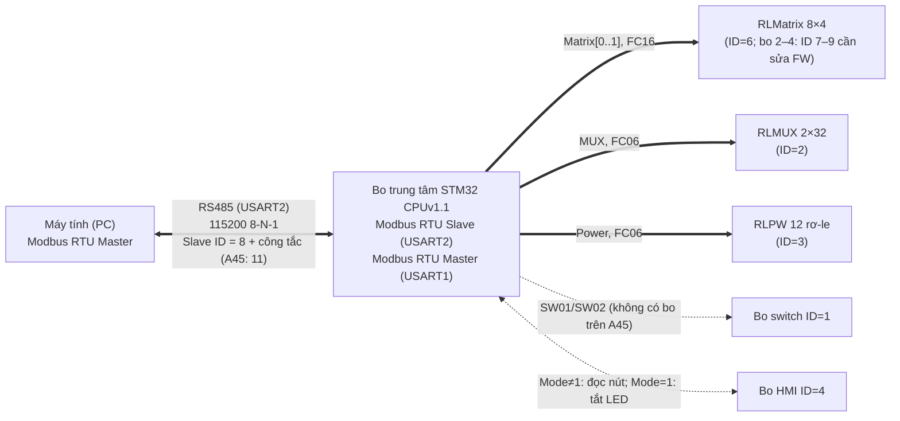
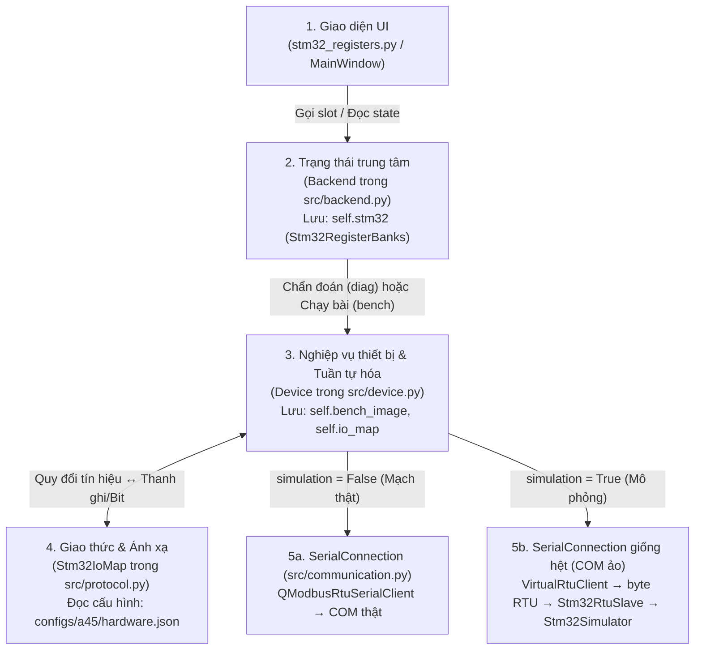

# Giao tiếp PC ↔ STM32 (Modbus RTU)

Tài liệu **duy nhất** về giao tiếp phần cứng giữa phần mềm PC và vi điều khiển trung tâm **STM32F407VETx** (firmware `CPUv1.0` của giá thử cũ và **`CPUv1.1 For DK_QDT` của giá thử A45 hiện tại**): kiến trúc kết nối serial, cơ chế hai mảng thanh ghi độc lập, cấu trúc từng byte của khung truyền, công thức quy đổi dữ liệu, vị trí lưu trữ trong mã nguồn Python, cách giao diện chẩn đoán và bộ chạy bài dùng chúng, cùng các quy tắc an toàn giao dịch. Phụ lục A ghi lại giao thức A45 v1 cũ (không dùng cho MCU).

- Nguồn bản đồ thanh ghi CPUv1.0: [PHAN_TICH_GIAO_THUC_VA_LUONG_CODE.md](PHAN_TICH_GIAO_THUC_VA_LUONG_CODE.md)
  (bản phân tích gốc, giữ nguyên).
- **Mã nguồn firmware đã đối chiếu** (chỉ đọc, ngoài repo): `D:\project\2026_DT_Chinh\ref\ref_AHung\A34_Phao37\Program\`
  → `CPUv1.0` (2026-11-18), `CPUv1.1 For DK_QDT`, `RLMatrixv1.0`, `RLMUXv1.0`, `RLPWv1.0` (2026-11-19).
  Luồng PC → CPU → bo chấp hành: **mục 9**; khác biệt CPUv1.1 và firmware bo con: **mục 3.1, 9.11**.
- Bản đồ thanh ghi trong code: `src/common/stm32.py` (`CPU_MAPS`); profile chọn bằng `hardware.cpu_map`
  (A45: `CPUv1.1`). Ánh xạ tín hiệu bài đo ↔ thanh ghi: `configs/a45/hardware.json` → `stm32_io`
  (schema: [CONFIGURATION.md](CONFIGURATION.md#hardwarejson)).
- Điểm phải kiểm khi lên mạch: `PROGRESS.md`, mục "Cần kiểm khi lên phần cứng thật".

> Hiện trạng (2026-11-19): người dùng đã đọc được CPU thật (slave 11) bằng "Đọc thử Modbus". Mở COM thật ở chế độ
> Modbus RTU → phần mềm tự đọc FC03 xác minh → "Sẵn sàng · COM THẬT". Trên mạch thật: **tự kiểm tra chạy được**;
> bài đo chỉ chạy khi mọi ánh xạ nó dùng đã `verified` và D02 đạt (mục 7). Trang **Test Modbus** (mục 6.1) để
> kiểm từng rơ-le/kênh. `production_ready` vẫn `false`.

---

## 1. Đường truyền và cấu hình serial

### 1.1. Mô hình kết nối vật lý và vai trò Master – Slave

Hệ thống giao tiếp theo chuẩn **Modbus RTU** trên đường truyền vật lý **RS485 hai dây (A/B)**:



| Mục | Giá trị |
|---|---|
| Vai trò | PC = Modbus RTU **Master**; **một** STM32 CPUv1.0 = Slave (`USART2`). MCU tự điều phối các bo `SW_board` / `MUX_board` / `RelayPower_board` / `HMI_board` phía dưới qua `USART1`; PC không giao tiếp trực tiếp với chúng |
| Vật lý | RS485 hai dây (`PD5` TX, `PD6` RX, `PD7` điều khiển hướng thu/phát tự động). Cần bộ chuyển USB–RS485; không nối USB–UART TTL trực tiếp vào A/B |
| Mặc định | Slave ID theo profile (`hardware.json` → `stm32_io.slave`; A45 = **11** vì CPUv1.1 dùng `8 + Read_board_ID()`; CPUv1.0 cố định 9), **115200** baud, **8N1**, không flow control |
| Timeout | 1000 ms mặc định (chỉnh 100–10000 ms trong Chi tiết); `setNumberOfRetries(0)` (không tự gửi lại) |
| Khung/CRC | Qt `QModbusRtuSerialClient` đóng khung RTU, tính CRC16 Modbus và canh khoảng lặng frame (`T3.5`) |

Một đối tượng `SerialConnection` (`src/communication.py`) duy nhất sở hữu cổng COM; vòng đời trạng thái:
`disconnected → connecting → open`, lỗi mở cổng hoặc rút cáp USB → `error`.
**Mở COM thành công chỉ xác nhận cổng serial trên PC đã mở**; chỉ khi nhận phản hồi `FC03` hợp lệ mới xác nhận Slave STM32 đang trả lời.

---

## 2. Mã hàm và địa chỉ

### 2.1. Bảng mã hàm (Function Codes) và quy tắc địa chỉ

| Thao tác | FC | Địa chỉ | Số word | Vùng MCU |
|---|---|---|---|---|
| Đọc toàn bộ dữ liệu | `03` (`0x03`) | `1` | `29` (CPUv1.0) / `42` (CPUv1.1) | `mod_buf_to_read[1..N]` |
| Ghi một ô | `06` (`0x06`) | `1…28` (v1.0) / `1…30` (v1.1) | `1` | `mod_buf_to_write[addr]` |
| Ghi một vùng liên tục | `16` (`0x10`) | như trên | không vượt cuối bản đồ | `mod_buf_to_write[addr..addr+N-1]` |

Bộ chạy bài và công cụ Test Modbus còn được ghi index 31–36 (`Matrix2_0…Matrix4_1`) vì profile A45 khai báo chúng là
**đề xuất sửa firmware** (mục 9.9); mảng của CPUv1.1 có 50 word nên ghi vào đó không đè RAM, nhưng chưa có tác dụng.

- **Địa chỉ zero-based = chỉ số mảng trực tiếp**: Khi nhận khung Modbus, hàm `mbfuncholding.c` trong firmware cộng `+1` vào địa chỉ bắt đầu, sau đó hàm callback `eMBRegHoldingCB` (`port.c`) lại trừ đi `usRegHoldingStart` (`= 1`). Hai phép tính `+1` và `-1` triệt tiêu nhau, nên **địa chỉ gửi trên khung truyền chính là chỉ số phần tử mảng `0, 1, 2...`** (không cộng 1, không dùng kiểu `40001`).
- **Index `0` là `Null`**: thanh ghi đệm không sử dụng. Firmware vẫn cho ghi, nhưng PC không bao giờ ghi vào địa chỉ `0`.
- **Firmware không chặn địa chỉ ngoài mảng** (chấp nhận tới 128 thanh ghi trong khi mảng chỉ có 32): ghi ngoài `0–31` sẽ đè RAM của MCU. PC tự giới hạn ghi `1–28`, đọc `1–29` (mục 9.6).
- **Thứ tự byte (Endianness)**:
  - Mọi trường 16-bit (Địa chỉ, Số lượng word, Giá trị thanh ghi) truyền theo chuẩn **Big-Endian** (Byte cao `Hi` trước, Byte thấp `Lo` sau).
  - Riêng 2 byte **CRC16-Modbus** ở cuối khung truyền theo chuẩn **Little-Endian** (Byte thấp `CRC_Lo` trước, Byte cao `CRC_Hi` sau; đa thức `0xA001`, khởi tạo `0xFFFF`).
- Firmware có `FC17` nhưng PC chưa dùng. `FC04` của firmware chỉ trả hằng `0x0304`, không có dữ liệu. Ô "Đọc một lần" (`FC03`/`FC04`, địa chỉ tùy ý) trên UI chỉ phục vụ chẩn đoán thô.

### 2.2. Cấu trúc chi tiết từng khung truyền (Frame Format)

#### A. Đọc toàn bộ trạng thái từ STM32 — `FC03` (Read Holding Registers)
PC luôn đọc một lượt **29 thanh ghi** từ địa chỉ `1` đến `29` (`mod_buf_to_read[1..29]`):

- **Khung PC gửi đi (Request — 8 bytes):**
  | Byte 0 | Byte 1 | Byte 2 | Byte 3 | Byte 4 | Byte 5 | Byte 6 | Byte 7 |
  | :---: | :---: | :---: | :---: | :---: | :---: | :---: | :---: |
  | **Slave ID** | **FC** | **Start Addr Hi** | **Start Addr Lo** | **Quantity Hi** | **Quantity Lo** | **CRC16 Lo** | **CRC16 Hi** |
  | `0x09` | `0x03` | `0x00` | `0x01` | `0x00` | `0x1D` (29) | `0xD5` | `0x4B` |

- **Khung STM32 phản hồi (Response — `5 + 2×29 = 63` bytes):**
  | Byte 0 | Byte 1 | Byte 2 | Byte 3..4 | ... | Byte 59..60 | Byte 61 | Byte 62 |
  | :---: | :---: | :---: | :---: | :---: | :---: | :---: | :---: |
  | **Slave ID** | **FC** | **Byte Count** | **Reg[1] Hi, Lo** | ... | **Reg[29] Hi, Lo** | **CRC16 Lo** | **CRC16 Hi** |
  | `0x09` | `0x03` | `0x3A` (58 bytes) | `mod_buf_to_read[1]` | ... | `mod_buf_to_read[29]` | `CRC_L` | `CRC_H` |

#### B. Ghi 1 thanh ghi đơn lẻ — `FC06` (Write Single Register)
Dùng khi PC chỉ thay đổi 1 thanh ghi trong vùng `1…28` (ví dụ ghi `Mode = 1` vào địa chỉ `1`):

- **Khung PC gửi đi (Request — 8 bytes):**
  | Byte 0 | Byte 1 | Byte 2 | Byte 3 | Byte 4 | Byte 5 | Byte 6 | Byte 7 |
  | :---: | :---: | :---: | :---: | :---: | :---: | :---: | :---: |
  | **Slave ID** | **FC** | **Reg Addr Hi** | **Reg Addr Lo** | **Value Hi** | **Value Lo** | **CRC16 Lo** | **CRC16 Hi** |
  | `0x09` | `0x06` | `0x00` | `0x01` | `0x00` | `0x01` | `0x18` | `0x82` |

- **Khung STM32 phản hồi (Response ACK — 8 bytes):**
  STM32 echo lại đúng 8 byte vừa nhận (`09 06 00 01 00 01 18 82`) làm biên nhận ACK.

#### C. Ghi nhiều thanh ghi liên tiếp — `FC16` / `0x10` (Write Multiple Registers)
Dùng khi PC ghi một dải `N` thanh ghi liên tiếp bắt đầu từ `Start Addr`:

- **Khung PC gửi đi (Request — `9 + 2×N` bytes):**
  | Byte 0 | Byte 1 | Byte 2..3 | Byte 4..5 | Byte 6 | Byte 7..8 | ... | Byte `7+2N..8+2N` |
  | :---: | :---: | :---: | :---: | :---: | :---: | :---: | :---: |
  | **Slave ID** | **FC** | **Start Addr Hi, Lo** | **Quantity (`N`) Hi, Lo** | **Byte Count (`2N`)** | **Val[1] Hi, Lo** | ... | **CRC16 Lo, Hi** |
  | `0x09` | `0x10` | `Addr Hi, Lo` | `N Hi, Lo` | `2 * N` | `Word 1` | ... | `CRC_L, CRC_H` |

- **Khung STM32 phản hồi (Response ACK — 8 bytes):**
  | Byte 0 | Byte 1 | Byte 2 | Byte 3 | Byte 4 | Byte 5 | Byte 6 | Byte 7 |
  | :---: | :---: | :---: | :---: | :---: | :---: | :---: | :---: |
  | **Slave ID** | **FC** | **Start Addr Hi** | **Start Addr Lo** | **Quantity Hi** | **Quantity Lo** | **CRC16 Lo** | **CRC16 Hi** |
  | `0x09` | `0x10` | `Addr Hi` | `Addr Lo` | `N Hi` | `N Lo` | `CRC_L` | `CRC_H` |

---

## 3. Hai mảng độc lập

Khi PC **ghi**, dữ liệu vào mảng `mod_buf_to_write` (29 word, `Modbus_DO`); khi PC **đọc**, dữ liệu lấy từ mảng `mod_buf_to_read` (30 word, `Modbus_DI`). **Cùng địa chỉ không phải cùng dữ liệu**: ghi địa chỉ `7` là đặt giá trị đầu ra `DAC_val`, đọc địa chỉ `7` lại nhận về điện áp đo `ADC0_val`. Enum `WriteRegister` và `ReadRegister` trong `src/common/stm32.py` là nơi duy nhất định nghĩa bản đồ này trong code.

| Index (Dec / Hex) | Ghi (`mod_buf_to_write` / DO) | Đọc (`mod_buf_to_read` / DI) | Ý nghĩa chi tiết |
| :---: | :--- | :--- | :--- |
| **`0` (`0x00`)** | `Null` | `Null` | Thanh ghi đệm, không sử dụng |
| **`1` (`0x01`)** | **`Mode`** | `Mode` (firmware luôn trả `0`) | Ghi `1` (`AutoComputer`): MCU chạy theo lệnh PC; `≠ 1`: chạy theo mặt máy HMI |
| **`2` (`0x02`)** | **`Plan`** | `Plan` | Chế độ: `0` = SelfTest, `1` = Test_EncoderPulse, `2` = Test |
| **`3–5` (`0x03–0x05`)** | `Block`, `Cabinet`, `Status` | `Block`, `Cabinet`, `Status` | Định danh khối, tủ và trạng thái hiển thị |
| **`6` (`0x06`)** | `DisplayOut` | `DisplayIN` | Dữ liệu hiển thị LED mặt máy |
| **`7` (`0x07`)** | **`DAC_val`** (`int16`) | **`ADC0_val`** (`int16`) | **Ghi**: Mã xuất DAC1 (`PA4`). **Đọc**: Điện áp kênh ADC0 (`int16/100` V, thang ±100 V) |
| **`8` (`0x08`)** | **`DOUT`** (`bit0–9`) | **`ADC1_val`** (`int16`) | **Ghi**: Xuất 10 kênh Digital Output. **Đọc**: Điện áp ADC1 (`int16/100` V, thang ±50 V) |
| **`9` (`0x09`)** | **`SW01`** → bo Switch reg 0 | **`ADC2_val`** (`int16`) | **Ghi**: 16 bit rơ-le chuyển mạch reg 0. **Đọc**: Điện áp ADC2 (`int16/100` V, thang ±24 V) |
| **`10` (`0x0A`)** | **`SW02`** → bo Switch reg 1 | **`ADC3_val`** (`int16`) | **Ghi**: 16 bit rơ-le chuyển mạch reg 1. **Đọc**: Điện áp ADC3 (`int16/100` V, thang ±12 V) |
| **`11` (`0x0B`)** | **`MUX`** → bo MUX | **`ADC4_val`** (`int16`) | **Ghi**: Chọn kênh đo trên bo đa hợp. **Đọc**: Điện áp ADC4 (`int16/100` V, thang ±7,5 V) |
| **`12` (`0x0C`)** | **`Power`** → bo RelayPower | **`Ohm_val`** | **Ghi**: 16 bit chuyển **nguyên vẹn** tới bo RelayPower (ID 3, reg 0) ở mỗi vòng lặp; bit nào là rơ-le nào do bo RelayPower quyết định. Mã HMI của CPU dùng `bit1` 24 V, `bit2` 12 V, `bit4` 5 V, `bit6` 3,3 V, `bit7–9` VDD1–3 (mục 9.5). **Đọc**: Giá trị đo điện trở |
| **`13` (`0x0D`)** | `DataO1`: encoder En/Dir/Period (tự xóa) | **`DIN`** (mức raw `bit0–9`) | **Ghi**: Lệnh phát xung Encoder (Bit 15 En, Bit 14 Dir, Bit 0–13 Period ms). **Đọc**: 10 kênh Digital Input |
| **`14` (`0x0E`)** | `DataO2`: số xung encoder (tự xóa) | `DataI1`: `encoder_count` (`int16`) | **Ghi**: Số xung Encoder cần phát. **Đọc**: Bộ đếm xung có xét chiều quay |
| **`15` (`0x0F`)** | `DataO3`: SSI En + byte | `DataI2`: `ENCA_cnt` (`uint16`) | **Ghi**: Bit 15 = SSI Enable, Bit 0–7 = Data byte (`main.c:297–298`). **Đọc**: Bộ đếm xung pha A |
| **`16–17` (`0x10–0x11`)** | `DataO4`, `DataO5` (dự phòng) | `DataI3`: `ENCB_cnt`, `DataI4`: `encoder_num_pulse` (`int16`) | **Ghi**: Dự phòng. **Đọc**: Bộ đếm xung pha B (`16`) và số xung mỗi vòng chốt theo xung Z (`17`) |
| **`18` (`0x12`)** | `CDT` (cổng RS232/422, enable `bit8`, độ dài) | `DataI5`: `SSI Ident` (`uint16`) | **Ghi**: Cấu hình phát UART ngoại vi. **Đọc**: Mã định danh 16-bit đọc về từ SSI |
| **`19` (`0x13`)** | `DataT0` | `CDN` (dự phòng) | **Ghi**: Byte 0–1 chuỗi phát UART. **Đọc**: Dự phòng (chưa mang độ dài RX) |
| **`20–28` (`0x14–0x1C`)** | `DataT1…DataT9` | `DataR0…DataR8` | **Ghi**: Byte 2–19 chuỗi phát UART. **Đọc**: Byte 0–17 chuỗi nhận UART |
| **`29` (`0x1D`)** | — *(không tồn tại)* | `DataR9` | **Đọc**: Byte 18–19 chuỗi nhận UART (tổng `DataR0…DataR9` = 20 byte) |

**Điều kiện bắt buộc (`Mode = 1`)**: Trong vòng lặp `while(1)` của STM32, phải **ghi `Mode = 1`** vào địa chỉ `1` thì MCU mới chép mảng `mod_buf_to_write` vào cấu trúc `Modbus_DO` để thực thi xuống phần cứng.
- Nếu `Mode ≠ 1`, MCU chạy theo nút bấm mặt máy (HMI) và tự bật một số nguồn/tiếp điểm.
- Sau khi MCU khởi động lại, `Mode` trở về 0.

Xem mục 9.5.

### 3.1. Khác biệt của CPUv1.1 For DK_QDT (giá thử A45)

Đối chiếu `Inc/System_Register.h`, `Inc/main.h`, `Src/main.c` của `CPUv1.1 For DK_QDT` với CPUv1.0:

| Index | CPUv1.0 | **CPUv1.1** | Ghi chú |
|---|---|---|---|
| DO 0–17 | như bảng trên | **giống hệt** | `Mode`…`DataO5` |
| DO 18 | `CDT` | **`Matrix[0]`** | CPU gửi `Matrix[0..1]` bằng FC16 tới bo RLMatrix **ID 6**, reg 0–1, mỗi vòng |
| DO 19 | `DataT0` | **`Matrix[1]`** | |
| DO 20 | `DataT1` | **`CDT`** | thêm `bit9` = đổi baud 4 cổng UART ngoài (`bit3–7` chọn 9600…115200) |
| DO 21–30 | `DataT2…` | `DataT[0..9]` | |
| DI 0–19 | | **giống hệt** | `ADC0_val`…`CDN` |
| DI 20–42 | `DataR0…DataR9` (20–29) | `DataR1[5]` 20–24, `DataR2[5]` 25–29, `DataR3[8]` 30–37, `DataR4[5]` 38–42 | 4 cổng RS422 riêng (UART4/5/6, USART3), tự xóa sau 3 s không nhận |
| Mảng | 32 word | **50 word** | `REG_HOLDING_NREGS` vẫn 128 → địa chỉ 50–127 vẫn đè RAM |
| Slave | 9 | **8 + công tắc ID** | mạch A45 trả lời ở **11** |

**Nguy hiểm khi dùng sai bản đồ:** công cụ cũ hiểu index 18 là `CDT`; trên CPUv1.1 ghi vào đó là **đóng rơ-le
bo matrix**. Phần mềm dùng bản đồ theo `hardware.cpu_map`; màn hình thanh ghi hiển thị đúng tên theo bản đồ.

---

## 4. Biểu diễn và giải mã (`src/protocol.py`)

- **Raw word `0…65535` (`uint16`)**: `encode_int16(value)` / `decode_int16(word)` đổi số nguyên có dấu bù hai (`-32768…32767`). Ví dụ: đọc `ADC` raw `64969` (`0xFDD7`) → `decode_int16` ra `-567` → chia `100` được **`−5,67 V`**.
- **`DAC_val` (địa chỉ ghi `7`)**: `V_DAC(PA4) = 1,62 − DAC_val/1000 × 1,55` (đã xác nhận trong `main.c:310`).
  - Firmware kẹp im lặng trong `0–3,3 V`, tương đương mã `−1083…+1045`.
  - `DAC_val = 0` cho **1,62 V tại PA4**.
  - Hệ số tầng khuếch đại ra tới chân `XP1` (ví dụ `-5 mV/mã`) vẫn đang là giả định trong `stm32_io`.
- **`Ohm_val` (địa chỉ đọc `12`)**:
  - 2 bit cao (`metric = word >> 14`) chọn đơn vị: `0` = $\Omega$ ($\times 1$), `1` = $\text{k}\Omega$ ($\times 1\,000$), `2` = $\text{M}\Omega$ ($\times 1\,000\,000$), `3` = quá thang đo (`overrange`).
  - 14 bit thấp (`amount = (word & 0x3FFF) / 100.0`) là giá trị số.
  - Hàm `decode_stm32()` trả về giá trị quy đổi ra $\Omega$; nếu `metric == 3` (quá thang) thì trả về `None` kèm `resistance_quality = 'overrange'` (tuyệt đối không trả `0` để tránh nhầm với ngắn mạch $0\,\Omega$).
- **`DIN` (địa chỉ đọc `13`)**: giữ nguyên mức logic raw từng bit (`(word >> bit) & 1` cho `bit 0..9`, mạch đầu vào pull-up, kích mức thấp), không tự đảo trong tầng giao thức.
- **`DataT0..9` / `DataR0..9` (chuỗi 20 byte UART)**: **byte thấp đứng trước bên trong mỗi word 16-bit** (khác với thứ tự Big-Endian của khung Modbus trên dây). Ví dụ chuỗi 4 byte `11 22 00 44` được đóng gói thành 2 word `[0x2211, 0x4400]`. Dùng `pack_data_t()` / `unpack_data_r()` (`struct.unpack('<10H', ...)`). Vì `CDN` chưa báo độ dài nhận thực tế, `unpack_data_r()` luôn trả đủ 20 byte và `received_length = None`.
- **Encoder (`DataO1`, `DataO2`)**: hàm `encode_encoder(period_ms, pulses, forward=True)` kiểm tra chu kỳ phải là bội số của `4 ms` trong dải `4…16380 ms` ($\le 250\text{ Hz}$) và trả về 2 word `[0x8000 | (0x4000 nếu forward) | period_ms, pulses]`.

---

## 5. Quy tắc giao dịch và trạng thái

### 5.1. Quy tắc an toàn giao dịch trên đường truyền
- **Một giao dịch tại một thời điểm**, I/O hoàn toàn bất đồng bộ theo event loop Qt (`QModbusRtuSerialClient` / `QTimer`), không chặn luồng giao diện (GUI thread).
- **Không retry** đối với cả lệnh ghi lẫn lệnh đọc (`setNumberOfRetries(0)`). Khi xảy ra Timeout hoặc phản hồi sai định dạng (`InvalidResponseError`) → **đóng cổng COM ngay lập tức**, người dùng phải kết nối lại (vì Modbus RTU không có Transaction ID; nếu giữ cổng mở và gửi tiếp, phản hồi trễ của giao dịch cũ có thể bị nhận nhầm cho giao dịch mới). Mã lỗi Modbus exception (`ProtocolError`) được báo riêng.
- **Xác minh lệnh Ghi**: `FC06` kiểm tra echo đúng địa chỉ + giá trị, `FC16` kiểm tra đúng địa chỉ + số lượng thanh ghi thông qua `reply.rawResult()` (với hàm `validate_write_ack()` trong `src/protocol.py`, vì [Qt `result()` không hợp lệ đối với request ghi](https://doc.qt.io/qt-6/qmodbusreply.html#result)). **ACK chỉ là biên nhận MCU đã nhận khung**, không xác nhận đầu ra vật lý đã đóng/cắt; nếu mất ACK thì trạng thái được coi là **chưa biết**, không tự gửi lại.
- **Xác minh lệnh Đọc**: chỉ cập nhật mảng đọc sau khi nhận phản hồi `FC03` hợp lệ (khớp Slave ID, địa chỉ bắt đầu `1`, đúng `29` word). Dữ liệu đọc mất hiệu lực khi gặp lỗi, ngắt kết nối, đổi nguồn/Slave ID hoặc quá hạn `READ_STALE_MS = 2000 ms` (chính sách hạn hiển thị phía PC; MCU không có timestamp hay bộ đếm mẫu nên không chứng minh được tuổi mẫu ADC hay tính nguyên tử giữa các kênh).
- **Không tự phát lệnh**: không tự động ghi khi mở COM, đổi nguồn giả lập/thật, kết nối lại hay khởi động lại ứng dụng; không tự ghi cả mảng zero; không gửi lại lệnh phát xung encoder.
- **Tự đọc định kỳ** (ô "Tự đọc mỗi" trên trang Test Modbus, bảng thanh ghi) chỉ dùng `FC03` dạng đọc nền (`request_stm32(background=True)`, mục 6.1), bỏ lượt khi đang có giao dịch khác, dừng khi ẩn trang/ngắt; tuyệt đối không poll bằng cách ghi mảng DO. Chuỗi hàm truyền/nhận trong code: [LUONG_CODE_VA_MODBUS.md](LUONG_CODE_VA_MODBUS.md) phần B.
- Chẩn đoán và bộ chạy bài dùng chung một kênh trong `Device`: mỗi request mang nhãn sở hữu `owner = 'diag'` hoặc `'bench'`; khi bộ chạy bài đang hoạt động, mọi thao tác đọc/ghi từ màn hình chẩn đoán bị từ chối.
- Nút **Dừng** qua phần mềm/Modbus **không thay thế** nút dừng khẩn cấp và mạch bảo vệ phần cứng.

### 5.2. Kiến trúc các tầng và nơi lưu trữ giá trị truyền/nhận trong code PC

Phần mềm phân tách thành 5 tầng rõ ràng, giao diện (Widgets/QML) chỉ đọc trạng thái và gọi API của `Backend`:



| Thành phần trong code | Vị trí lưu trữ / Lớp phụ trách | Vai trò cụ thể |
|---|---|---|
| **Trạng thái 2 mảng trên UI** | `backend.stm32` (`Stm32RegisterBanks` tại `src/common/stm32.py`, khởi tạo ở `src/backend.py`) | - `mod_buf_to_write` (list 29 `uint16`): lưu **bản nháp** các ô chuẩn bị ghi.<br>- `staged` (`set`): ghi nhận những địa chỉ người dùng đã sửa trên bản nháp.<br>- `mod_buf_to_read` (list 30 `uint16`): lưu kết quả lần đọc `FC03` hợp lệ gần nhất.<br>- `read_valid`, `received_at`, `last_ack`: quản lý tính hợp lệ, thời điểm nhận và biên nhận ACK. |
| **Ảnh thanh ghi DO của bộ chạy bài** | `device.bench_image` (`dict {address: uint16}` tại `src/device.py`) | Lưu các thanh ghi DO mà MCU đã ACK trong bài đo đang chạy. Bước kế tiếp chỉ gửi những thanh ghi có giá trị thay đổi so với `bench_image` (`Stm32IoMap.writes()`). Nếu ghi lỗi/hủy, địa chỉ đó bị xóa khỏi `bench_image` (`_forget_write()`). |
| **Ánh xạ Tín hiệu ↔ Thanh ghi** | `device.io_map` (`Stm32IoMap` tại `src/protocol.py`, nạp từ `stm32_io` trong `configs/a45/hardware.json`) | Dịch các lệnh nghiệp vụ (`dc_27v`, `set_40`...) thành thao tác bật/tắt bit hoặc tính mã `DAC_val` + bit định tuyến `route`; dịch số đo từ thanh ghi `ADC` + kênh `MUX` sang đơn vị vật lý (`V`, `A`...). |
| **Cổng Serial & Khung RTU** | `device.serial_connection` (COM thật) và `device.virtual_connection` (COM ảo), cùng lớp `SerialConnection` tại `src/communication.py` | Thực thi `read_registers()` (`FC03`) và `write_registers()` (`FC06`/`FC16`), quản lý timer `deadline`, đóng cổng khi lỗi/timeout, phát `frame_logged` (khung TX/RX dựng lại từ PDU). |

---

## 6. Sử dụng trên giao diện (chẩn đoán)

1. Thanh Kết nối: chọn **Modbus RTU** (hoặc **UART** để mở cổng serial thuần), COM, baudrate → **Kết nối**. Thao tác quét danh sách COM (`available_serial_ports()`) không mở hay thăm dò cổng. Với profile adapter `stm32`, mở cổng Modbus RTU xong phần mềm **tự đọc một FC03** tới slave của profile (không ghi gì): trả lời hợp lệ → **"Sẵn sàng · COM THẬT"**; không trả lời → "Không có phản hồi STM32 (slave N)" kèm gợi ý kiểm tra công tắc ID, dây A/B, baud; cổng đóng sau timeout như mọi giao dịch lỗi.
2. **8N1 · Chi tiết**: chỉnh data bits/parity/stop bits/timeout trước khi nối; **Đọc một lần** `FC03`/`FC04` theo Slave ID, địa chỉ zero-based thập phân, số thanh ghi. Chế độ UART hiển thị byte nhận được dạng hex.
3. **Hai mảng STM32 · Giả lập / COM thật** (`src/ui/widgets/stm32_registers.py`):
   - Bảng tên thanh ghi theo bản đồ của profile (`hardware.cpu_map`; A45 = CPUv1.1, DI đọc 1–42). Rê chuột lên tên thanh ghi để xem lưu ý (Matrix, CDT, encoder…). Có **Tự đọc mỗi … ms** (chỉ đọc FC03, tự dừng khi ẩn).
   - Mặc định **GIẢ LẬP** qua COM ảo (mục 8), không cần COM thật. Để nối mạch thật: mở COM ở chế độ Modbus RTU, bỏ chọn giả lập, chọn Slave ID (mặc định theo profile), bấm **đọc FC03 trước**.
   - Ghi `MUX` có kênh ≥ 32 bị **từ chối** trước khi gửi (firmware RLMUX không kiểm giới hạn).
   - Sửa ô trên bảng ghi chỉ sửa **bản nháp** (`backend.stm32.mod_buf_to_write`); những ô chưa nhập không bao giờ được gửi. Chọn vùng địa chỉ rồi bấm gửi (`FC06`/`FC16`); giá trị được chụp tại thời điểm gửi.
   - Đổi nguồn giả lập/thật **không tự gửi** bản nháp. Khi bộ chạy bài đang chạy, bảng DI hiển thị lần đọc mới nhất của bộ chạy bài (chỉ xem).
   - Dòng **Khung RTU gần nhất** hiện TX/RX dạng hex của nguồn đang chọn. Khung được dựng lại từ PDU và CRC tính lại (Qt không cho lấy byte thô); dùng để đối chiếu với máy dò Modbus.
4. **Ngắt** luôn hủy giao dịch đang chờ và giải phóng cổng serial.

Ví dụ gọi API trong mã (chạy theo event loop Qt, chỉ gọi giao dịch kế tiếp sau khi giao dịch trước đã hoàn tất):

```python
from src.common.stm32 import WriteRegister as WO
backend.stage_stm32(WO.Mode, [1, 2])                      # chỉ sửa bản nháp (Mode=1, Plan=2)
backend.request_stm32(simulation=True)                    # đọc FC03 (slave theo profile, DI 1..N)
backend.request_stm32(simulation=True, address=1, count=2)  # ghi FC16 Mode+Plan
```

### 6.1. Trang "Test Modbus" (`src/ui/widgets/modbus_test.py`)

Mục riêng trên thanh bên trái, ba tab. Bị khóa khi bộ chạy bài đang chạy; bộ chạy bài cũng không bắt đầu khi công cụ còn
lệnh đang chờ. Chọn **COM ảo** để thử trước, **COM thật** khi cổng đã mở ở chế độ Modbus RTU.

- **Điều khiển qua CPU** (cùng `Stm32IoMap` với bộ chạy bài). PC **không** nói chuyện với bo con: PC ghi thanh ghi
  của CPU (slave 11), mỗi vòng lặp CPU tự gửi tiếp xuống bus riêng của nó (`CpuMap.forwards`: `Power` → RLPW ID 3,
  `Matrix0/1` → RLMatrix ID 6, `MUX` → RLMUX ID 2). Dòng "Đường đi lệnh" và tiêu đề từng nhóm ghi rõ thanh ghi CPU và
  bo nhận; bo profile không dùng (bo switch) ghi "không lắp". "CPU slave" là ID của CPU, không phải của bo con.
  - **Phần mềm ép nguyên tắc này**: `Backend.check_cpu_slave()` từ chối mọi yêu cầu FC03/06/16 (đọc, ghi thô, công cụ)
    tới slave khác `stm32_io.slave`; ô "CPU slave" ở trang này, ở bảng thanh ghi và ô "ID CPU" trên thanh kết nối chỉ
    hiển thị, không sửa được (đổi trong `hardware.json`). Bộ chạy bài và bước xác minh khi mở cổng vốn chỉ dùng
    `stm32_io.slave`. Ngoại lệ duy nhất: "Đọc thử" trong Chi tiết kết nối (chỉ đọc FC03/04, ID tùy ý) để dò ID của bo
    CPU khi không có phản hồi.
  - **Lấy quyền điều khiển**: ghi `Mode=1`, `Plan=2` và toàn bộ trạng thái an toàn. Sau đó trạng thái đầu ra "đã biết"
    (theo ACK); mọi nút điều khiển mới mở. Trên COM thật có hộp thoại xác nhận.
  - **Về an toàn**: ghi lại toàn bộ trạng thái an toàn (dùng được cả khi trạng thái chưa biết). **Trả về HMI**: `Mode=0`
    (CPU tự bật VDD1–3; có xác nhận).
  - **Rơ-le nguồn**: 12 nút RL1–RL12 có tên tín hiệu; RL8–10 (bit 7–9, HMI ép bật) bị khóa. Liên động AC 36/22 V áp như
    bộ chạy bài; đóng nguồn trên COM thật phải xác nhận.
  - **Bo matrix**: một tab mỗi bo (ID 6; ID 7–9 ghi "cần sửa FW"), lưới đầu ra × đầu vào. Bấm ô = nối chân với nguồn đó
    (nhả nguồn cũ, chờ `break_ms`, rồi đóng); cột "Hở" = nhả. Ô DAC dùng giá trị "Mức DAC". Rê chuột lên ô để xem
    thanh ghi/bit.
  - **MUX**: chọn kênh cho từng bank (31 = hở hết), ghi rồi tự đọc lại sau `di_update_ms + mux_settle_ms`; hiển thị giá
    trị của tín hiệu gán cho kênh đó.
  - **DAC** (V theo hệ số giả định) và **DOUT** bit 0–9.
  - **Giá trị CPU đọc được**: ADC0–4 (V), điện trở, DIN, giờ cập nhật; nút Đọc và tự đọc (200–5000 ms, mặc định 500).
    Tự đọc là **đọc nền** (`request_stm32(background=True)`): không khóa nút, không đổi dòng trạng thái; lệnh bấm trong
    lúc đọc được xếp hàng và gửi ngay khi lượt đọc trả về (lượt đọc lỗi → hủy lệnh chưa gửi, đầu ra không đổi). Ô số cố
    định, chỉ vẽ lại khi giá trị đổi. Đọc nhanh hơn chu kỳ vòng lặp CPU (D02) chỉ lặp lại số cũ.
  - Lỗi/timeout giữa chuỗi: dừng, **không tự gửi lại**, trạng thái đầu ra thành "chưa biết". Ghi thanh ghi thô ở tab bên
    cạnh cũng làm trạng thái thành "chưa biết". ACK không chứng minh rơ-le đã đóng: kiểm bằng đồng hồ/đo ngược.
- **Thanh ghi CPU**: bảng hai mảng như hộp thoại ở bước 3 phía trên, theo bản đồ của profile. Tự đọc cũng là đọc nền;
  bấm "Gửi" trong lúc đọc nền thì lệnh ghi được gửi ngay sau lượt đọc.
- **Nhật ký**: các thao tác của công cụ và khung RTU TX/RX (cả COM ảo và COM thật, 500 khung gần nhất), xuất ra `.txt`.

Quy trình kiểm một rơ-le / một điểm giao matrix / một kênh MUX trên mạch: mục 9.7 và 9.10; đạt thì đổi `status`
mục tương ứng trong `hardware.json` thành `verified`.

---

## 7. Bộ chạy bài qua hai mảng (`hardware.adapter = "stm32"`)

Bộ tuần tự `Device.bench_*` (`src/device.py`) thực thi từng giao dịch một, không bao giờ retry:

```mermaid
sequenceDiagram
    participant Runner as Backend / Device (PC)
    participant STM32 as STM32 (hoặc Stm32Simulator)

    Note over Runner,STM32: 1. Kết nối mô phỏng: mở COM ảo (bench_connect)
    Runner->>STM32: FC03 (Đọc địa chỉ 1..29, không ghi gì)
    STM32-->>Runner: 29 words hợp lệ -> Xác nhận "Sẵn sàng"

    Note over Runner,STM32: 2. Chuẩn bị bài đo (bench_prepare)
    Runner->>STM32: FC03 (Kiểm tra liên lạc đầu bài)
    STM32-->>Runner: 29 words
    Runner->>STM32: FC06/FC16: Ghi safe_state đầy đủ (Mode=1, Plan=2 trước; mọi nguồn/SW/MUX/DAC tắt)
    STM32-->>Runner: ACK
    Runner->>STM32: FC06/FC16: Ghi trình tự chuẩn bị (prepare actions)
    STM32-->>Runner: ACK

    Note over Runner,STM32: 3. Từng bước kích thích & đo (apply -> wait -> measure)
    Runner->>STM32: FC06/FC16: Mở các rơ-le phải nhả (nếu bước vừa nhả vừa đóng)
    STM32-->>Runner: ACK
    Note right of Runner: Chờ break_ms kể từ ACK (ngắt trước đóng sau)
    Runner->>STM32: FC06/FC16: Ghi phần còn lại khác ảnh DO đã ACK (bench_apply)
    STM32-->>Runner: ACK
    Note right of Runner: Chờ ổn định tín hiệu (wait_ms; ×N chỉ trong mô phỏng)
    loop Cho mỗi nhóm kênh MUX cần đo (bench_measure)
        Runner->>STM32: FC06: Ghi MUX (địa chỉ 11) = số kênh (byte thấp MUX1, byte cao MUX2)
        STM32-->>Runner: ACK
        Note right of Runner: Chờ đủ di_update_ms + mux_settle_ms kể từ ACK ghi cuối
        Runner->>STM32: FC03: Đọc 29 words (địa chỉ 1..29)
        STM32-->>Runner: 29 words -> word × scale + offset -> so nominal ± tolerance
    end

    Note over Runner,STM32: 4. Kết thúc / Dừng bài (bench_finish)
    Runner->>STM32: FC06/FC16: Ghi cleanup -> safe_state (ngắt nguồn/rơ-le an toàn)
    STM32-->>Runner: ACK
```

Tóm tắt trình tự:
```text
Kết nối mô phỏng → mở COM ảo → FC03 (không ghi gì)
prepare          → FC03 → ghi safe_state đầy đủ (Mode=1, Plan=2 trước; mọi
                   nguồn/định tuyến/MUX/DAC tắt) → ghi trình tự chuẩn bị
apply (mỗi bước) → chỉ ghi các word khác ảnh DO đã ACK (cộng dồn trong bài);
                   nếu vừa nhả vừa đóng rơ-le: ghi nhả → chờ break_ms → ghi đóng
chờ ổn định      → wait_ms (×N chỉ trong mô phỏng)
measure          → mỗi nhóm tín hiệu đo: ghi MUX = số kênh → chờ tới khi đủ
                   di_update_ms + mux_settle_ms kể từ ACK ghi cuối
                   → FC03 → word × scale → so nominal ± tolerance
                   tín hiệu "manual": hỏi người vận hành (đầu ra vẫn giữ nguyên)
finish           → cleanup → safe_state (dừng tay cũng đi qua bước này)
```

- **Ánh xạ `Stm32IoMap`** đọc từ `hardware.json` → `stm32_io` (quy tắc cấu hình: [CONFIGURATION.md](CONFIGURATION.md#stm32_io); bảng bit A45: mục 9.10):
  - Output kiểu `bit` (rơ-le nguồn trên `Power`, tiếp điểm trên `DOUT`): `value == on_value` thì bật `1 << bit`; `off_value` hoặc `null` thì nhả.
  - Output kiểu `pin` (chân nối vào **bo matrix rơ-le 8×4**): mỗi đầu vào của bo mang sẵn một nguồn (`+3 V`, `−3 V`, đất, DAC, xung…). `apply` nhả mọi điểm giao của chân rồi đóng **đúng một** đầu vào có mức bằng `value`. Không có mức sẵn thì dùng đầu vào DAC (`count = round((value − offset) / scale)` vào `DAC_val`). Không có nguồn phù hợp hoặc ngoài dải DAC thì báo lỗi, **không kẹp**. `null` = hở mạch.
  - Input kiểu `adc` (`ADC0_val…ADC4_val` + số kênh `mux`, `mux_bank`): gom nhóm theo word MUX (`Stm32IoMap.groups()`), ghi `MUX`, chờ `di_update_ms + mux_settle_ms` kể từ ACK ghi cuối, đọc `FC03` rồi tính `decode_int16(raw) * scale + offset`.
  - Input kiểu `link`: trả về `1` khi có phản hồi `FC03` hợp lệ.
  - Input kiểu `manual`: người vận hành nhập (ví dụ tần số đo bằng oxilo). Bỏ trống thì ghi giá trị danh định với chất lượng `default`; kết quả vẫn được đánh giá nhưng ghi rõ **"mặc định, chưa đo"**, phiên có `defaults_used`.
  - Input kiểu `loop_probe` (tự kiểm tra D02): đọc FC03 mỗi `poll_ms` trong `duration_ms`, chu kỳ vòng lặp = khoảng thời gian trung bình giữa các lần ADC0–4 đổi giá trị.
- **Ngắt trước đóng sau** (`break_ms`): khi một bước vừa nhả vừa đóng rơ-le (đổi +3 V → −3 V trên một chân, AC 36 V → 22 V), bộ chạy bài ghi phần nhả trước, chờ `break_ms` kể từ ACK để vòng lặp CPU đã thực thi, rồi mới ghi phần đóng. **Liên động** `interlocks` (ví dụ `ac_36v` / `ac_22v`) bị từ chối ngay khi tính ảnh DO.
- **Giới hạn vùng ghi**: Bộ chạy bài chỉ được phép ghi các thanh ghi `bench_writable` của bản đồ CPU (`Mode`, `Plan`, `Block`, `Cabinet`, `Status`, `DisplayOut`, `DAC_val`, `DOUT`, `SW01`, `SW02`, `MUX`, `Power`, `DataO4`, `DataO5`; CPUv1.1 thêm `Matrix0`/`Matrix1`) cộng các thanh ghi **đề xuất sửa firmware** mà profile khai báo trong `extra_write_registers` (A45: `Matrix2_0…Matrix4_1`, index 31–36). **Không bao giờ** tự ghi `DataO1`/`DataO2` (encoder tự xóa), `DataO3` (SSI), `CDT`, `DataT…` hoặc index `0`. Bit mà firmware tự bật ở chế độ HMI (`hmi_forced_bits`) không được gán cho output nào.
- **Lưu vết và đánh giá**: Biên nhận ACK được lưu vào `attempt.transactions` với ghi chú *"chưa xác nhận đầu ra vật lý"*. Kết luận `PASS`/`FAIL` chỉ đến từ số đo `FC03` hợp lệ sau thời gian chờ ổn định, hoặc số người vận hành nhập. Check có `absolute: true` so `|giá trị|` với `nominal ± tolerance`.
- **Xử lý lỗi giữa chừng**: Lỗi hoặc timeout ở bất kỳ bước nào → bài đo nhận trạng thái `ERROR`; các thanh ghi đang ghi trong `bench_image` coi là **chưa biết**; không tự gửi lại, không tự ghi `safe_state` đè lên sau khi kênh truyền đã lỗi.
- **Bài nguồn hỏng thì dừng lượt** (`stop_on_fail` ở P01/P02): bài FAIL → cleanup về `safe_state` như thường, rồi bỏ các bài còn lại (dòng sai thường là chập/hỏng).
- **Ràng buộc 1 kênh DAC**: hai chân cần hai mức khác nhau trên cùng `DAC_val` bị từ chối ngay.
- **Mục `unsupported`** (một bo matrix, một input…) → bài kiểm tra chuyển sang `BLOCKED` trước khi gửi bất kỳ lệnh nào xuống STM32.
- **Tạm dừng (`Pause`)**: Chuỗi giao dịch đang chạy được thay bằng `finish` (giao dịch đang ở trên đường dây vẫn hoàn tất trước) → đưa đầu ra về `safe_state`; lần thử hiện tại ghi nhận `PAUSED`; khi bấm **Tiếp tục**, bài đó chạy lại từ bước `prepare`. Trong lúc đang tạm dừng không gửi gì xuống MCU. Tạm dừng/dừng khi đang chờ nhập tay thì hộp thoại đóng, câu trả lời muộn bị bỏ qua.
- `CPUv1.0` không có cờ sẵn sàng/bảo vệ riêng: trên giao diện, `"Sẵn sàng"` = phản hồi `FC03` hợp lệ; `"Bảo vệ"` hiển thị `"Chưa biết"`.
- **Thời gian chờ DI** (`stm32_io.di_update_ms`, giả định 150 ms): ACK chỉ cho biết MCU đã chép lệnh vào mảng. Số đo chỉ phản ánh lệnh mới sau tối đa ~2 vòng lặp CPU (mục 9.2). Đo chu kỳ vòng lặp trên mạch thật bằng bài tự kiểm tra **D02** rồi chỉnh.
- **Chạy trên mạch thật**: cùng đường code (`Device` → `SerialConnection`), chỉ khác client Modbus. Điều kiện mở (tự kiểm tra ngay; bài đo cần `verified` + D02 + xác nhận): mục 10.

---

## 8. Mô phỏng = cổng COM ảo (`src/virtual_port.py`, `src/simulator.py`)

```text
Backend → Device → SerialConnection ─┬─ QModbusRtuSerialClient → COM thật → STM32
                                     └─ VirtualRtuClient → byte RTU → Stm32RtuSlave → Stm32Simulator
```

- **Cùng một đường code**: chế độ mô phỏng dùng một `SerialConnection` thứ hai, giống hệt của COM thật, chỉ thay client Qt bằng `VirtualRtuClient`. Mọi kiểm tra phía PC (slave/địa chỉ/số lượng, ACK FC06/FC16 qua `rawResult()`, exception, timeout → đóng COM) đều chạy như khi nối mạch.
- **Khung byte thật**: ADU `slave + PDU + CRC16`, tính theo thời gian truyền 115200 baud (10 bit/ký tự, T3.5, 1 ms `eMBPoll`). Phản hồi được tách lại như client Qt: sai CRC/slave/FC thì bỏ, chờ timeout.
- **`Stm32RtuSlave`** xử lý khung như FreeModbus của CPUv1.0:
  - sai CRC, khác slave ID hoặc broadcast: im lặng;
  - FC03 đọc `mod_buf_to_read`; FC06/FC16 ghi `mod_buf_to_write` (ghi được cả index 0);
  - exception 03 khi sai số lượng/độ dài; 01 với FC khác.
  - **Khác firmware có chủ đích**: COM ảo trả exception 02 khi vượt mảng 30 DI / 29 DO (cộng các thanh ghi `extra_write_registers` profile đề xuất), còn firmware thật chấp nhận tới 128 thanh ghi và đọc/ghi tràn RAM (mục 9.6). Mục đích là bắt lỗi phía PC.
  - FC17 không mô phỏng vì PC không dùng.
- **Vòng lặp chính CPU** (`mock.json` → `stm32_timing.loop_ms`, giả định 50 ms; mã thật ước tính 50–60 ms, mục 9.2):
  - lệnh ghi được ACK ngay, nhưng chỉ có hiệu lực ở đầu vòng lặp kế tiếp;
  - FC03 trả bản DI chép ở vòng lặp đã chạy xong gần nhất;
  - đọc quá sớm sau khi đổi MUX hoặc kích thích sẽ nhận kênh cũ và bài FAIL, giống mạch thật.
- Hai vùng nhớ độc lập; `Mode` ở DI luôn 0; `DataO1`/`DataO2` tự xóa khi `Mode = 1` (như firmware).
- `MUX` không chọn kênh đo nào (ví dụ kênh an toàn 31): các thanh ghi đo trả giá trị cố định (phục vụ màn hình chẩn đoán). `ADC2` có nhiễu 1 LSB đổi theo từng vòng lặp để bài D02 đo được chu kỳ.
- Khi bộ chạy bài chọn kênh `MUX`:
  - ADC trả phản hồi demo từ `mock.json` → `stm32_cases`, dựa trên **kích thích đọc ngược từ ảnh DO đang thực thi** (`Stm32IoMap.inverse()`);
  - `Mode ≠ 1` thì coi như không có kích thích;
  - sai bit hoặc sai đầu vào matrix → ADC trả 0 → FAIL; một chân bị đóng hai nguồn cùng lúc (chập) cũng không khớp case nào;
  - mức DAC khớp case trong phạm vi nửa bước DAC (lượng tử);
  - `after_ms` mô phỏng đáp ứng theo thời gian.
- **Kịch bản lỗi** được tạo **trên đường truyền** (`VirtualLine`), nên ứng dụng thấy chúng như với COM thật:
  - `slow`: trả lời trễ thêm 320 ms;
  - `timeout` (khi apply) và `stop_timeout` (khi finish): slave im lặng → timeout → đóng COM ảo, phải kết nối lại;
  - `disconnect` (khi đo): mất cổng, như rút cáp;
  - `fail`: lệch một số đo.

  `stale`/`protection` không áp dụng.
- **Không mô phỏng**: tín hiệu điện, các khung trên USART1 tới bo con và lỗi bo con, HMI mode, jitter vòng lặp, dạng sóng encoder, race xóa `RevData`.

---

## 9. Firmware CPUv1.0: từ lệnh PC tới rơ-le / MUX (đã đối chiếu mã nguồn)

Đối chiếu trực tiếp mã nguồn `…\ref\ref_AHung\A34_Phao37\Program\CPUv1.0` (2026-11-18; thư mục cũ `D:\project\2026_DT_Chinh\Program\CPUv1.0` đã chuyển). Mục 9.1–9.8 viết theo CPUv1.0; **CPUv1.1 giữ nguyên vòng lặp**, chỉ thêm gửi `Matrix[0..1]` tới bo matrix ID 6 (FC16) giữa bước 2 và 3, và 4 cổng UART nhận riêng (mục 3.1). Tham chiếu dạng `file:dòng` theo CPUv1.0.
**Chỉ có firmware của bo CPU**; firmware và sơ đồ của các bo `SW_board` / `MUX_board` /
`RelayPower_board` / `HMI_board` chưa có. Vì vậy chặng cuối "bit trong thanh ghi bo con → rơ-le nào →
chân giắc nào" **không suy ra được từ mã**, phải lấy từ sơ đồ hoặc firmware bo con (mục 9.7, bước 1).

### 9.1. Bức tranh tổng thể

```text
PC ──FC06/FC16 (USART2, ID 9)──► mod_buf_to_write[]  (ngắt SysTick 1 ms: ghi ngay vào mảng, trả ACK ngay)
                                       │
                vòng lặp main(): nếu mod_buf_to_write[1] (Mode) == 1 → memcpy → Modbus_DO
                                       │
     ┌─ SW01  (index 9)  ──FC06──► SW_board         ID 1, reg 0 ─► rơ-le/tiếp điểm tín hiệu
     ├─ SW02  (index 10) ──FC06──► SW_board         ID 1, reg 1 ─► (bit → rơ-le do bo SW quyết định)
     ├─ MUX   (index 11) ──FC06──► MUX_board        ID 2, reg 0 ─► chọn điểm đo đưa về ADC của CPU
     ├─ Power (index 12) ──FC06──► RelayPower_board ID 3, reg 0 ─► rơ-le nguồn
     ├─ DAC_val (7) ─► DAC1 chân PA4 trên CPU (mức analog DUY NHẤT PC tạo ra)
     ├─ DOUT    (8) ─► 10 chân GPIO trên CPU
     └─ DataO1/2 (encoder), DataO3 (SSI), CDT + DataT (UART) ─► ngoại vi trên CPU
ADC 5 kênh + điện trở + DIN + encoder ─► Modbus_DI ─memcpy cuối vòng─► mod_buf_to_read ─FC03─► PC
```

Hiểu đúng ba loại tín hiệu PC ghi xuống:
- **Cấp nguồn / cấp tín hiệu dạng bit** (`Power`, `SW01`, `SW02`, `MUX`): CPU **không giải mã từng bit**. Nó chuyển **nguyên 16 bit** sang bo con bằng FC06 ở **mọi vòng lặp** (`main.c:246–261`). Bit nào đóng rơ-le nào là do firmware và mạch của bo con.
- **Tín hiệu analog** (`DAC_val`): chỉ có **một** DAC trên chân `PA4` của CPU. Giá thử A45 đưa DAC vào một đầu vào của bo matrix rơ-le, rồi đóng điểm giao tới chân `XP1` cần (kiểu `pin` trong `stm32_io`, mục 9.10). Các mức cố định (±3 V, 27 V, 5 V, đất, xung) lấy từ nguồn ngoài có sẵn qua rơ-le, không dùng DAC.
- **ADC là đầu vào đo, không phải đầu ra.** `ADC0…ADC4_val` là 5 kênh đo điện áp **của CPU**, mỗi kênh có dải cố định. Điểm nào trên khối được đưa vào ADC thì do giá trị `MUX` gửi xuống bo MUX quyết định. PC chỉ đọc ADC bằng FC03, không "tạo ADC".

### 9.2. Vòng lặp chính (`main.c:207–341`) và thời gian

| # | Việc | Mã | Thời gian (ước tính) |
|---|---|---|---|
| 1 | Đọc `Mode = mod_buf_to_write[1]`. Nếu `= 1`: chép **toàn bộ** 29 word sang `Modbus_DO`, rồi FC16 tới HMI (ID 4, reg 4 = 0, tắt LED) + `Delay(10)`. Nếu `≠ 1`: `HMI_processing()` (mục 9.5) | `main.c:212–224` | ~2 ms + 10 ms |
| 2 | FC06 → SW (ID 1) reg 0 = `SW01`; FC06 → SW reg 1 = `SW02`; `Delay(10)` | `main.c:246–248` | ~4 ms + 10 ms |
| 3 | FC06 → MUX (ID 2) reg 0 = `MUX`; `Delay(10)` | `main.c:253–254` | ~2 ms + 10 ms |
| 4 | FC06 → RelayPower (ID 3) reg 0 = `Power`; `Delay(10)` | `main.c:260–261` | ~2 ms + 10 ms |
| 5 | `Plan == 0` → `GPIO_Configuration()` **mỗi vòng**; `Plan == 1` → `Encoder_GPIO_Config()` mỗi vòng | `main.c:271–278` | |
| 6 | Nạp encoder từ `DataO1/DataO2`, tự xóa `mod_buf_to_write[13..14]` | `main.c:281–295` | |
| 7 | SSI: `En = DataO3 bit15`, byte = `bit0–7` | `main.c:297–305` | |
| 8 | `ADC_process()`: quy đổi 5 kênh áp, đo điện trở tự chuyển thang | `main.c:308`, `654–739` | 1–5 ms |
| 9 | `DAC_Out(1.62 − DAC_val/1000 × 1.55)` | `main.c:310` | |
| 10 | Đọc 10 DIN, xuất 10 DOUT (trừ chân đang dùng cho encoder/SSI) | `main.c:314–326` | |
| 11 | Chép `Modbus_DI` → `mod_buf_to_read` (đây là lúc PC thấy số đo mới) | `main.c:336` | |
| 12 | Nhận/phát UART ngoại vi | `main.c:338–339` | |

- **Chu kỳ bình thường ≈ 50–60 ms (ước tính, chưa đo)**: 4 × `Delay(10)` + 5 giao dịch nội bộ + ADC.
  - **Mỗi bo con không trả lời làm vòng lặp dài thêm 100 ms cho mỗi giao dịch** (timeout `t_timeout = 100`, `System_Register.h:5`). Ví dụ thiếu bo SW: +200 ms mỗi vòng.
  - Không có retry.
  - **CPUv1.1 trên giá thử A45** (`main.c:222–360`, Mode = 1). Mỗi vòng CPU làm master, gửi lần lượt và **chờ trả lời**
    (vòng `while` tới khi nhận đủ 8 byte hoặc quá `t_timeout`):

    | Khung | Bo | Lắp? | Thời gian |
    |---|---|---|---|
    | FC16 tắt LED | HMI ID 4 | không | 100 ms chờ + `Delay(10)` |
    | FC06 `SW01`, FC06 `SW02` | switch ID 1 | không | 2 × 100 ms chờ + `Delay(10)` |
    | FC16 `Matrix0/1` | RLMatrix ID 6 | có | ~3 ms + `Delay(10)` |
    | FC06 `MUX` | RLMUX ID 2 | có | ~2 ms + `Delay(10)` |
    | FC06 `Power` | RLPW ID 3 | có | ~2 ms + `Delay(10)` |
    | ADC, DAC, DIN/DOUT, UART ngoại vi | trong CPU | | vài ms |

    Ước tính **≈ 360–380 ms/vòng**, trong đó 300 ms là chờ 3 khung không ai trả lời. Sửa firmware bỏ gửi bo vắng
    (mục 9.9) → **≈ 60–70 ms**. Thêm bo matrix 2–4 có lắp: mỗi bo +~13 ms; có trong firmware mà không lắp: +110 ms.
    Bo có lắp nhưng sai ID / đứt dây A-B cũng tốn đủ 100 ms như bo vắng. Đây là ước tính từ mã nguồn; D02 cho số thật.
- **Yêu cầu từ PC được phục vụ trong ngắt**, độc lập với vòng lặp: `eMBPoll()` chạy trong `SysTick_Handler` mỗi 1 ms (`stm32f4xx_it.c:232`). ACK về gần như ngay, kể cả khi vòng lặp đang chờ bo con.
- **Hệ quả cho PC**:
  - Lệnh ghi được ACK có thể chờ tới gần một vòng lặp mới được chép; sau đó bo con mới nhận.
  - ADC đọc ở bước 8 và DI chép ở bước 11 của vòng lặp đó. Vì vậy số đo phản ánh lệnh mới sau **tối đa ~2 vòng** (≈ 120 ms nếu vòng 60 ms).
  - Bộ chạy bài chờ `di_update_ms + mux_settle_ms = 150 + 20 ms` kể từ ACK ghi cuối (mục 7; nâng từ 100 ms ngày 2026-11-18 cho có dư). **Phải đo chu kỳ vòng lặp thật** bằng bài tự kiểm tra D02 rồi chỉnh `di_update_ms`, `break_ms`, ngưỡng của D02 và `mock.json` → `stm32_timing.loop_ms` (đang giả định 50 ms).
- Rơ-le đóng ở bước 2–4, ADC đọc ở bước 8, cách khoảng 10–30 ms trong cùng vòng. Thời gian ổn định của khối sau khi cấp nguồn vẫn do `wait_ms` của từng bước bài đo.

### 9.3. Bus nội bộ USART1: CPU làm Master tới các bo con

| Bo con | ID | Khung CPU gửi **mỗi vòng** | Lấy từ | Ví dụ (CRC đúng) |
|---|---|---|---|---|
| `SW_board` | `0x01` | FC06 reg `0x0000` | `SW01` (index 9) | `SW01 = 0x0008` → `01 06 00 00 00 08 88 0C` |
| `SW_board` | `0x01` | FC06 reg `0x0001` | `SW02` (index 10) | `SW02 = 0` → `01 06 00 01 00 00 D8 0A` |
| `MUX_board` | `0x02` | FC06 reg `0x0000` | `MUX` (index 11) | `MUX = 14` → `02 06 00 00 00 0E 08 3D` |
| `RelayPower_board` | `0x03` | FC06 reg `0x0000` | `Power` (index 12) | `Power = 0x0002` → `03 06 00 00 00 02 09 E9` |
| `HMI_board` | `0x04` | Mode = 1: FC16 reg 4 = 0 (tắt LED). Mode ≠ 1: FC03 đọc 5 thanh ghi | — | `04 10 00 04 00 01 02 00 00 98 84` |

- Phần cứng: `USART1` `PA9` TX / `PA10` RX, chân hướng RS485 `PA8`, 115200 8N1 (`usart.c:44–45`, `main.h:38–39`). Hàm tự viết `MBMasterWriteRegister` / `…MultiRegister` / `…ReadHoldingRegister` (`main.c:742–924`) chạy kiểu **chặn**: gửi khung rồi chờ đủ 8 byte hoặc hết 100 ms.
- **Giá trị 16 bit được chuyển nguyên vẹn**, không đảo, không che bit. Khung được **gửi lại ở mọi vòng** dù giá trị không đổi (~17–20 lần/giây), nên bo con khởi động lại cũng nhận lại trạng thái sau ≤ 1 vòng.
- Kiểm tra phản hồi: chỉ so ID, FC và CRC; **không so địa chỉ/giá trị echo** (`main.c:801–817`). Bo con trả exception (5 byte) thì CPU chờ tới hết 100 ms.
- **Lỗi bo con không được báo lên PC**: kết quả lưu ở `Error_M[ID]` (`main.c:99`, `790–816`) nhưng không được dùng hay chép vào DI. Vì vậy ACK của CPU **không chứng minh rơ-le đã đóng**, PASS/FAIL phải dựa vào số đo.

### 9.4. Ngoại vi trực tiếp trên bo CPU

| Nhóm | Chi tiết (mã nguồn) |
|---|---|
| `DOUT` bit 0–9 | `PE5, PE6, PC13, PC14, PC3, PA0, PA1, PA2, PA3, PA5` (`gpio_all.h:14–52`). Bit 5–7 bị encoder chiếm khi đang phát xung; bit 1–3 bị SSI chiếm khi `SSI.En = 1` (`main.c:318–325`) |
| `DIN` bit 0–9 | `PE7, PE8, PE9, PE10, PE11, PE12, PE13, PE14, PE15, PB10` (`gpio_all.h:81–120`), pull-up, kích mức thấp |
| `DAC_val` | DAC1 `PA4`: `V = 1,62 − DAC_val/1000 × 1,55` (`main.c:310`), cập nhật mỗi vòng. Firmware **tự kẹp** mã DAC trong `0–4095` (`adc.c:135–145`), nên mã ngoài khoảng ≈ `−1083…+1045` bị bão hòa mà không báo lỗi. **`DAC_val = 0` cho 1,62 V tại PA4, không phải 0 V**; điện áp thật tại `XP1` phụ thuộc tầng khuếch đại sau PA4 (chưa đo) |
| ADC 5 kênh | ADC1 + DMA quét liên tục (`adc.c:77–82`). `ADC0` ch9 `PB1` ×62,5 (±100 V); `ADC1` ch8 `PB0` ×30,3 (±50 V); `ADC2` ch14 `PC4` ×14,5 (±24 V); `ADC3` ch15 `PC5` ×8,33 (±12 V); `ADC4` ch7 `PA7` ×4,55 (±7,5 V). `V = (offset − raw × gain) × hệ số`, gửi `int16 = V × 100`. Offset hiệu chỉnh cứng `1,63/1,64/1,635/1,62/1,65` (`main.c:661–677`). Mỗi vòng lấy 1 giá trị DMA mới nhất, **không lấy trung bình** |
| Điện trở | ch6 `PA6`, chuyển thang bằng `PE0–PE4`, mỗi bước `Delay(1)` (`main.c:679–739`) |

### 9.5. `Mode ≠ 1` (mặt máy HMI) và khi MCU khởi động lại: lưu ý an toàn

- Khi khởi động, firmware xóa `mod_buf_to_write` về 0 (`main.c:200–203`), tức `Mode = 0`. Lúc đó **`HMI_processing()` điều khiển** (`main.c:345–464`) và vẫn gửi xuống bo con ở mọi vòng:
  - `Power` bit 7–9 (VDD1–3) **luôn bật**; bit 1/2/4/6 (24/12/5/3,3 V) theo nút mặt máy;
  - `SW01` bit 12, 14 và `SW02` bit 0, 12 luôn bật; `SW01` bit 5–7 theo OUT1–3 hoặc encoder;
  - `MUX` bit 1 (R+) bật.
- Do đó **`safe_state` của PC chỉ giữ được khi `Mode = 1`**. Nếu PC ghi `Mode = 0`, hoặc MCU bị reset (sụt nguồn, nạp lại), giá thử chuyển sang trạng thái mặc định của HMI, **không phải tắt hết**.
- PC **không phát hiện được** việc MCU reset: `Mode` ở DI luôn 0, không có boot ID hay bộ đếm. Đề xuất firmware ở mục 9.9.
- Ý nghĩa bit `Power` trong tài liệu (bit1 24 V, bit2 12 V, bit4 5 V, bit6 3,3 V, bit7–9 VDD1–3) **chỉ đến từ mã HMI của CPU**. Rơ-le thật ứng với từng bit trên bo RelayPower của giá thử mới vẫn phải xác nhận.

### 9.6. Stack Modbus slave (`MIddleware/Modbus_slave`)

- Khởi tạo `eMBInit(MB_RTU, 9, …, 115200, MB_PAR_NONE)` (`main.c:169`), `USART2`, chân hướng `PD7` (`main.h:55–56`, `portserial.c:44–53`). T3.5 cố định 1,75 ms vì baud > 19200 (`mbrtu.c:101`).
- Địa chỉ trên khung = chỉ số mảng: `usRegAddress++` (`mbfuncholding.c:87/123/183`) rồi trừ `usRegHoldingStart = 1` (`port.c:72`).
- FC03 đọc `mod_buf_to_read`, FC06/FC16 ghi `mod_buf_to_write` (`port.c:65–98`). Firmware cũng bật FC17 (đọc DI + ghi DO trong một lần), FC01/05/15 (coil) và FC04. FC04 chỉ trả hằng `0x0304` (`port.c:39–60`), không có dữ liệu.
- **Giới hạn địa chỉ sai so với kích thước mảng**:
  - `REG_HOLDING_NREGS = 128` (`main.c:58–59`), trong khi `mod_buf_to_write` / `mod_buf_to_read` chỉ có **32** phần tử (`main.h:33–34`).
  - Vì vậy firmware **không trả exception** với địa chỉ 32–127: FC03 trả nội dung RAM lân cận, còn **FC06/FC16 ghi đè RAM khác của MCU**.
  - Exception 02 chỉ xảy ra khi `địa chỉ + số lượng > 128`. Exception 03 khi số lượng ngoài `1–125` (FC03) hoặc `1–120` (FC16).
  - Index 29–31 của mảng ghi có tồn tại nhưng không được chép sang `Modbus_DO` (`DOsize = 29`). Index 0 ghi được ở mức firmware.
- **Phần mềm PC tự chặn**: chỉ ghi/đọc trong bản đồ của profile (CPUv1.0: ghi 1–28, đọc 1–29; CPUv1.1: ghi 1–30, đọc 1–42) qua `stm32_write_words`, `make_read_unit`. Ngoại lệ: bộ chạy bài và công cụ Test Modbus được ghi index 31–36 vì profile A45 khai báo chúng là **đề xuất sửa firmware** (mục 9.9); mảng CPUv1.1 có 50 word nên không đè RAM. Slave trong COM ảo (mục 8) cố ý chặt hơn firmware (exception 02 ngoài vùng khai báo) để bắt lỗi phía PC.
- ACK được tạo ngay trong ngắt, nghĩa là mảng đã được ghi. Lệnh chỉ được thực thi ở vòng lặp kế tiếp (mục 9.2).

### 9.7. Hướng dẫn: điều khiển một đầu ra rơ-le (ví dụ một nguồn cấp)

1. **Xác định phần cứng** (không có trong mã CPU). Lập bảng: đầu ra nằm trên bo nào (RelayPower ID 3 / SW ID 1 / hay chân `DOUT` của CPU), **bit nào** của thanh ghi bo đó, mức `1` là đóng hay nhả, và tiếp điểm nối tới **chân giắc nào** (`XP1-…`). Nguồn: sơ đồ nguyên lý và firmware bo con.
2. **Tra chặng CPU** (cố định trong firmware):

   | Bo | Thanh ghi bo con | Index DO PC ghi | Tên |
   |---|---|---|---|
   | RelayPower | reg 0 | 12 | `Power` |
   | SW | reg 0 / reg 1 | 9 / 10 | `SW01` / `SW02` |
   | MUX | reg 0 | 11 | `MUX` |
   | Chân CPU | — | 8 | `DOUT` bit 0–9 |

3. **Khai báo phía PC** (không sửa code):
   - `system.json`: tín hiệu lệnh (`kind: "boolean"`, `source: "derived"`, đơn vị).
   - `hardware.json` → `stm32_io.outputs.<id>`: `{"kind": "bit", "register": "Power", "bit": n, "on_value": 1, "status": "assumed", "note": "rơ-le K?, chân XP?"}`. `safe_state` đã có `Power = 0`. Validator chặn bit trùng và thanh ghi bị cấm.
   - Bài đo dùng `{"signal": "<id>", "value": 1}` trong `actions`, hoặc trong `sequences` nếu là nguồn chung.
4. **Thử trên COM ảo**: chạy bài; trong **Hai mảng STM32**, dòng "Khung RTU gần nhất" phải thấy, ví dụ bật bit 1: `09 06 00 0C 00 02 C9 40`. Khi đó CPU thật sẽ gửi tiếp `03 06 00 00 00 02 09 E9` tới bo RelayPower.
5. **Thử trên mạch thật**, không tải, từng bước:
   - mở COM, đọc FC03;
   - ghi `Mode = 1, Plan = 2` (FC16 `09 10 00 01 00 02 04 00 01 00 02 C8 02`);
   - ghi `Power = 1 << n`, đo bằng đồng hồ tại tiếp điểm hoặc chân giắc;
   - có thể gắn máy dò Modbus vào bus USART1 để thấy khung `03 06 00 00 …` lặp lại mỗi vòng;
   - ghi `Power = 0` để kiểm tra rơ-le nhả.

   ACK không đủ làm bằng chứng, vì CPU không báo lỗi bo con (mục 9.3).
6. Đạt thì đổi `status` thành `"verified"` và ghi kết quả đo vào `note`/PROGRESS.
7. **Khi đầu ra không nằm trong 4 thanh ghi được chuyển tiếp** (bo matrix thứ hai, thanh ghi khác của bo RelayPower, hoặc cần nhiều hơn 16 rơ-le): **phải sửa firmware CPU** (đề xuất cho A45: mục 9.9).
   - Ví dụ: thêm `MBMasterWriteRegister(<ID>, <reg>, Modbus_DO.<word>, t_timeout)` vào vòng lặp. `DataO4`/`DataO5` (index 16–17) đang dự phòng; index 29–31 có trong mảng nhưng phải tăng `DOsize` để được chép sang `Modbus_DO`.
   - Mỗi lệnh thêm khoảng 2 ms (cộng `Delay` nếu có) vào chu kỳ vòng lặp. Sau đó đo lại bằng D02 và cập nhật `di_update_ms`.
8. **Bo matrix 8×4**: mỗi đầu vào mang một nguồn, mỗi đầu ra là một chân. Khai báo bo trong `matrix_boards` thay vì từng bit; khi biết bảng bit thật của bo, chỉ cần sửa `registers`/`layout` hoặc số đầu vào/ra trong JSON.

### 9.8. Hành vi khác cần lưu ý

- `Plan = 0` **không gọi hàm SelfTest** nào: nó gọi `GPIO_Configuration()` ở **mọi vòng** (cấu hình lại GPIO liên tục). `Plan = 1` gọi `Encoder_GPIO_Config()` mỗi vòng. Bộ chạy bài dùng `Plan = 2`.
- `CDT` `bit8 = 1` làm MCU phát chuỗi RS232/RS422 **lặp lại ở mỗi vòng** và xóa bộ đệm nhận `RevData`; phải xóa `bit8` về 0 để dừng. Payload tối đa 20 byte. SSI/encoder và DOUT/UART dùng chung một số chân.
- `DataO1`/`DataO2` (encoder) là lệnh tự xóa: không gửi lặp định kỳ, không retry. Chu kỳ tối thiểu 4 ms (≤ 250 Hz).
- `memcpy` ở đầu vòng lặp có thể chạy xen với một lệnh FC16 đang được ghi trong ngắt. Khi đó một lệnh ghi nhiều thanh ghi có thể có hiệu lực chia ra hai vòng (hiếm, vòng sau sẽ đúng).

### 9.9. Đề xuất sửa firmware

Người dùng cho phép sửa firmware CPU (và bo con) cho phù hợp, nhưng **chưa sửa**. Đề xuất dưới đây chỉ là tài liệu;
phần mềm PC không đụng vào thư mục firmware. Ba mục đầu là **bắt buộc** để dùng đủ 4 bo matrix trên mạch thật:

1. **Mỗi bo con một slave ID riêng.** RLMatrix/RLMUX/RLPW đặt `SLAVE_ADDRESS` cố định trong `User/Include/main.h`
   (`0x06`/`0x02`/`0x03`) và không đọc công tắc. Bốn bo matrix cùng ID sẽ cùng trả lời một khung → xung đột bus.
   Build mỗi bo một bản: matrix **6, 7, 8, 9**; MUX **2** (thêm bo MUX thì 12, 13, 14); nguồn **3**. (Bus USART1 của CPU
   tách khỏi bus PC, nên ID trùng với slave 11 của CPU cũng không sao, nhưng nên tránh cho dễ dò.)
2. **CPU gửi thêm bo matrix 2–4.** Trong `DataOutTypeDef` (CPUv1.1) thêm sau `DataT[10]` (index 31–36):
   ```c
   uint16_t Matrix2[2];   // index 31–32 → RLMatrix ID 7
   uint16_t Matrix3[2];   // index 33–34 → RLMatrix ID 8
   uint16_t Matrix4[2];   // index 35–36 → RLMatrix ID 9
   ```
   và trong vòng lặp, ngay sau `MBMasterWriteMultiRegister(Matrix_board_add, 0, 2, Modbus_DO.Matrix, t_timeout)`:
   ```c
   MBMasterWriteMultiRegister(0x07, 0, 2, Modbus_DO.Matrix2, t_timeout);
   MBMasterWriteMultiRegister(0x08, 0, 2, Modbus_DO.Matrix3, t_timeout);
   MBMasterWriteMultiRegister(0x09, 0, 2, Modbus_DO.Matrix4, t_timeout);
   Delay(t_delay);
   ```
   `memcpy(&Modbus_DO, &mod_buf_to_write, sizeof(Modbus_DO))` tự chép thêm các word này (mảng có 50 word). Bản đồ đã khai
   báo sẵn trong `hardware.json` → `extra_write_registers`; sửa firmware xong chỉ cần đổi `status` các bo sau khi kiểm.
3. **Bỏ gửi tới bo không lắp.** CPUv1.1 vẫn gửi `SW01`/`SW02` tới bo switch ID 1 và FC16 tới HMI ID 4 mỗi vòng; mỗi giao
   dịch không ai trả lời làm vòng lặp chậm thêm **100 ms** (`t_timeout`). Thiếu bo switch: +200 ms/vòng; thiếu HMI: +100 ms.
   Xóa (hoặc bọc `#if`) các dòng `MBMasterWriteRegister(SW_board_add, …)` và lệnh tắt LED HMI nếu không lắp HMI.
   Kiểm bằng bài tự kiểm tra **D02** trước và sau khi sửa.
4. Thêm bo MUX 2–4 (nếu cần nhiều hơn 64 điểm đo): thêm `MUX2..MUX4` (index 37–39) và gửi tới ID 12–14. A45 hiện chỉ
   dùng 18 kênh của một bo nên **chưa cần**.
5. **Sửa giới hạn vùng thanh ghi** (`REG_HOLDING_NREGS` 128 → bằng kích thước mảng) để không ghi đè RAM.
6. Bo RLMUX: kiểm `MUX1_val < 32`, `MUX2_val < 32` trước khi tra `Mux_Decoder` (hiện đọc tràn bảng → rơ-le ngẫu nhiên).
7. Đưa `Error_M` của từng bo con và **bộ đếm vòng lặp** lên DI; **echo `Mode`** và **boot ID** để PC phát hiện MCU reset.
8. Trạng thái mặc định an toàn khi khởi động (không tự bật VDD1–3); watchdog tự ngắt đầu ra khi mất PC.
9. Version/map ID, sample counter/timestamp, cờ `ready`/`fault`/`interlock`, độ dài chuỗi UART nhận được.
10. Lỗi nhỏ: `main.c` đặt bit 31 cho `Modbus_DO.MUX` (biến 16 bit), câu lệnh không có tác dụng.

### 9.10. Phân bổ bit giá thử A45 (giả định, để đi dây)

Cập nhật 2026-11-19 cho phần cứng thật: CPUv1.1 (slave 11), **4 bo RLMatrix 8×4, bo RLMUX 2×32, bo RLPW 12 rơ-le, không
có bo switch**. Phần cứng chưa đi dây, nên đây là bảng **đề xuất để đi dây theo**; mọi mục là `assumed` trong
`hardware.json` → `stm32_io` (nguồn chính, tài liệu này chỉ tóm tắt). Điểm cần kiểm: PROGRESS.md, mục "Cần kiểm khi lên
phần cứng thật".

**Nguyên tắc**
- Nguồn và tín hiệu (AC 36/22 V, DC ±, ±3 V, 27 V, 5 V, xung 10 kHz, đất) do bo/nguồn ngoài tạo sẵn; phần mềm chỉ
  **đóng rơ-le** đưa chúng vào chân. DAC chỉ dùng cho mức nhỏ biến đổi. Lệnh mức (27V-KOM, CX3, CX4, ОТКЛ) cũng đi qua
  bo matrix, nên **không cần mạch driver cho DOUT**.
- Đất chung cho toàn giá thử, không cần đo vi sai. Bảo vệ phần cứng: atomat tổng, cầu chì từng nguồn; MCU không có
  watchdog khi mất PC.
- Không dùng `Power` bit 7–9 (firmware tự bật khi `Mode ≠ 1`/reset, mục 9.5). HMI không ghi `Matrix[]`, nên sau reset bo
  matrix nhận 0 (mọi rơ-le nhả).
- Firmware RLMatrix: bit `k` của 32 bit (`reg0` bit 0–15, `reg1` bit 0–15) → rơ-le **RL(k+1)**. Rơ-le nào nối đầu vào nào
  với đầu ra nào thì nằm trên sơ đồ mạch; phần mềm **giả định** `k = (đầu ra − 1) × 8 + (đầu vào − 1)`. Sai thì chỉ sửa
  `matrix_boards` trong JSON.

**Bo rơ-le nguồn RLPW** (ID 3, `Power`; bit `k` → RL`k+1`)

| Bit | 0 | 1 | 2 | 3 | 4 | 5 | 6 | 7–9 | 10 | 11 |
|---|---|---|---|---|---|---|---|---|---|---|
| Nguồn | AC 36 V | AC 22 V | +27 V | +15 V | −15 V | +12 V | −12 V | **để trống** | +5 V | −5 V |

AC 36 V và AC 22 V có liên động phần mềm (không bao giờ cùng bật); P01 đổi từ 36 sang 22 V theo kiểu ngắt trước đóng sau.

**Bo matrix tín hiệu RLMatrix** (8 đầu vào × 4 đầu ra)

| Bo | Thanh ghi CPU | Đầu vào | Đầu ra |
|---|---|---|---|
| ID 6 (có sẵn trong CPUv1.1) | `Matrix0`, `Matrix1` (index 18–19) | 1 = +3 V, 2 = −3 V, 3 = DAC, 4 = đất; 5–8 dư | 1 = 40XP1, 2 = 41XP1, 3 = 42XP1, 4 = 22XP1 |
| ID 7 (**cần sửa FW**, mục 9.9) | `Matrix2_0/1` (31–32) | 1 = +3 V, 2 = −3 V, 3 = đất, 4 = xung 10 kHz 4,5 Vpp; 5–8 dư | 1 = 32XP1, 2 = 54XP1, 3 = 43XP1, 4 = 44XP1 |
| ID 8 (**cần sửa FW**) | `Matrix3_0/1` (33–34) | 1 = 27 V, 2 = đất, 3 = 5 V; 4–8 dư | 1 = 4XP1, 2 = 12XP1, 3 = 13XP1, 4 = 15XP1 |
| ID 9 (**cần sửa FW**) | `Matrix4_0/1` (35–36) | 1 = đất; 2–8 dư | 1 = 23XP1; 2–4 dư |

Ví dụ: nối 40XP1 với +3 V = bo ID 6, `Matrix0` bit 0 (RL1); 41XP1 với đất = `Matrix0` bit 11 (RL12); 22XP1 với −3 V =
`Matrix1` bit 9 (RL26). Mỗi chân chỉ nối một nguồn; không lệnh = hở mạch.

**DAC**: tầng khuếch đại hệ số 1 có trừ 1,62 V → `V_XP1 = −DAC_val × 1,55 mV` (dải ±1,55 V, bước 1,55 mV; phần mềm
giới hạn ±1,5 V, mã ±1000). Phải đo hiệu chuẩn 5 điểm (`DAC_val` = −1000, −500, 0, 500, 1000) rồi sửa
`stm32_io.dac.scale/offset`.

**MUX RLMUX** (ID 2, 2 kênh × 32 đầu vào). **Đã đối chiếu firmware**: byte thấp của `MUX` = số kênh MUX1 (0–31,
kênh `k` = `Mux1.(k+1)`), byte cao = MUX2; bo tự tra `Mux_Decoder[32]`. Kênh 31 (`Mux1.32` = `0x0000`, hở hết) là trạng
thái an toàn (`safe_state.MUX = 0x1F1F`). Kênh ≥ 32 bị phần mềm chặn. MUX1 → `ADC3` (±12 V, bước 0,01 V) **giả định**:

| Kênh | 0 | 1 | 2 | 3 | 4 | 5 | 6 | 7 | 8 | 9 | 10 | 11 | 12 | 13 | 14 | 15–17 | 18–30 |
|---|---|---|---|---|---|---|---|---|---|---|---|---|---|---|---|---|---|
| Điểm đo | 14XP1 | 25 | 26 | 29 | 34 | 37 | 48 | 49 | 50 | 51 | 52 | 56 | 63 | dòng AC | dòng DC | áp pha A/B/C | dư |

Dòng/áp nguồn đi qua mạch đo có sẵn (giả định 1 V/A và 0,1 V/V) vào kênh MUX như các chân khác. Tần số 3 pha nhập tay
từ oxilo.

### 9.11. Firmware bo con (đã đối chiếu 2026-11-19)

| Bo | Thư mục | Slave | Nhận | Hành vi |
|---|---|---|---|---|
| RLMatrix v1.0 | `RLMatrixv1.0/User` | `0x06` cố định (`main.h`) | `mod_buf_to_write[0..1]` (FC06/FC16 reg 0–1) | Mỗi 1 ms tách 32 bit → 32 chân GPIO RL1–RL32 (`gpio.h`: RL1 = PA3 …); không đọc lại, không báo lỗi |
| RLMUX v1.0 | `RLMUXv1.0/User` | `0x02` cố định | reg 0 | `MUX1_val = reg0 & 0xFF`, `MUX2_val = reg0 >> 8`, tra `Mux_Decoder[32][2]` → 16 rơ-le mỗi kênh; **không kiểm < 32** |
| RLPW v1.0 | `RLPWv1.0/USER` | `0x03` cố định | reg 0 | Bit 0–11 → RL1–RL12 (`gpio.h`); bit 12–15 nối chân khác (không dùng) |

Cả ba dùng FreeModbus slave 115200 8N1, `REG_HOLDING_NREGS = 128`, không có watchdog hay trạng thái an toàn riêng: rơ-le
giữ giá trị ghi cuối cùng (CPU gửi lại mỗi vòng). Chúng không đo gì nên PC chỉ kiểm được đầu ra bằng đo ngược (MUX/ADC
hoặc đồng hồ).

---

## 10. Điều kiện chạy trên mạch thật (đã có trong phần mềm)

Phần mềm cho phép chạy trên COM thật khi đã xác minh CPU (FC03 lúc mở cổng). Điều kiện được **kiểm trong code**, không
bật bằng một cờ:

1. **Tự kiểm tra** (D01 truyền thông, D02 chu kỳ vòng lặp): chạy được ngay sau khi xác nhận; chỉ ghi trạng thái an toàn.
2. **Bài đo**: chỉ chạy khi
   - mọi ánh xạ bài dùng (output/pin, bo matrix, DAC, input) đã `verified` trong `hardware.json`
     (`profiles.stm32_unverified`);
   - D02 đạt **trên chính kết nối thật này** và chu kỳ đo được ≤ `di_update_ms / 2`;
   - người vận hành xác nhận hộp thoại "Chạy trên MẠCH THẬT".
3. Trên mạch thật: thời gian chờ **không** chia hệ số mô phỏng; phiên ghi `simulation: false`, `cpu_map`, sự kiện xác nhận.
   Lỗi giữa chừng → ERROR, không tự ghi lại trạng thái an toàn (dùng "Về an toàn" ở trang Test Modbus).
4. Trước khi đổi `verified`: dùng trang Test Modbus kiểm từng rơ-le nguồn, từng điểm giao matrix, từng kênh MUX bằng đồng
   hồ; đo bảng DAC; đối chiếu ADC với đồng hồ chuẩn; thử rút cáp/timeout; chạy D02 sau khi sửa firmware (mục 9.9).
5. `production_ready` vẫn `false`: profile chưa được phê duyệt toàn bộ; việc mở từng bài dựa vào `verified` từng mục.

---

## 11. Ví dụ khung và hiệu chỉnh CRC

Tính lại theo chuẩn CRC16/Modbus (`init = 0xFFFF`, `poly = 0xA001`, byte thấp truyền trước) cho thấy ba ví dụ khung trong tài liệu phân tích gốc có byte CRC bị sai. Các khung đúng trên đường dây:

```text
FC03 đọc DI 1–29        : 09 03 00 01 00 1D D5 4B
FC06 ghi Mode=1         : 09 06 00 01 00 01 18 82
FC16 ACK start 1, n=28  : 09 10 00 01 00 1C 91 48
FC03 bo HMI (USART1)    : 04 03 00 00 00 05 85 9C   (tài liệu gốc ghi sai 84 5C)
```

Khung trên bus nội bộ USART1 tới bo con: mục 9.3.

Phần mềm PC luôn để thư viện Qt tự tính và kiểm tra CRC; không dùng các chuỗi byte hard-code để giao tiếp. COM ảo tính CRC bằng `protocol.crc16_modbus`, đã kiểm với vector chuẩn `01 03 00 00 00 01 84 0A` (`tests/test_virtual_port.py`).

---

## 12. Kiểm thử

Chạy trong môi trường Conda `qt_env`:

```powershell
conda run -n qt_env python -m tests.preview_stm32                    # giao diện hai mảng, giả lập
conda run -n qt_env python -B -m unittest tests.test_stm32_modbus -v  # chẩn đoán, ACK, timeout
conda run -n qt_env python -B -m unittest tests.test_stm32_bench -v   # ánh xạ, simulator, bộ chạy bài
conda run -n qt_env python -B -m unittest tests.test_virtual_port -v   # COM ảo: CRC, slave FreeModbus, vòng lặp CPU
conda run -n qt_env python -B -m unittest tests.test_real_bench -v    # đường COM thật (giả lập CPUv1.1), công cụ Test Modbus
conda run -n qt_env python -m tests.preview_main --state modbus       # xem trang Test Modbus trên COM ảo
conda run -n qt_env python -B -m unittest tests.test_serial_connection -v
```

Bộ test tự động mặc định không mở cổng COM thật.

---

## Phụ lục A. Giao thức A45 v1 cũ (không dùng cho MCU)

Đề xuất của dự án trước khi có tài liệu firmware `CPUv1.0`. **Không yêu cầu firmware hiện tại thực hiện**, không bọc vào giao dịch STM32. Hiện còn tồn tại trong mã nguồn vì:
- phục vụ adapter `mock` của bộ chạy bài (cấu hình thứ hai `alternative_profile` trong `tests/test_bench.py`);
- validator vẫn bắt buộc `hardware.wire_signals` liệt kê mọi tín hiệu (1–80 kênh, ID duy nhất);
- hàm `SerialConnection.exchange_frame()` và công cụ `tests.preview_protocol`.

Tóm tắt (chi tiết nằm trong mã: `src/common/wire.py`, `WireCodec` trong `src/protocol.py`, `SimulatedController` trong `src/simulator.py`, test `tests/test_wire_protocol.py`):
- Khung truyền: `A5 5A | version 01 | node | opcode | flags | session u32 | sequence u32 | length u16 | payload | CRC-16/CCITT-FALSE`, big-endian, tối đa 1042 byte.
- Lệnh: `HELLO 0x01`, `SNAPSHOT 0x02`, `PREPARE 0x10`, `APPLY 0x11`, `FINISH 0x12`; báo lỗi bằng `flags = 03` + mã lỗi `u16`.
- Khi bọc qua Modbus: thanh ghi `COMMIT 0x0FFF`, `request mailbox 0x1000`, `response mailbox 0x2000` (522 thanh ghi mỗi vùng).

Bản đầy đủ cũ (`COMMUNICATION_PROTOCOL.md`, `MODBUS_CONTRACT.md`) đã gộp vào tài liệu này ngày 2026-11-18; bản gốc còn lưu trong `.backup/GUI_2026-11-18_00-15-14_UTC+07_before-docs-consolidation.zip`. Chỉ loại bỏ hẳn phần A45 v1 khi đã thay thế adapter `mock` và các bài test liên quan.
